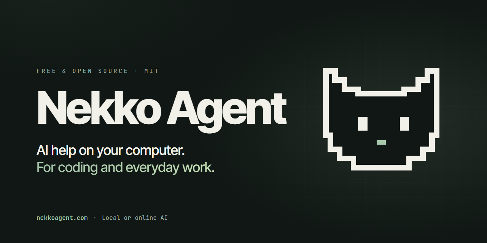
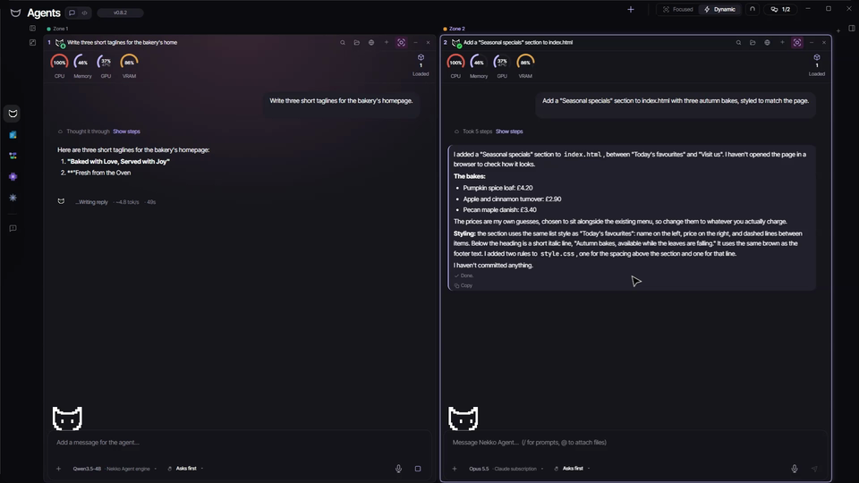

# Nekko Agent

**The personal, local AI agent you can trust.**



Run powerful AI models on your own computer, or bring in supported online providers when you want them. Chat, cowork and code in one app, or use the same engine from the Local Web UI, CLI or MCP.

Free and open source. MIT licensed. No account needed for local AI. Local work can run offline after setup.

[**Download**](https://github.com/nekko-labs/nekko-agent/releases/latest) · [Website](https://nekkoagent.com) · [Documentation](https://nekkoagent.com/docs) · [Features and limitations](https://nekkoagent.com/docs/features)

## Highlights

- **Fast local models.** Search, download and run models from Hugging Face with the built-in Local Model Server, or connect Ollama, LM Studio or vLLM. Measurably faster than Ollama on the same weights ([benchmarks](docs/benchmarks.md)).
- **Local or online, per chat.** Use ChatGPT subscription sign-in, Anthropic or OpenAI API keys, OpenRouter or any compatible endpoint. Claude subscriptions run through your installed Claude Code.
- **Code, review, approve.** Read, search and edit across the project folders you pick. Inspect every change line by line, keep or undo edits, recover from mistakes.
- **See every request.** The Context Inspector shows files, instructions, memory and token counts before anything leaves your machine. [Privacy Shield](docs/privacy-shield.md) can mask sensitive values before they reach a cloud model.
- **Automate repeat work.** Schedule tasks or run them on supported triggers, with run history and output.
- **Delegate and follow progress.** Split independent jobs into sub-agents. Connect GitHub, Linear, Slack, Discord, Gmail and Drive.
- **Create more than code.** Produce reports, Mermaid diagrams and editable HTML prototypes from the workbench.
- **CLI and MCP.** Drive the same engine from Claude Code, Codex, Cursor or any MCP client. See [CLI and MCP](docs/CLI.md).
- **Continue from your phone (beta).** Pair a native iOS or Android app to follow chats, answer questions and approve commands on your computer.



## Install

Download the latest build for Windows, Apple-silicon macOS or Linux from the [GitHub releases page](https://github.com/nekko-labs/nekko-agent/releases/latest). macOS builds are signed and notarized. Windows signing is in progress. See [signing and verification](docs/signing.md) before trusting a build.

## Run from source

### Prerequisites

- [Node.js 22.12.0 or newer](https://nodejs.org/en/download) with npm
- [Rust through rustup](https://rustup.rs) (includes Cargo)

Close and reopen your terminal after installing either tool so PATH refreshes, then confirm:

```bash
node --version       # 22.12.0 or newer
npm --version
rustc --version
cargo --version
```

### Build and launch

```bash
git clone https://github.com/nekko-labs/nekko-agent
cd nekko-agent
npm install
npm run local        # build the desktop app and launch it
```

Or run the Local Web UI at `http://localhost:1440`:

```bash
npm run build:nekkod # build the engine on a fresh checkout
npm run web
```

Or with Docker:

```bash
docker compose up    # same, in a container
```

See [CONTRIBUTING.md](CONTRIBUTING.md) for the full development workflow, project layout and how to land a change.

## License

MIT (c) [Nekko Labs](https://nekkolabs.com). Contributions welcome: see [CONTRIBUTING.md](CONTRIBUTING.md).
