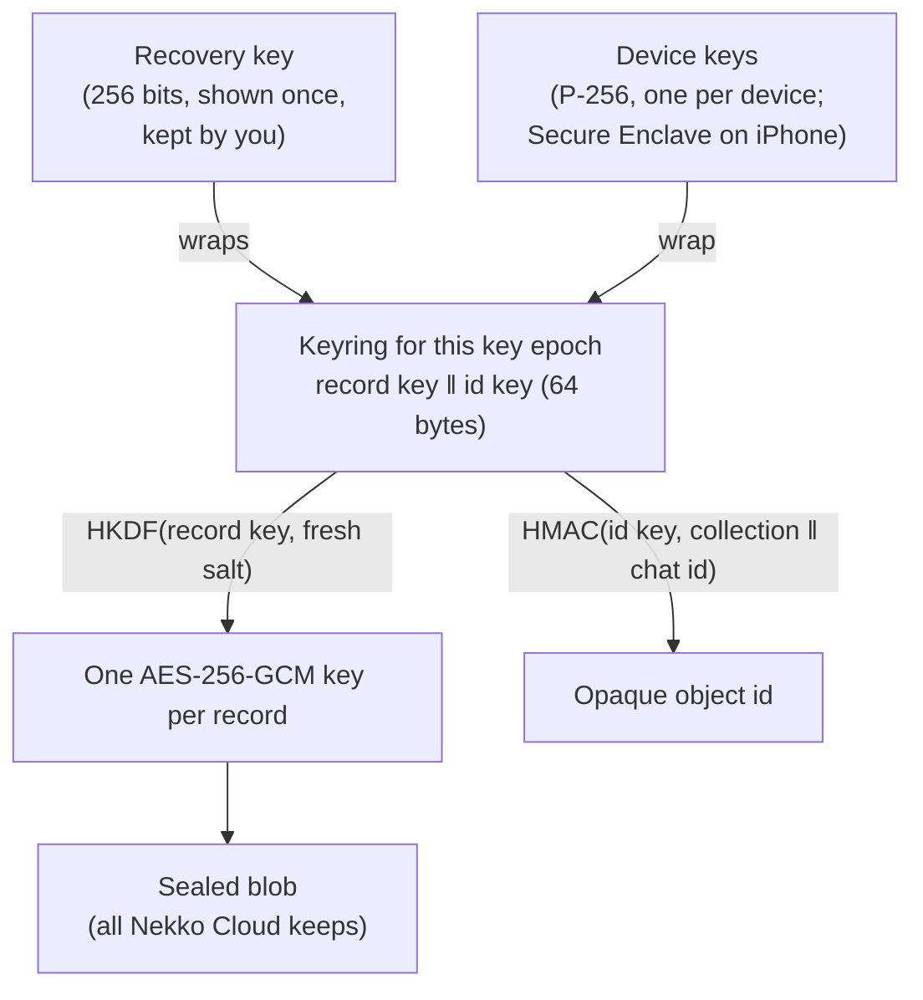

# End-to-end encrypted sync

Nekko Cloud **Pro** and **Team** sync your chats between your computers and phones. The sync is end-to-end encrypted: your devices lock every chat before it leaves them, and Nekko Cloud only ever stores the locked copy. Nekko Labs can't read your synced chats. We don't hold the keys, and nobody can make us produce something we don't have.

If you turn on **Help improve Nekko Agent** (off unless you turn it on), samples you share are encrypted too, with a key that never sits on any server, and carry nothing that ties them to your account.

> **Status (2026-10-22):** sign-in (Supabase Auth), the sync engine, Settings → Sync on the computer and the iPhone's screens are built and tested end to end against a local copy of Nekko Cloud, and the findings of an internal adversarial review are fixed. Sync stays off for users until the Supabase project is connected, Nekko Cloud is deployed with it, and an outside cryptography review is done. See [What's built](#whats-built).

## What Nekko Cloud can and can't see

| Nekko Cloud stores | Nekko Cloud never has |
| --- | --- |
| Your account email and plan | The text of any chat, title, prompt, reply or file |
| Each device's public key and the short name you gave it | Any key that can decrypt a chat |
| Encrypted records, their approximate size (padded), revision number and an opaque id | Which chat a record belongs to (ids are keyed hashes) |
| When a record last changed | Your recovery key |
| Encrypted donations, with the day they arrived | Who sent a donation, or their IP address |

## How it works

- **Keyring.** The first device you turn sync on with creates a random 64-byte keyring: a record key and an id key. It never leaves your devices unencrypted.
- **Records.** Each chat is stored as records (`chat`, `chat-part`, and later `prompt` and others). Every revision of a record gets its own AES-256-GCM key and nonce, derived with HKDF-SHA256 from the record key and a fresh 32-byte random salt, so no key is used twice and there is no limit on how many records one key can protect. The account, key epoch, record type, object id and revision are authenticated with it, so the server can't swap a record into another chat, another account, or roll it back to an older revision without the device noticing. The plaintext is padded (Padmé) to hide its exact length.
- **Object ids.** The server files a record under `HMAC-SHA256(id key, type ‖ chat id)`. Every one of your devices computes the same id; the server can't link it to a chat.
- **Devices.** Each device has its own P-256 key pair. On the iPhone the private key is created inside the Secure Enclave and never leaves it. The keyring is encrypted to each device's public key and **authenticated by the sending device's key**: ECIES (ephemeral ECDH, HKDF-SHA256, AES-256-GCM) with a second, static-static ECDH secret between the sender and the recipient mixed into the key, the shape of HPKE's Auth mode. The wrap names the account, key epoch, recipient and sender, so it can't be handed to another device, and only the sender could have made it.
- **Trust.** Each device holds one key epoch and that epoch's sealed account record, which lists the devices the account trusts. A device takes a newer epoch only from a wrap made by a device in that list, one epoch at a time, and only once the new epoch's own record lists it. Someone who can sign in to your account (with an emailed code, say) or who runs the server can't hand your devices a keyring of their own.
- **Adding a device.** Two ways. With the recovery key, the new device opens the current epoch itself. Or by approval: the new device shows a one-time **join code** (16 characters), and on a device that already syncs you choose Approve and type it. The code does two jobs. The new device published a tag of its key made with the code, so the approving device checks that the key Nekko Cloud shows is really the new device's (a key swapped in by anyone else fails). And the keyring is wrapped with a key derived from the code, so the new device knows the wrap came from someone you showed the code to. The code never reaches the server.
- **Removing a device.** Revoking a device cuts its sign-in and deletes its wrapped keyring. The device that removed it then starts a new **key epoch**: a new record key, wrapped only to the devices you kept, and seals every chat again under it. Your devices ignore anything written under an older epoch and forget the old keyring, so the removed device can neither read what is written afterwards nor plant a change with the key it kept. Nekko Cloud only accepts writes under the newest epoch.
- **Recovery key.** When you turn sync on, you get a recovery key: 55 characters in groups of five, with a checksum that catches a typo. You save it (copy it, or save the printable recovery kit with a QR code), then type it back so we know it was saved right. The recovery key stands for a P-256 key pair; every key epoch's keyring is also sealed to its public half, so your devices never hold the recovery secret, yet a rotation after removing a device is still recoverable. If you lose every device, the recovery key on a new one gets your chats back; without it, nobody can, including us. There is deliberately no password option: a password-derived key could be guessed by whoever holds the encrypted keyring, and that is the server.
- **The account record.** Each key epoch has one more sealed record: the epoch number, the devices the account trusts, and the recovery key's public half. Only a holder of that epoch's keyring can write it, so the server can't slip a device of its own into the next key rotation, or swap the recovery key that new epochs are sealed to. A device refuses an account record that names another epoch or a different recovery key from the one it pinned, and never accepts an older revision of any record than one it has seen.

## Plans

- **Pro and Team** can turn sync on (5 GB and 20 GB of encrypted storage per account).
- **Free** keeps everything on your own devices, as today.
- **Downgrading never locks you out.** If a Pro plan ends, your devices can still download and decrypt what was synced, and you can delete it; only new uploads stop.
- **Delete everything synced** removes every record, keyring and device from Nekko Cloud at once. Your account stays, and your chats stay on your devices.

## Help improve Nekko Agent (opt-in)

Off unless you turn it on, and turning it off changes no feature. When it is on:

1. You choose what to share (a chat, or a single reply you rated).
2. Your device removes secrets, email addresses, file paths and anything that looks like a key or token before anything else happens.
3. The sample is encrypted on your device to Nekko Labs' **research key**. Its private half is kept offline, never on a server, so the donation is ciphertext in Nekko Cloud's database just like your synced chats.
4. It is uploaded without your sign-in. Nekko Cloud doesn't record your account, device or IP address with it, and keeps only the day it arrived.
5. Your device keeps a delete token for each donation, so you can withdraw it later. Anything not withdrawn is deleted after 180 days.

## Threat model

| If someone… | They get |
| --- | --- |
| Copies Nekko Cloud's database | Ciphertext, padded sizes, opaque ids, device public keys, account emails and plans |
| Signs in to your account (gets an emailed code) | Your email and plan, the device list, and the power to delete what's synced. Not your chats: without a device your other devices trust, nothing they accept comes from them, and Nekko Cloud refuses key, device and data changes from a sign-in that hasn't proved it holds the current epoch's keyring |
| Runs a malicious Nekko Cloud | The same, plus the ability to withhold or delete records and to refuse service. It can't read, forge or relabel records, roll a device back to a revision it has seen, or get a key of its own trusted. See the limits below |
| Steals an unlocked device | That device's synced chats, until you revoke it from another device; then nothing new |
| Learns your recovery key | Everything synced, so keep it like a password manager's emergency kit |
| Obtains a donation | Nothing without the offline research key |

What is not hidden: how many records you have, roughly how big they are, when they change, how many times each chat has changed (its revision), device names, and which record is the account record.

**Limits, stated plainly** (from the internal review; the outside review is asked about each):

- **A malicious server colluding with a device you removed** can show your other devices different views (a fork). It can keep the rotation away from a device that hasn't seen it yet, so that device keeps writing under the old epoch the removed device can read, and it can serve a new device that restores with the recovery key an epoch the removed device made up. Devices that have seen the rotation refuse all of it. Stopping a forking server completely needs devices to cross-check what they have seen (fork consistency), which is future work.
- **The id key doesn't rotate.** A removed device can still compute the object ids of chats it knows, so it can tell when those chats change (not what changes).
- **Deleting is a server's power.** Nekko Cloud, or someone signed in to your account right after a fresh sign-in, can delete what's synced. Your devices keep their copies.

## Wire format

The reference implementation is `crates/nekko-sync`; `apps/ios/Protocol/Sources/NekkoProtocol/SyncCrypto.swift` matches it byte for byte, and both are tested against `crates/nekko-sync/tests/golden/sync-crypto.json`. All binary values are base64url without padding.

| Blob | Layout | Key and nonce | Associated data |
| --- | --- | --- | --- |
| Record | `01 ‖ salt[32] ‖ ct ‖ tag[16]` | HKDF-SHA256(record key, salt, `nekko-sync/v1 record`) → 44 bytes | `nekko-sync/v1 record⏎account⏎keyId⏎collection⏎objectId⏎revision` |
| Device wrap | `01 ‖ ephemeral P-256 public[65] ‖ ct ‖ tag` | HKDF-SHA256(ikm = ECDH(ephemeral, recipient) x ‖ ECDH(sender, recipient) x, salt = ephemeral ‖ recipient public ‖ sender public, info = context) | context = `nekko-sync/v1 wrap⏎account⏎keyId⏎recipientId⏎senderId` |
| Join wrap | as a device wrap | HKDF-SHA256(ikm = ECDH(ephemeral, recipient) x ‖ psk, salt = ephemeral ‖ recipient public, info = context); psk = HKDF-SHA256(code, empty salt, `nekko-sync/v1 join-psk⏎account⏎deviceId`) | context = `nekko-sync/v1 join-wrap⏎account⏎keyId⏎deviceId` |
| Recovery wrap | as a device wrap, to the recovery public key, without a sender | HKDF-SHA256(ECDH x, ephemeral ‖ recovery public, context) | context = `nekko-sync/v1 recovery⏎account⏎keyId` |
| Donation | as a recovery wrap, to the research key | as a recovery wrap | context = `nekko-donation/v1⏎donationId` |

Record and donation plaintext is framed as a 4-byte big-endian length and the bytes, zero-padded to the Padmé size of the frame (at least 256 bytes). The keyring is `record key[32] ‖ id key[32]`. Object ids are `base64url(HMAC-SHA256(id key, "nekko-sync/v1 object⏎" ‖ collection ‖ "⏎" ‖ localId))`. The recovery key text is Crockford base32 of `key[32] ‖ SHA-256(key)[0..2]`, in groups of five. Its P-256 key pair is the first valid scalar among `HKDF-SHA256(recovery key, salt = empty, info = "nekko-sync/v1 recovery-key" ‖ counter)` for counter = 0, 1, …. The join code is 10 random bytes as 16 Crockford base32 characters in groups of four; the tag a joining device publishes is `HMAC-SHA256(HKDF-SHA256(code, empty salt, "nekko-sync/v1 join-tag"), account ‖ "⏎" ‖ public key)`. Typed codes and recovery keys are read as ASCII only. The account record of epoch *n* is the `account` collection with local id `epoch-n`: `{"v":2,"epoch":n,"recoveryPublic":…,"devices":[{"id","publicKey","label"}]}`.

### Choices and alternatives

- **AES-256-GCM with a derived key per record** rather than XChaCha20-Poly1305: CryptoKit, Android and WebCrypto all have AES-GCM with hardware support, none of them have XChaCha. Deriving a fresh key per record from a 32-byte salt removes GCM's random-nonce limit.
- **P-256** rather than X25519: the iPhone's Secure Enclave only does P-256, and Android before API 31 has no X25519.
- **Hand-rolled ECIES** rather than HPKE (RFC 9180): CryptoKit has HPKE from iOS 17, but Node and the RustCrypto stack used here don't ship it yet. Device wraps follow HPKE's Auth mode in spirit (ephemeral and static-static ECDH, all public keys in the KDF, the context as associated data), join wraps its PSK mode, and recovery wraps and donations its base mode. Moving to HPKE is a version bump (`01` → `02`).
- **Authenticated wraps** rather than signatures: the Secure Enclave key is a key-agreement key, and a static-static ECDH secret authenticates the sender to the one recipient without a second key per device.
- **A typed join code** rather than comparing fingerprints on two screens: comparing only checked the new device's key, one way, and only if the user looked closely. The code checks both ways and can't be skipped.
- **Whole-record last-writer conflicts with revisions** rather than a CRDT: the server enforces `revision = previous + 1`, a losing device pulls, merges in plaintext and pushes again. Transcripts are append-only, so merges are rare.
- **No server-side search.** Search runs on your devices over decrypted chats. Encrypted search schemes leak access patterns and weren't worth that.

## Signing in

Supabase Auth proves who you are; Nekko Cloud keeps the account. The app signs in to Supabase with an emailed 6-digit code, or with Apple, GitHub or Google in the browser (PKCE; the computer listens on a loopback port for the redirect, the iPhone uses `nekko-agent://cloud-callback`). It trades the Supabase access token once, at `POST /v1/auth/session`, for this device's own Nekko Cloud token, and drops the Supabase session. Nekko Cloud checks the token against the project's published keys (JWKS), its issuer, audience and expiry, and refuses anonymous users. An existing account (a beta signup's, say) is linked by email only when Supabase vouches for the email. A device token lasts 180 days from its last use; signing out revokes it, and signing in again binds the new token to the same device, so removing the device always ends it. The loopback page shows no text from the request, and a request without a code that PKCE accepts doesn't end the wait.

Where the keys live: on a Mac, the Keychain; on Windows, Credential Manager; on Linux, a file only your user can read (like the app's other sign-ins); on the iPhone, a Secure Enclave key-agreement key plus the Keychain (this device only).

## What syncs

Every chat, except incognito chats (never) and chats in the Local only mode (unless you include them in Settings → Sync). Pictures and attached files are left out of the synced copy (a short note stands in), so a record is mostly text; a chat whose text is over 1 MB isn't synced and Settings says how many. The newest change to a chat wins; a chat a reply is being written in is never overwritten from the cloud. Deleting a chat deletes it on your other devices. The iPhone reads synced chats (they stay readable offline) but doesn't change them.

## Locked out?

No company that runs real end-to-end encryption keeps a key it can use on its own. They combine a key you keep, your other devices, a trusted contact, a PIN held in tamper-proof hardware that erases after a few wrong guesses, or (for businesses) an admin key. The research is in [reports/e2ee-lockout-recovery-2026-10-22.md](../reports/e2ee-lockout-recovery-2026-10-22.md). Nekko Agent does the first two today, with the recovery kit, the confirm step and the prompt to add a second device. The next options (a recovery contact, a Team admin key, PIN recovery in an enclave) are open decisions.

## Nekko Cloud API

All sync routes take `Authorization: Bearer nk_…`. Writes answer `402 {"error":"plan-required"}` on the Free plan.

| Sign-in route | What it does |
| --- | --- |
| `GET /v1/auth/config` | The Supabase project URL and its public anon key |
| `POST /v1/auth/session` `{accessToken, label}` | A Supabase access token for this device's token and the account (30 per IP per minute) |
| `GET /v1/auth/me` | The account and plan |
| `DELETE /v1/auth/session` | Sign this device out |

| Route | What it does |
| --- | --- |
"Holds the keys" below means the token is bound to a live device that has a wrap of the current epoch, **and** the token has shown the epoch proof for it. The epoch proof is `HKDF-SHA256(ikm = the 64-byte keyring, salt = empty, info = "nekko-sync-epoch-proof/v1\n" ‖ keyId)`, 32 bytes (`epoch_proof` in `crates/nekko-sync`, `SyncCrypto.epochProof` on the iPhone, held to the same bytes by the shared vectors). Only a holder of the keyring can compute it; Nekko Cloud keeps only its SHA-256 per epoch, compares in constant time, and can derive no key from it. The device that starts an epoch sends it with the keyring, a device that restored with the recovery key sends it with its own wrap, and any other device sends it once per sign-in and epoch to `POST /v1/sync/keyrings/:keyId/proof`. A wrap row or a registered public key alone never counts, so a sign-in that holds no keys can't change keys, devices or data. Nekko Cloud checks this to stop someone who can only sign in; the devices' own checks are what stop a malicious server.

| Route | What it does |
| --- | --- |
| `GET /v1/sync/state` | Plan, whether it can write, this device, the current key epoch, devices (with any join tag), storage used |
| `POST /v1/sync/devices` `{publicKey, label, joinTag?}` | Register this device's public key; the token becomes this device's. The same key again binds a new sign-in's token to it |
| `DELETE /v1/sync/devices/:id` | Revoke a device: its tokens and wraps go; then rotate. Holds the keys, or removes itself while it has no wrap of the current epoch (still waiting to join) |
| `PUT /v1/sync/keyrings/:keyId` `{recoveryWrap, proof, wraps[]}` | Start key epoch `keyId` (must be the next one), storing the hash of its epoch proof; the calling token holds the keys of the new epoch. The first from a registered device wrapping to itself; later ones only from a device holding the keys |
| `PUT /v1/sync/keyrings/:keyId/wraps/:deviceId` `{wrap, proof?}` | Add a wrap to the current epoch: for an approved device (holds the keys), or to itself after a restore with the epoch's proof (which then counts the token as holding the keys). Never over an existing wrap |
| `POST /v1/sync/keyrings/:keyId/proof` `{proof}` | Show the current epoch's proof: `204` and the token holds the keys (with its device's wrap); `403 bad-proof` on a mismatch, `409` for an older epoch |
| `GET /v1/sync/keyrings/:keyId` | The recovery wrap, and this device's wrap |
| `POST /v1/sync/push` `{objects[]}` | Up to 200 sealed revisions; per object `ok`, `conflict` or `stale-key`. Holds the keys |
| `GET /v1/sync/pull?since=&limit=` | Changes after a sequence number, oldest first |
| `GET /v1/sync/objects/:collection/:objectId` | One object, out of order (a new epoch's account record) |
| `DELETE /v1/sync` | Delete everything synced. Holds the keys, or signed in within the last 10 minutes |
| `POST /v1/donations` `{id, blob, deleteHash}` | Unauthenticated; not logged |
| `DELETE /v1/donations/:id` with `x-delete-token` | Withdraw a donation |

## What's built

- [x] Encryption format and reference implementation (`crates/nekko-sync`), with tests for tampering, relabelling, rollback, rotation, wrong devices and recovery-key typos; vectors cross-checked against Node's `crypto`.
- [x] Nekko Cloud: Supabase sign-in, device tokens, the storage API, Pro and Team gating, quotas, revocation, delete everything, anonymous donations (`apps/nekko-agent-api`), and `npm run dev:local`, the whole service with a stand-in Supabase on one machine.
- [x] The sync engine (`crates/nekko-cloud`) in nekkod, tested with three devices against the local service (`tests/live.rs`): sign-in, turn on, recovery-key restore, approval by join code, edits both ways, revoke, rotate and seal again, deletes, and no plaintext on the server. `tests/attacks.rs` runs the internal review's attacks through a proxy that rewrites the server's answers: a keyring from an untrusted key, a swapped key at approval, a lowered rollback guard and a replayed revision, writes under an old epoch, and a withheld account record. Each is refused.
- [x] An internal adversarial review ([reports/crypto-review-internal-2026-10-22.md](../reports/crypto-review-internal-2026-10-22.md)) and its fixes ([decision 0008](decisions/0008-authenticated-wraps-and-join-codes.md)).
- [x] Settings → Sync and the sign-in screen on the computer, with the animated sync picture, the recovery key and kit, devices, approve and remove.
- [x] The iPhone: sign-in, join by recovery key or approval, approve a computer, read synced chats offline (`CloudSync` tests on an in-memory server; screens built on macOS CI).
- [x] The offline research-key tooling and runbook ([research-key-ceremony.md](research-key-ceremony.md)).
- [ ] Connect the Supabase project and deploy Nekko Cloud with it (settings in `apps/nekko-agent-api/README.md`).
- [ ] Stripe plans into `users.plan`.
- [ ] Generate the research key offline, pin it, and build donation redaction and sharing.
- [ ] Android.
- [ ] The outside cryptography review ([scope and RFP](../reports/crypto-review-scope-2026-10-22.md)) before sync is switched on for anyone.
