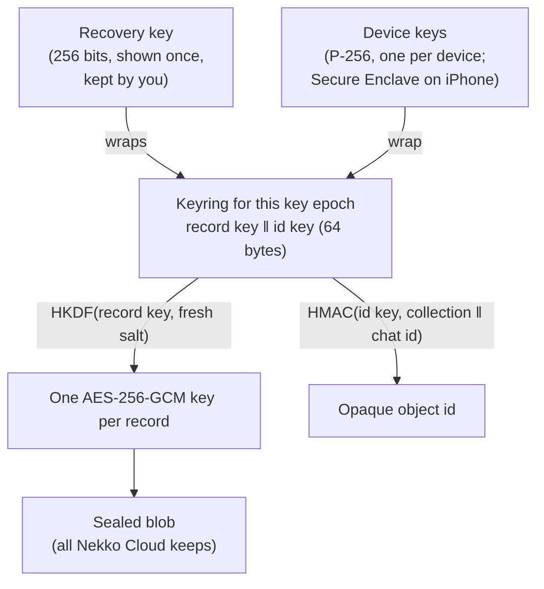

# End-to-end encrypted sync

Nekko Cloud **Pro** and **Team** sync your chats between your computers and phones. The sync is end-to-end encrypted: your devices lock every chat before it leaves them, and Nekko Cloud only ever stores the locked copy. Nekko Labs can't read your synced chats. We don't hold the keys, and nobody can make us produce something we don't have.

If you turn on **Help improve Nekko Agent** (off unless you turn it on), samples you share are encrypted too, with a key that never sits on any server, and carry nothing that ties them to your account.

> **Status (2026-10-22):** the encryption format, the Nekko Cloud storage API and the iPhone's crypto are implemented and tested. Signing in to Nekko Cloud, the sync engine on the computer and the screens that turn sync on are not built yet, so sync can't be switched on in the app today. See [What's built](#whats-built).

## What Nekko Cloud can and can't see

| Nekko Cloud stores | Nekko Cloud never has |
| --- | --- |
| Your account email and plan | The text of any chat, title, prompt, reply or file |
| Each device's public key and the short name you gave it | Any key that can decrypt a chat |
| Encrypted records, their approximate size (padded), revision number and an opaque id | Which chat a record belongs to (ids are keyed hashes) |
| When a record last changed | Your recovery key |
| Encrypted donations, with the day they arrived | Who sent a donation, or their IP address |

## How it works

- **Keyring.** The first device you turn sync on with creates a random 64-byte keyring: a record key and an id key. It never leaves your devices unencrypted.
- **Records.** Each chat is stored as records (`chat`, `chat-part`, and later `prompt` and others). Every revision of a record gets its own AES-256-GCM key and nonce, derived with HKDF-SHA256 from the record key and a fresh 32-byte random salt, so no key is used twice and there is no limit on how many records one key can protect. The account, key epoch, record type, object id and revision are authenticated with it, so the server can't swap a record into another chat, another account, or roll it back to an older revision without the device noticing. The plaintext is padded (Padmé) to hide its exact length.
- **Object ids.** The server files a record under `HMAC-SHA256(id key, type ‖ chat id)`. Every one of your devices computes the same id; the server can't link it to a chat.
- **Devices.** Each device has its own P-256 key pair. On the iPhone the private key is created inside the Secure Enclave and never leaves it. The keyring is encrypted to each device's public key (ECIES: ephemeral ECDH, HKDF-SHA256, AES-256-GCM), naming the account, key epoch and device, so a wrap made for one device can't be handed to another.
- **Adding a device.** A new device registers its public key, and one of your existing devices encrypts the keyring to it. Before it does, both screens show the same short code (a fingerprint of the new key), or the hand-over rides the phone's existing encrypted pairing with your computer. This is what stops a server that registered a key of its own from being trusted.
- **Removing a device.** Revoking a device cuts its sign-in and deletes its wrapped keyring. Your remaining devices then start a new **key epoch**: a new record key, wrapped only to the devices you kept. Everything written afterwards is unreadable to the removed device. Nekko Cloud only accepts writes under the newest epoch, so a rotation takes effect at once.
- **Recovery key.** When you turn sync on, you get a recovery key: 55 characters in groups of five, with a checksum that catches a typo. It also encrypts the keyring. If you lose every device, the recovery key on a new one gets your chats back; without it, nobody can, including us. There is deliberately no password option: a password-derived key could be guessed by whoever holds the encrypted keyring, and that is the server.

## Plans

- **Pro and Team** can turn sync on (5 GB and 20 GB of encrypted storage per account).
- **Free** keeps everything on your own devices, as today.
- **Downgrading never locks you out.** If a Pro plan ends, your devices can still download and decrypt what was synced, and you can delete it; only new uploads stop.
- **Delete everything synced** removes every record, keyring and device from Nekko Cloud at once. Your account stays, and your chats stay on your devices.

## Help improve Nekko Agent (opt-in)

Off unless you turn it on, and turning it off changes no feature. When it is on:

1. You choose what to share (a chat, or a single reply you rated).
2. Your device removes secrets, email addresses, file paths and anything that looks like a key or token before anything else happens.
3. The sample is encrypted on your device to Nekko Labs' **research key**. Its private half is kept offline, never on a server, so the donation is ciphertext in Nekko Cloud's database just like your synced chats.
4. It is uploaded without your sign-in. Nekko Cloud doesn't record your account, device or IP address with it, and keeps only the day it arrived.
5. Your device keeps a delete token for each donation, so you can withdraw it later. Anything not withdrawn is deleted after 180 days.

## Threat model

| If someone… | They get |
| --- | --- |
| Copies Nekko Cloud's database | Ciphertext, padded sizes, opaque ids, device public keys, account emails and plans |
| Runs a malicious Nekko Cloud | The same, plus the ability to withhold or delete records (a device sees a record vanish but can't be shown a forged or rolled-back one) and to refuse service. It can't read, forge or reorder records |
| Steals an unlocked device | That device's synced chats, until you revoke it from another device; then nothing new |
| Learns your recovery key | Everything synced, so keep it like a password manager's emergency kit |
| Obtains a donation | Nothing without the offline research key |

What is not hidden: how many records you have, roughly how big they are, and when they change.

## Wire format

The reference implementation is `crates/nekko-sync`; `apps/ios/Protocol/Sources/NekkoProtocol/SyncCrypto.swift` matches it byte for byte, and both are tested against `crates/nekko-sync/tests/golden/sync-crypto.json`. All binary values are base64url without padding.

| Blob | Layout | Key and nonce | Associated data |
| --- | --- | --- | --- |
| Record | `01 ‖ salt[32] ‖ ct ‖ tag[16]` | HKDF-SHA256(record key, salt, `nekko-sync/v1 record`) → 44 bytes | `nekko-sync/v1 record⏎account⏎keyId⏎collection⏎objectId⏎revision` |
| Device wrap | `01 ‖ ephemeral P-256 public[65] ‖ ct ‖ tag` | HKDF-SHA256(ECDH x, ephemeral ‖ device public, context) | context = `nekko-sync/v1 wrap⏎account⏎keyId⏎deviceId` |
| Recovery wrap | `01 ‖ salt[32] ‖ ct ‖ tag` | HKDF-SHA256(recovery key, salt, context) | context = `nekko-sync/v1 recovery⏎account⏎keyId` |
| Donation | as a device wrap, to the research key | as a device wrap | context = `nekko-donation/v1⏎donationId` |

Record and donation plaintext is framed as a 4-byte big-endian length and the bytes, zero-padded to the Padmé size of the frame (at least 256 bytes). The keyring is `record key[32] ‖ id key[32]`. Object ids are `base64url(HMAC-SHA256(id key, "nekko-sync/v1 object⏎" ‖ collection ‖ "⏎" ‖ localId))`. The recovery key text is Crockford base32 of `key[32] ‖ SHA-256(key)[0..2]`, in groups of five.

### Choices and alternatives

- **AES-256-GCM with a derived key per record** rather than XChaCha20-Poly1305: CryptoKit, Android and WebCrypto all have AES-GCM with hardware support, none of them have XChaCha. Deriving a fresh key per record from a 32-byte salt removes GCM's random-nonce limit.
- **P-256** rather than X25519: the iPhone's Secure Enclave only does P-256, and Android before API 31 has no X25519.
- **Hand-rolled ECIES** rather than HPKE (RFC 9180): CryptoKit has HPKE from iOS 17, but Node and the RustCrypto stack used here don't ship it yet. The construction is HPKE's base mode in spirit (ephemeral ECDH, both public keys in the KDF, the context as associated data). Moving to HPKE is a version bump (`01` → `02`).
- **Whole-record last-writer conflicts with revisions** rather than a CRDT: the server enforces `revision = previous + 1`, a losing device pulls, merges in plaintext and pushes again. Transcripts are append-only, so merges are rare.
- **No server-side search.** Search runs on your devices over decrypted chats. Encrypted search schemes leak access patterns and weren't worth that.

## Nekko Cloud API

All sync routes take `Authorization: Bearer nk_…`. Writes answer `402 {"error":"plan-required"}` on the Free plan.

| Route | What it does |
| --- | --- |
| `GET /v1/sync/state` | Plan, whether it can write, this device, the current key epoch, devices, storage used |
| `POST /v1/sync/devices` `{publicKey, label}` | Register this device's public key; the token becomes this device's |
| `DELETE /v1/sync/devices/:id` | Revoke a device: its tokens and wraps go; then rotate |
| `PUT /v1/sync/keyrings/:keyId` `{recoveryWrap, wraps[]}` | Start key epoch `keyId` (must be the next one) |
| `PUT /v1/sync/keyrings/:keyId/wraps/:deviceId` `{wrap}` | Give a newly added device the keyring |
| `GET /v1/sync/keyrings/:keyId` | The recovery wrap, and this device's wrap |
| `POST /v1/sync/push` `{objects[]}` | Up to 200 sealed revisions; per object `ok`, `conflict` or `stale-key` |
| `GET /v1/sync/pull?since=&limit=` | Changes after a sequence number, oldest first |
| `DELETE /v1/sync` | Delete everything synced |
| `POST /v1/donations` `{id, blob, deleteHash}` | Unauthenticated; not logged |
| `DELETE /v1/donations/:id` with `x-delete-token` | Withdraw a donation |

## What's built

- [x] Encryption format and reference implementation (`crates/nekko-sync`), with tests for tampering, relabelling, rollback, rotation, wrong devices and recovery-key typos; vectors cross-checked against Node's `crypto`.
- [x] Nekko Cloud storage API and schema (`apps/nekko-agent-api`), Pro and Team gating, quotas, revocation, delete everything, anonymous donations.
- [x] iPhone crypto (`SyncCrypto.swift`) held to the same vectors, with a Secure Enclave device key type.
- [ ] Nekko Cloud sign-in that issues tokens (accounts are PF14 step 4).
- [ ] The sync engine in nekkod (record layout for chats, push and pull, merge) and the desktop's **Settings → Sync** (turn on, recovery key, devices, delete everything).
- [ ] The iPhone's sync screens and reading synced chats without the computer online.
- [ ] Android's crypto port.
- [ ] Generating the research key offline, pinning its public half in the apps, and the on-device redaction for donations.
- [ ] An outside cryptography review before sync is switched on for anyone.
