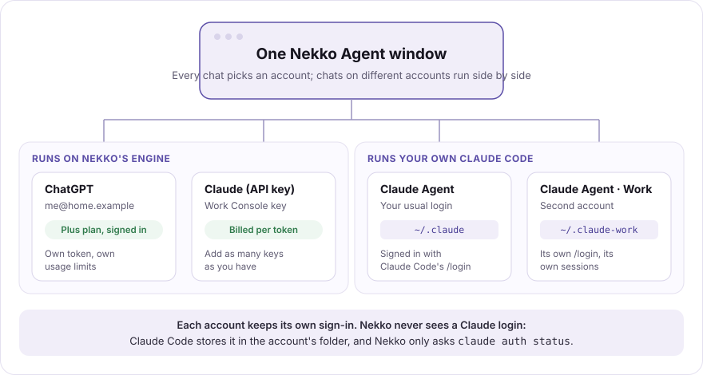
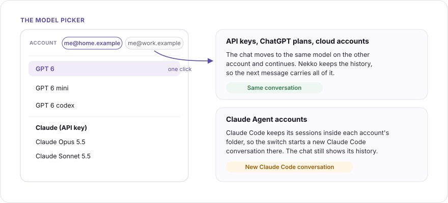
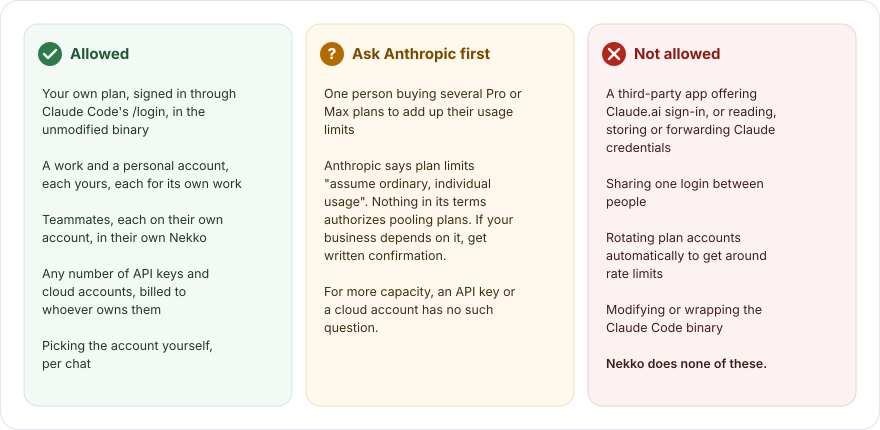

# Accounts and switching

Nekko Agent can hold as many accounts as you have, for any provider: two ChatGPT plans, a personal and a work Anthropic API key, an OpenRouter key, a Bedrock account, and two Claude Code logins, all in one window. Every chat picks its account, chats on different accounts run side by side, and you can move a chat to another account in one click.



## What counts as an account

Each account is a provider on the **Models** page. Adding a second one of the same kind gives you a second account:

| Provider | How you add another account | How Nekko tells them apart |
| --- | --- | --- |
| ChatGPT plan | **Sign in with ChatGPT** again, with the other account | The email the plan is signed in as |
| Anthropic, OpenAI, OpenRouter API key | **Add provider** again with the other key | The label you give it |
| Bedrock, Vertex, Foundry | **Add provider** again with the other account's credentials | The label you give it |
| Claude Agent (your Claude Code) | **Add provider → Claude Agent → Another account** | The account name you give it |

Local model servers (Ollama, LM Studio, vLLM, the built-in engine) are computers, not accounts, so they never get a switcher.

## Switching accounts

When the chat's provider has more than one account, the model picker opens with an **Account** row at the top. Click another account and the chat moves to the same model on that account. An account greys out when it does not offer the chat's model.



- **API keys, ChatGPT plans and cloud accounts** run on Nekko's own engine, which keeps the chat's history. The next message goes out on the new account with the whole conversation, as if it had been there all along.
- **Claude Agent accounts** run your own Claude Code, which keeps its sessions inside each account's folder. A switch therefore starts a **new Claude Code conversation** on the other account: the chat still shows everything above, but Claude Code on the new account does not see it. Switching back later starts another new one.
- **New chats** start on the account you used last. To pin one, right-click a model in the picker and choose **Set as default**.

Nekko does not switch accounts on its own unless you ask it to: in a chat on **✨ Auto** you can turn on **Follow capacity & cost**, and then a turn whose provider is spent runs on an equivalent model on another provider, which can be another of your accounts. Claude Agent accounts are never part of that: Auto never moves a turn onto a Claude plan, and a Claude Agent chat has no Auto. When a Claude Agent account hits its plan limit, the chat says so and waits for you.

## Several Claude accounts

The **Claude** provider (an Anthropic API key, or Bedrock, Vertex or Foundry) works like any other API provider: add one per key or cloud account.

**Claude Agent** runs the Claude Code you already have installed, so it can use a Claude plan. Each Claude Agent account is a separate Claude Code login:

1. On the Models page, choose **Add provider → Claude Agent**.
2. Pick **Another account** and give it a name, such as `Work`. Nekko shows the folder Claude Code will keep that login in: `~/.claude-work`.
3. Choose **Open Claude Code to sign in**. A Nekko terminal opens with Claude Code running on that folder. Type `/login` and finish signing in with Anthropic, in Claude Code's own flow.
4. Back in Nekko, the panel turns to **Signed in**. Choose **Add Work**.

Your usual login (`~/.claude`) stays as it was, so the first Claude Agent keeps working. The folder is an ordinary Claude Code config folder, the one Claude Code's documented `CLAUDE_CONFIG_DIR` variable points at, so you can use the same account from any terminal:

```bash
CLAUDE_CONFIG_DIR=~/.claude-work claude
```

**What Nekko does and does not touch.** Nekko starts Claude Code with `CLAUDE_CONFIG_DIR` set to the account's folder, and asks `claude auth status` whether it is signed in. It never opens the folder, never reads or copies the login inside it, never sets a token, and never changes the Claude Code binary. The folder name comes only from the account name (`a-z`, `0-9` and `-`), never from a path you type.

**Usage.** Claude Code shows each account's plan usage itself (`/usage`). Nekko shows none for a Claude plan, because Anthropic has no approved way for another app to read it.

## What Anthropic allows

Anthropic's rules for Claude Code ([Legal and compliance](https://code.claude.com/docs/en/legal-and-compliance)) separate two things: **you** signing in to the unmodified Claude Code with your own plan, which is allowed even when another app runs Claude Code for you, and **an app** offering Claude sign-in or handling Claude credentials, which is not. Nekko is built on the first and does none of the second.



| What you want to do | Allowed? | Notes |
| --- | --- | --- |
| Use your own Claude plan through Claude Agent | Yes | You sign in inside Claude Code with `/login`; Nekko never sees the login. |
| Keep a work and a personal Claude account, each for its own work | Yes | Each is a separate Claude Agent account with its own login. |
| Teammates each using their own account | Yes | Each person signs in to their own Claude Code, in their own Nekko. |
| Any number of API keys or cloud accounts | Yes | Billed to whoever owns each key or account. Every Nekko feature works on them. |
| One person buying several Pro or Max plans to add up their limits | Ask Anthropic first | Anthropic says plan limits "assume ordinary, individual usage". Nothing in its terms authorizes pooling plans, so treat it as a gray area and get written confirmation before a business depends on it. An API key or a cloud account has no such question. |
| Switch Claude accounts automatically when one runs out | No | Getting around rate limits is a compliance risk. Nekko only switches when you click. |
| Share one Claude login between people | No | Anthropic's consumer terms forbid sharing account credentials. |
| Sign in to Claude inside a third-party app, or let it read your Claude Code credentials | No | Nekko removed its old Claude plan sign-in for this reason; see [Subscription sign-in](SUBSCRIPTIONS.md). |

This page describes how Nekko works, not legal advice. If something matters to your business, ask Anthropic.

## Accounts on another computer

Nekko runs Claude Code on the computer it runs on. To use an account that lives on another machine (for example Claude Code inside WSL on a Windows desktop), open a terminal to it from **Terminal → SSH hosts** and run `claude` there: it appears as a terminal tab in the same window, with that machine's login, but not as a Nekko chat. Running a Claude Agent chat on another computer, with its approvals and transcript in this window, is not built yet.

Your phone works the other way round: it drives the Nekko on your computer, with whatever accounts that computer has. See [Phone remote control](REMOTE.md).
