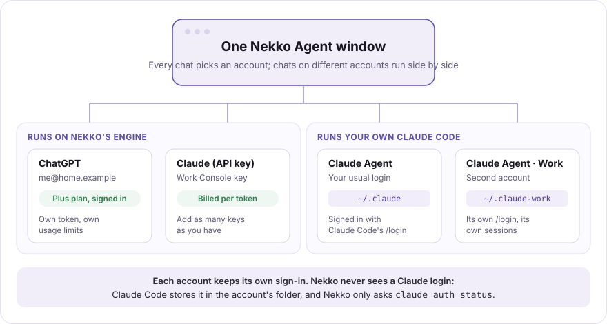
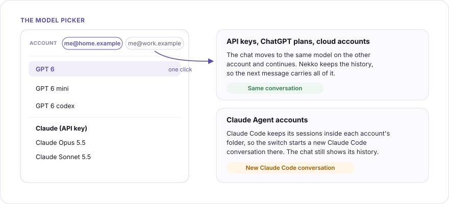
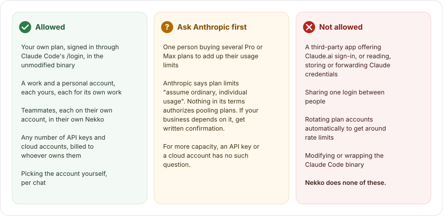

# Accounts and switching

Nekko Agent can hold as many accounts as you have, for any provider: two ChatGPT plans, a personal and a work Anthropic API key, an OpenRouter key, a Bedrock account, and two Claude Code logins, all in one window. Every chat picks its account, chats on different accounts run side by side, and you can move a chat to another account in one click.



## What counts as an account

Each account is a provider on the **Models** page. Adding a second one of the same kind gives you a second account:

| Provider | How you add another account | How Nekko tells them apart |
| --- | --- | --- |
| ChatGPT plan | **Sign in with ChatGPT** again, with the other account | The email the plan is signed in as |
| Anthropic, OpenAI, OpenRouter API key | **Add provider** again with the other key | The label you give it |
| Bedrock, Vertex, Foundry | **Add provider** again with the other account's credentials | The label you give it |
| Claude subscription (your Claude Code) | **Add provider → Claude → Subscription → + Another subscription account** | The account name you give it, plus the email, organization, and plan Claude Code reports |

Local model servers (Ollama, LM Studio, vLLM, the built-in engine) are computers, not accounts, so they never get a switcher.

## Switching accounts

The model picker groups your providers by what they sell: **Claude** holds your Claude subscription logins, Anthropic API keys and Bedrock, Vertex or Foundry accounts; **OpenAI** holds ChatGPT plans and OpenAI API keys. When a group has more than one account, its accounts show as tabs under the heading, named the way you know them: **Personal · Max** for your own plan, your organization's name for a work seat (**Acme Inc · Team**), and an API key by the name you gave it (**Production · API**). If every account uses the same email, it shows once beside the heading. A dot marks the account this chat is on, and the model button names the account too.

Click another account in the chat's own group and the chat moves to the same model on that account in one click. If that account does not offer the model, the tab just shows its models and nothing changes until you pick one. Searching lists a model on every account at once, each row naming its account.



- **API keys, ChatGPT plans and cloud accounts** run on Nekko's own engine, which keeps the chat's history. The next message goes out on the new account with the whole conversation, as if it had been there all along.
- **Claude subscription accounts** run your own Claude Code, which keeps its sessions inside each account's folder. A switch therefore starts a **new Claude Code conversation** on the other account: the chat still shows everything above, but Claude Code on the new account does not see it. Switching back later starts another new one.
- **New chats** start on the account you used last. To pin one, right-click a model in the picker and choose **Set as default**.

Nekko does not switch accounts on its own unless you ask it to: in a chat on **✨ Auto** you can turn on **Follow capacity & cost**, and then a turn whose provider is spent runs on an equivalent model on another provider, which can be another of your accounts. Claude subscription accounts are never part of that: Auto never moves a turn onto a Claude plan, and a Claude subscription chat has no Auto. When a Claude subscription account hits its plan limit, the chat says so and waits for you.

## Several Claude accounts

**Claude** offers subscription and API accounts. Each connected card has a colored provider icon and identifies its account:

- `you@work.com · Your organization · Team plan · work`: a named Claude plan. Hover the source line for its Claude Code version and configuration folder.
- `API · Anthropic API key`, or `API · Amazon Bedrock · us-east-1`: an API or cloud account Nekko calls directly.

**Your first subscription account** takes one press: **Add provider → Claude → Subscription** shows three steps, *Install Claude Code*, *Sign in* and *Connect*, starting at the one your computer has reached. Press the button and each step starts when the last one finishes; you only need to sign in when your browser opens.

**API accounts** (an Anthropic API key, or Bedrock, Vertex or Foundry) work like any other API provider: choose **Add provider → Claude → API → Connect** once per key or cloud account. Give each a recognizable **Connection name**, such as `Production API` or `Sandbox API`, before saving. Adding another key creates a separate connection; it does not replace the previous key.

**Subscription accounts** run the Claude Code you already have installed. Each one is a separate Claude Code login:

1. On the Models page, choose **Add provider → Claude**, then the **Subscription** column. Connect your usual Claude Code login, or choose **+ Another subscription account** for a separate named profile.
2. Choose **+ Another subscription account** and give it a name, such as `Work`. Nekko shows the folder Claude Code will keep that login in: `~/.claude-work`. A profile name a saved connection already uses is blocked before sign-in, even if that connection is turned off. Choose a different name rather than overwriting its login.
3. Choose **Sign in to Work**. A terminal opens inside the panel and runs Claude Code's own sign-in on that folder (`claude auth login --claudeai`), which opens Anthropic's sign-in page in your browser. Sign in there; if no page opens, open the link the terminal shows and paste back any code it asks for. The panel moves on by itself once you're signed in.
4. Nekko reads who the new login is (`claude auth status` prints its email, organization and plan) and checks it against the accounts you already have:
   - **A different person or organization** (say, your company's Team seat beside your personal Max plan): **Add Work** is ready.
   - **Another personal plan** beside a personal plan you already connected: Nekko explains that Anthropic's plan limits "assume ordinary, individual usage" and asks you to confirm the account is for separate work, not for adding up your limits, before **Add** turns on.
   - **The same login again** (same email and organization as an account you already connected): Nekko won't add it. A second copy of one login could only be used to rotate between them around plan limits, which Anthropic's terms rule out. Sign in with a different account instead.

Your usual login (`~/.claude`) stays as it was, so the first subscription account keeps working. The folder is an ordinary Claude Code config folder, the one Claude Code's documented `CLAUDE_CONFIG_DIR` variable points at, so you can use the same account from any terminal:

```bash
CLAUDE_CONFIG_DIR=~/.claude-work claude
```

**What Nekko does and does not touch.** Nekko starts Claude Code with `CLAUDE_CONFIG_DIR` set to the account's folder, and asks `claude auth status` whether it is signed in, and as whom (email, organization and plan, which the CLI prints itself). It never opens the folder, never reads or copies the login inside it, never sets a token, and never changes the Claude Code binary. The folder name comes only from the account name (`a-z`, `0-9` and `-`), never from a path you type.

**Usage.** Nekko shows a Claude plan's usage limits (the current session and the week) as that account's own Claude Code reports them while it works, or when you run `/usage` in the chat. Nekko never asks Anthropic for them with your login, so they are only as fresh as Claude Code's last report.

### Personal and work subscriptions under the same email

On the Models page, your Claude login shows as one connection: your email, with each account on it underneath (for example **Personal** · Personal plan · Max, and **Acme Inc** · Organization · Team). To add the other one, choose **+ Add another account on this login** under your email. Claude Code's sign-in opens in your browser; sign in with the same email and pick the other account when Anthropic asks which one to use. Nekko checks it is not an account you already connected, then adds it. You never name a folder: the account names itself from the sign-in.

Nekko distinguishes accounts by email **and organization**, not just email. The model picker shows each as a tab under **Claude** (**Personal · Max**, **Acme Inc · Team**), one click apart, with the account's email and whether it is your personal plan or the organization under the tabs. On iPhone and Android each account is its own group in the model list. Each account keeps its own usage limits and usage totals.

One sign-in does **not** automatically populate every organization associated with your email. Claude Code documents separate configuration directories for simultaneous personal/work logins, not an API to enumerate every membership. Organization policies and Claude Code entitlement still apply. See the [investigation and verification limits](claude-account-selection.md).

## What Anthropic allows

Anthropic's rules for Claude Code ([Legal and compliance](https://code.claude.com/docs/en/legal-and-compliance)) separate two things: **you** signing in to the unmodified Claude Code with your own plan, which is allowed even when another app runs Claude Code for you, and **an app** offering Claude sign-in or handling Claude credentials, which is not. Nekko is built on the first and does none of the second.



| What you want to do | Allowed? | Notes |
| --- | --- | --- |
| Use your own Claude plan through the Subscription option | Yes | You sign in inside Claude Code with `/login`; Nekko never sees the login. |
| See Claude Code’s own plan on the chat’s plan sheet | Yes | Nekko reads the to-do list Claude Code prints (its `TodoWrite` and task calls) and shows it; nothing is added to Claude Code. |
| Keep a work and a personal Claude account, each for its own work | Yes | Each is a separate subscription account with its own login. |
| Teammates each using their own account | Yes | Each person signs in to their own Claude Code, in their own Nekko. |
| Any number of API keys or cloud accounts | Yes | Billed to whoever owns each key or account. Every Nekko feature works on them. |
| One person buying several Pro or Max plans to add up their limits | Ask Anthropic first | Anthropic says plan limits "assume ordinary, individual usage". Nothing in its terms authorizes pooling plans, so treat it as a gray area and get written confirmation before a business depends on it. Nekko asks you to confirm a second personal plan is for separate work before adding it. An API key or a cloud account has no such question. |
| Switch Claude accounts automatically when one runs out | No | Getting around rate limits is a compliance risk. Nekko only switches when you click. |
| Add the same Claude login twice | No | Nekko refuses it: two copies of one login only serve to rotate around plan limits. |
| Share one Claude login between people | No | Anthropic's consumer terms forbid sharing account credentials. |
| Sign in to Claude inside a third-party app, or let it read your Claude Code credentials | No | Nekko removed its old Claude plan sign-in for this reason; see [Subscription sign-in](SUBSCRIPTIONS.md). |

This page describes how Nekko works, not legal advice. If something matters to your business, ask Anthropic.

## Where your keys are kept

API keys, connector and MCP server tokens, and sign-ins (ChatGPT, OpenRouter, Google) are saved in your computer's own keystore: the Keychain on a Mac, the Credential Manager on Windows. Nekko's settings file keeps everything else. On Linux there is no keystore Nekko can rely on, so they stay in the settings files, readable only by you.

**Settings > System > Backup & restore** exports your settings without any key or token. Importing a backup keeps the keys this computer already has; on a new computer, add your keys again. **Delete everything** deletes the saved keys too.

### macOS Keychain access requests

On a Mac, the app keeps its API keys, sign-ins, and encryption keys together in one Keychain item per app data profile. Its name is **Nekko Agent: API keys, sign-ins and encryption keys**, followed by a short profile identifier. macOS may identify the requesting engine as **nekkod**. This unlocks Nekko Agent's saved credentials; it is not a request to read unrelated passwords in your Keychain.

The engine loads this item once and shares it across the app, rather than reading a separate Keychain item for each key. macOS decides whether approval is needed, especially after a signing identity changes. Saving a changed credential can also require authorization.

**Upgrading from separate items:** the first use of an older saved key moves it into the shared item only after checking that the new copy reads back correctly. Apple may still ask you to approve each old item during this one-time move. Existing per-item permissions cannot be combined retroactively. Later read-only starts use the shared item.

If you deny access, the app remembers that refusal instead of repeatedly asking through other startup callers. Your saved keys are retained, but the affected credentials are unavailable in that run. Unlock Keychain if necessary, then quit and reopen Nekko Agent when you want to retry. Changes made manually in Keychain also take effect after reopening the app. Older app versions do not understand the consolidated storage, so downgrading may require signing in again.

## Accounts on another computer

Nekko runs Claude Code on the computer it runs on. To use an account that lives on another machine (for example Claude Code inside WSL on a Windows desktop), open a terminal to it from **Terminal → SSH hosts** and run `claude` there: it appears as a terminal tab in the same window, with that machine's login, but not as a Nekko chat. Running a Claude subscription chat on another computer, with its approvals and transcript in this window, is not built yet.

Your phone works the other way round: it drives the Nekko on your computer, with whatever accounts that computer has. See [Phone remote control](REMOTE.md).

### Navigating provider setup

In Models, the underlined section selects **Local model server** or **Cloud providers**. Click **More providers** (···) to open the full chooser. Click it again, click outside the setup area, or press Escape to close it without saving. Settings uses the same underlined section links. Its Skills and Connectors pages have a **Back to Settings** button.
