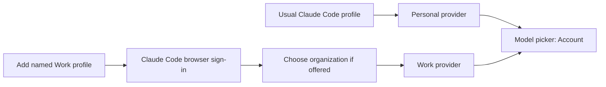

# Claude personal and organization subscription selection

Investigation for [#2094](https://github.com/nekko-labs/nekko-agent/issues/2094), 2026-11-07.

## Finding

**Both can be selectable in Nekko as separately connected Claude Code profiles. One saved login cannot currently populate both automatically through a documented interface.** An email address is not the account boundary: Nekko already compares email plus organization. The UI now includes the reported organization name alongside email and plan so these accounts are recognizable.

## Evidence and constraints

| Source | What it establishes |
| --- | --- |
| [Claude Code authentication: multiple accounts](https://code.claude.com/docs/en/authentication#log-in-with-multiple-accounts) | Officially recommends a separate `CLAUDE_CONFIG_DIR` for simultaneous personal and work accounts. Each directory has its own claude.ai login, settings, and session history. |
| [CLI reference](https://code.claude.com/docs/en/cli-reference#cli-commands) | `claude auth login` performs sign-in; `claude auth status` describes the current configuration. No documented organization-membership-list or organization-switch command was found. This is a documentation finding, not proof that no private endpoint exists. |
| [Organization restrictions](https://code.claude.com/docs/en/authentication#restrict-login-to-your-organization) | Managed `forceLoginOrgUUID` can restrict permitted organizations. It is policy, not permission for Nekko to discover memberships or rewrite organizational settings. |
| `spec/models/accounts-and-switching.md`, `ClaudeSetup.tsx`, shared `claude-policy.ts` | Existing named profiles, same-email/different-org identity checks, manual account switching, and new-conversation boundary for Claude Code account changes. |
| `spec/product/claude-policy.md` | Nekko runs unmodified user-installed Claude Code. It must not read/copy tokens or call Claude plan endpoints to discover accounts. |

## Supported user flow

The two browser sign-ins may use the same email, but each must result in its intended organization. If the second profile reports the same email and organization, Nekko refuses the duplicate rather than treating it as extra capacity. The existing manual account switch starts a fresh Claude Code conversation on the selected profile; it does not pool limits or automatically fail over.

## Implemented in this change

- Organization name in the existing compact Claude identity line when the CLI reports it.
- A shorter card source line; version and profile-directory diagnostics remain in a tooltip.
- Documentation of the existing separate-profile flow; no new login or credential plumbing.

## Not verified / future work

No real personal/team account was signed in, switched, or signed out during this work. The user's credentials and settings were not inspected. Synthetic renderer data and the existing identity tests do not prove a particular organization's browser account chooser or seat entitlement.

To verify the real flow, the account owner should add a named Work profile, sign in through Claude Code, select the organization if offered, and confirm its reported organization/plan before connecting. Then confirm both entries in the model picker's Account row. If Anthropic's browser does not offer the expected organization, check team invitation, Claude Code entitlement, SSO and managed-login policy; do not bypass them. Automatic membership enumeration remains a possible future feature only if Anthropic publishes a supported interface.
