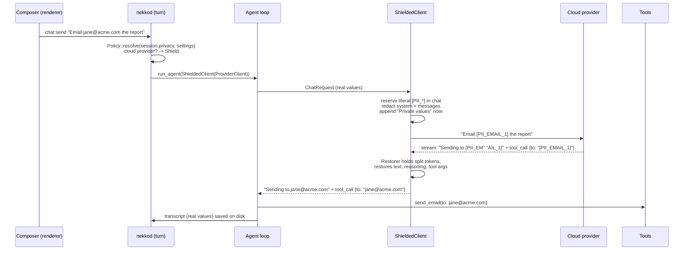

# Privacy Shield: control what reaches a cloud model, Design

**Status:** v1 implemented 2026-10-22 (this PR). Later phases below are proposals, not commitments.

**Goal:** a user can see exactly what a chat would send a cloud model, and stop personal data and
secrets from leaving their computer, without breaking the agent. The agent must still write the real
email into the real file, open the real `/Users/<name>/...` path, and show the user real names in
the reply. Only the provider sees placeholders.

**Why now:** other agent harnesses have started shipping a "privacy filter" step between the agent
and the model API. Nekko Agent's pitch is local-first: your machine, your models, your data. A
local-first agent that still sends every email address and API key in the transcript to a cloud
provider when the user picks a cloud model has a gap exactly where its positioning is strongest.
We already have Offline (local model only) and Incognito (nothing saved). Privacy Shield is the
missing middle: use a cloud model, but on your terms.

---

## User stories

1. *I paste a customer's support ticket* with their name, email and phone into a chat on Claude.
   The model should get `[PII_EMAIL_1]`, not the customer's address, and still be able to draft
   the reply, which I read with the real address back in it.
2. *I work for a client under NDA.* I add "Acme Corp" and "Project Falcon" once; every shielded
   chat sends `[PII_TERM_1]` and `[PII_TERM_2]` instead. This is the "make the request generic"
   case.
3. *My `.env` has keys in it* and the agent reads it while debugging. The key goes out as
   `[PII_SECRET_1]`; if the agent rewrites the file, the real key is written back.
4. *I want to know before I send.* A panel next to Incognito lists every value the shield would
   replace in my draft and the chat so far, what the model reads instead, and lets me send any one
   of them as written.
5. *I'm on a local model.* The panel says nothing leaves the computer and the shield stays out of
   the way.

## Non-goals (v1)

- Anonymization in the GDPR sense. Placeholders are **pseudonymization**: reversible on this
  computer, and quasi-identifiers (a rare job title + a city + a date) can still identify someone.
  The UI and docs say so.
- Names, street addresses and free-form personal facts in prose. Regular expressions cannot find
  these reliably. Custom terms cover the names that matter most to a user; phase 2 adds an
  on-device model (below).
- Images, audio and file attachments sent as bytes. Text only in v1.
- Claude Agent chats. The user's own Claude Code process sends those requests; the shield cannot
  reach them. The panel says so.

---

## Options considered

### Where the shield sits

| Option | How | Pros | Cons |
|---|---|---|---|
| **A. `ModelClient` wrapper in the daemon** (chosen) | Wrap the loop's model client: redact each `ChatRequest`, restore each streamed chunk | One choke point for every agent turn; sees typed messages (content, tool calls, tool results) not raw HTTP; restore happens before tools and the transcript; no new process | Side calls (titles, compaction, suggestions) need the same helper applied by hand |
| B. Per-provider, in `nekko-agent` | Redact inside each provider's request builder | Catches everything that uses a provider | Eleven provider kinds, three wire formats; restore would have to live in each SSE parser; mixes policy into transport |
| C. Local HTTPS proxy | Point providers at a localhost proxy that rewrites JSON | Provider-agnostic, could cover Claude Code too | TLS interception or per-provider base-URL hacks; must parse every wire format; streaming restore across SSE frames; another process to supervise |
| D. Renderer-side, before send | Redact the draft in the composer | Trivial | Misses everything the agent reads (files, tool output, context block, memory); cannot restore |

A covers the whole agent loop through one seam (nekkod's `chat_client::ProviderClient` is the only
`ModelClient` the daemon builds for a turn). C is the only way to reach Claude Agent chats and is
noted as a later option.

### What happens to a private value

| Option | Example out | Agent still works? | Reversible? |
|---|---|---|---|
| **Placeholder + vault (pseudonymize)** (chosen) | `[PII_EMAIL_1]` | Yes: restored before tools run | On this computer only |
| Mask | `j***@example.com` | No: the agent writes the masked value into files | No |
| Drop | *(removed)* | No: the request stops making sense | No |
| Synthetic substitute | `alex@example.org` | Mostly, but the model may "correct" or reuse a plausible fake | Yes, but collisions with real text are likely |
| Format-preserving encryption | `k9w2@q7x.zz` | Yes | Yes, with a key; no gain over a vault here |

Placeholders win for an *agent* (as opposed to a chatbot): the model must be able to refer to a value
and hand it back in a tool call. Stable, typed tokens let it say "email [PII_EMAIL_1]" and write
`[PII_EMAIL_1]` into a file, and the daemon puts the real value in before the write happens.

### How private values are found

| Option | Coverage | Cost | Runs where | v1? |
|---|---|---|---|---|
| **Regex + validators** | Structured: email, phone, cards (Luhn), SSN, My Number (check digit), public IPv4, known key shapes, quoted/env secrets, home-folder account name | Microseconds, no dependencies (`regress`, already in the tree) | Daemon | **Yes** |
| **User terms** | Whatever the user names: clients, codenames, people | Free | Daemon | **Yes** |
| On-device NER (ONNX, e.g. a small multilingual NER model) | Names, organizations, locations in prose | ~5-20 ms per KB on CPU, a model download | Daemon (`ort` is already a dependency via `nekko-decide`) | Phase 2 |
| Local LLM classifier/rewriter | Anything, including "make this generic" | Seconds per request; needs a resident local model | Model Server | Phase 3, opt-in |
| Presidio | Structured + NER | A Python service | Sidecar | No: a Python runtime is the wrong dependency for a desktop app |
| Cloud DLP (Google, AWS Macie, Azure) | Broad | Network + cost | Someone else's cloud | No: defeats the purpose |

Detection must never call a cloud service: the detector would see exactly what we are trying to
keep in.

---

## Architecture



### Components

| Piece | Where | What it does |
|---|---|---|
| `nekko-privacy` | `crates/nekko-privacy` (new, pure, no I/O) | `detect` (kinds, regexes, validators, terms, usernames), `policy` (resolve session + settings), `shield` (vault, redact/restore, streaming `Restorer`, `preview`) |
| `ShieldedClient` | `crates/nekkod/src/chat_client.rs` | `ModelClient` wrapper: redacts requests, restores streams. With no shield it is a passthrough |
| Daemon wiring | `crates/nekkod/src/privacy.rs` | `shield_for` (only providers off this computer), `guard`/`unguard` for one-shot side calls, the `privacy:preview` channel |
| Call sites | `turns.rs` (agent turns, titles), `side.rs` (suggested replies, prompt-part fill), `compaction.rs` (summaries), `spawn.rs` (sub-agents inherit `privacy`) | Every place the daemon sends chat content to the chat's model |
| UI | `PrivacyShield.tsx` beside Incognito in the composer's privacy row | Switch, live findings, per-value "Send", per-kind switches, the user's terms, "your message as the model reads it" |
| Shared types | `packages/shared/src/privacy.ts` | `SessionPrivacy`, `PrivacyPreview`, kind labels, helpers |

### Which calls are shielded

| Call | Shielded | Notes |
|---|---|---|
| Agent turns (every request of a reply) | Yes | One shield per reply: a value keeps its placeholder across every request |
| Sub-agents (`spawn_agent`) | Yes | The child chat inherits the parent's `privacy` with its tool policy |
| Chat titles | Yes | `guard`/`unguard` |
| Suggested replies and prompt-part fill (`side.rs`) | Yes | `guard`/`unguard`; a filled-in part comes back with real values |
| Compaction summaries | Yes | One shield across all chunks of one compaction |
| Local providers on loopback (llama.cpp, Ollama, LM Studio, vLLM, openai-compat on localhost) | No, by design | Nothing leaves the computer |
| A "local" server on another machine (`ollama` at `10.0.0.2`) | Yes | It is off this computer |
| Claude Agent (Claude Code) chats | No | Out of reach; panel says so |
| Image generation prompts (`image_turns.rs`) | No | Follow-up |
| Repository review, workspace one-shots (`repository_review.rs`, `workspace.rs`) | No | Follow-up; not chat content |
| Images attached to messages | No | Sent as bytes; follow-up (OCR or a block) |

### Data model

```ts
// Session (per chat), saved with the chat; a user field, so a change mid-turn is kept.
privacy?: {
  mode?: 'off' | 'redact';        // unset: settings.privacyMode, else 'off'
  disabledKinds?: PrivacyKind[];  // unset: settings.privacyDisabledKinds
  allow?: string[];               // exact values the user chose to send as written
}

// AppSettings (every chat)
privacyMode?: 'off' | 'redact';
privacyDisabledKinds?: PrivacyKind[];
privacyTerms?: string[];          // "Acme Corp", "Project Falcon"
```

`PrivacyKind`: `email`, `phone`, `card`, `ssn`, `my-number`, `ip`, `secret`, `username`, `term`.

The settings keys ride the turn spec (`admission.rs` picks them), so the shield reads the same
values the user just saved. No settings default changed: the shield is **off unless switched on**,
so existing chats behave exactly as before and no golden fixture moves.

### Placeholders

- Format `[PII_<KIND>_<n>]`: ASCII (no tokenizer surprises), bracketed and prefixed so it does not
  collide with code (`[0]`, `[TODO]`), and typed so the model knows what it stands for.
- Numbered in order of first appearance in the request. The system prompt comes first and the
  transcript only grows, so numbering is stable from one request to the next and from one reply to
  the next: the prompt prefix stays cacheable (prompt caching keeps working). Compaction or
  history windowing can renumber, and those already invalidate the cache.
- **Reserved literals:** if a placeholder-shaped string is already really in the chat (a file
  about this feature, say), it is reserved before any value is numbered, so restoring can never
  rewrite text the user wrote.
- A placeholder the shield never handed out is left alone on the way back.
- The system prompt gains a short "Private values" note so the model uses placeholders verbatim
  in replies, paths and tool arguments instead of asking about them.

### Streaming restore

Deltas can cut a placeholder in two: `"Sending to [PII_EM"`, `"AIL_1] now"`. The `Restorer` holds
back a tail that could still become a placeholder (from the last `[` that matches the
`[PII_[A-Z0-9_]*` prefix, at most 40 bytes) and releases it when the next delta settles it. Held
text is flushed ahead of a tool call, usage, done, an error, or the end of the stream, so ordering
is preserved. Reasoning is restored with its own `Restorer`. Provider errors are restored too (a
provider may quote the request back). No provider re-sends stored reasoning, so restoring it is
safe.

### What the user sees

The **Shield** switch sits in the composer's privacy row, between Offline and Incognito. Its dot
lights when the chat is shielded and it shows how many values are being replaced. Opening it shows:

```
┌ Privacy Shield ─────────────────────────────────────── [●──] ┐
│ Replaces private values with placeholders before a request    │
│ leaves this computer, and puts the real values back.          │
│                                                               │
│ WHAT THE MODEL READS INSTEAD                                  │
│ Email addr…  jane@acme.com      → [PII_EMAIL_1]  draft  Send  │
│ API keys…    sk-ant-api03-…     → [PII_SECRET_1] chat   Send  │
│ Your terms   Acme Corp          → [PII_TERM_1]   chat   Send  │
│                                                               │
│ SENT AS WRITTEN (YOU ALLOWED THESE)                           │
│ Phone num…   +81 90-1234-5678                    Hide again   │
│                                                               │
│ YOUR MESSAGE AS THE MODEL READS IT                    [Show]  │
│ HIDE IN THIS CHAT   ●Email ●Phone ●Card ○Public IP …          │
│ YOUR TERMS (EVERY CHAT)  [Acme Corp ×]  [ Add a term ] [Add]  │
│                                                               │
│ Detection runs on this computer and is pattern-based…         │
└───────────────────────────────────────────────────────────────┘
```

The list is the engine's own redaction (`privacy:preview` runs the same `Shield` over the draft
and the saved chat), not a renderer re-implementation, so what it shows is what goes out. The
renderer asks again 250 ms after the draft stops changing while the panel is open, and every
750 ms (debounced) while the shield is on, for the count.

---

## Privacy and security boundaries

- **Nothing new leaves the computer.** Detection, the vault and the preview run in the daemon.
  The preview channel is not on the phone allow-list (default deny), so a paired phone cannot read
  the list of private values.
- **The vault lives in memory for one reply** (one compaction, one side call) and is dropped with
  it. It is never written to disk. The transcript on disk keeps real values, as it does today;
  Incognito still decides whether the transcript is saved at all.
- **The allow-list is saved with the chat** (`privacy.allow`), next to the transcript that already
  holds the same values.
- **Logs record counts by kind, never values:** `privacy shield: replaced {"email": 2}` (no chat id either).
- **Fail closed on detection, open on restore:** a value that might be private is replaced; a
  placeholder that cannot be restored is shown as is rather than guessed.
- **Known gaps (stated in the UI and docs):** names and addresses in prose unless they are terms;
  quasi-identifiers; images; Claude Agent chats; image generation prompts; a bare `1.2.3.4`
  version string looks like a public IP. Private (RFC 1918), loopback and link-local IPs are never
  replaced: they identify a network, not a person, and appear constantly in code.

## Testing

| Layer | Tests |
|---|---|
| Detectors | Each kind found with its exact span; a list of code that must stay untouched (`git@github.com:...`, `password: string`, `$VAR` secrets, private IPs, dates, timestamps, IDs, `v10.20.30.40`); My Number check digit; kind switches |
| Vault | Same value same placeholder; literal placeholders reserved; allow-list; message walker touches only content, tool args and tool output; split-token streaming; unknown placeholders kept; preview shape |
| Wrapper | Placeholders out and real values back through text and tool calls; held tail ordered before an error; passthrough with no shield |
| Daemon | `shield_for` only for providers off this computer; side-call round trip; **end to end**: a real `nekkod` turn against a scripted provider: the wire never carries the email, the tool writes the real email to disk, the saved transcript keeps it, `privacy:preview` lists it |
| Renderer | Panel lists values, placeholders and where they occur; allowed values; kind switches; reach notes; failure and empty states; the composer button reflects the chat's mode |

---

## Rollout

| Phase | Scope | Status |
|---|---|---|
| **v1** | Regex + validators + terms + account name; per-chat switch and app default; live preview panel; agent turns, titles, side calls, compaction | **This PR** |
| v1.1 | **Review before send**: a third mode where the composer shows the panel and waits for Send on any message with new findings. Settings UI for the app-wide default and terms (today: the panel and `settings.json`). Shield badge on replies ("3 values hidden") from the turn's counts | Next |
| v2 | **On-device NER** (ONNX through the `ort` runtime the daemon already ships) for person, organization and location names in prose, multilingual (EN/JA first). Image generation prompts and repository review shielded | Proposed |
| v3 | **Generic rewrite**: an opt-in pass on the user's local model that rewrites a request to strip context that is not needed ("my client Acme's Q3 churn" → "a B2B SaaS company's quarterly churn"), shown as a diff before sending | Proposed |
| v4 | Team policy (required kinds and terms for a workspace), exportable audit of counts per chat; a localhost proxy mode to reach Claude Agent chats | Proposed |

## Open questions

1. **Default on for cloud chats?** v1 ships off (no behavior change). Turning it on by default is
   a product call: it is the competitive headline, but a false positive (a 16-digit test card in a
   payments repo) changes what the model sees. Suggest: on by default in the "Private" saved mode
   first, measure, then decide.
2. **Saved modes.** Should the Private starter mode turn the shield on? It changes a golden
   fixture (`STARTER_MODES`), so it is left for its own change.
3. **Local Web UI and the phone apps.** Local Web UI shares the desktop renderer, so it gets the
   panel. A turn started from a phone is shielded when its chat is (the engine decides), but phones
   cannot yet switch it: `session:setOptions` from a phone accepts a fixed set of keys, and
   `privacy:preview` is not on the phone allow-list. Both are follow-ups with their own access review.
