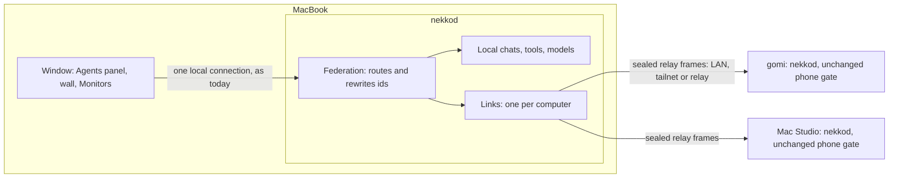

# Connected computers: agents from every machine on one desktop

Date: 2026-11-02. Apps: desktop (Electron renderer) and `nekkod`. Status: **design, awaiting approval, nothing built.**
Visual design: [reports/connected-computers-prototype.html](../../../reports/connected-computers-prototype.html) (open it in a browser; it is clickable, and the screens below are named after its scenes).

## Intent

Philip works from a MacBook, but his power sits elsewhere: a desktop PC with an RTX 5090 (`gomi`), a Mac Studio on the way, and whatever comes next. Today the phones can already reach those machines. The desktop app cannot: from the MacBook, an agent on `gomi` is invisible.

What he asked for, in his words: the desktop should support "connecting to other devices and having them show up on the desktop apps", run "local models and cloud subscriptions from my desktop 5090 server, upcoming Mac Studio server and other devices", "aggregate agent sessions from all of them, identify where the agent is running, and be able to optionally group".

So the MacBook becomes one place to run and watch every agent he owns, wherever each one really runs.

## Goals

1. **Connect.** A desktop app pairs with another computer running Nekko Agent, the way a phone does, over the same routes (LAN, Tailscale, relay).
2. **Aggregate.** Every agent from every connected computer appears in the Agents panel beside the local ones, live.
3. **Identify.** At a glance, every agent says which computer it runs on: on its card, on its wall window, in notifications.
4. **Group.** Optional, in the existing view menu: **Group by > Computer**. The default stays Activity, so "needs input" still comes first across all machines.
5. **Run there.** Start a new agent on any connected computer, using that computer's local models, its subscriptions and its folders.
6. **Drive it fully.** Read, reply, stop, approve and answer on a remote agent exactly as on a local one.

## Non-goals (for this design)

- Moving a running chat between computers.
- The phone apps aggregating several computers. They stay one connection at a time.
- Sharing a computer with another person. Every computer here belongs to one owner.
- Managing a remote computer's accounts, connectors, MCP servers or engine installs from another desktop. Those screens say "Do this on gomi".
- Wake-on-LAN, and a windowless service install. V1 needs the app running on the host (the tray counts).

## Anti-goals (failure even if it works)

- **A paired laptop becomes a way into the server.** A prompt-injected agent on the MacBook must not be able to drive `gomi`.
- **A subscription credential leaves the machine it signed in on.** A Claude plan runs only through the user's own unmodified Claude Code on that computer. The MacBook sends prompts, never tokens.
- **The app gets slower for someone with one computer.** With nothing paired, there is no new work on any path and no pixel changes.
- **A slow or dead machine stalls the panel.** The list paints from cache and never waits on the network.
- **You can't tell where something runs.** Approving a command on the wrong machine because a label was missing is the worst outcome in this feature.

## What already exists, and what that decides

Most of this is built for phones. The design is mostly "a desktop is another paired device, with its own access class, and the engine merges what it sees".

| Exists today | Where | Used for |
| --- | --- | --- |
| Relay v2: sealed frames, signed HELLO with challenge and `seq` (protocol 5), device registry, Read and Change switches, revocation | `crates/nekko-remote`, `docs/REMOTE.md`, decisions 0012, 0036 | The transport, as it is |
| Relay on this computer, on the tailnet at `ws://<name>:4400`; `alt=` routes in a pairing link | `crates/nekkod/src/local_relay.rs`, IO-19, IO-20 | Routes |
| Phone policy: every channel classed, fails closed, secrets stripped | `crates/nekko-remote/src/phone-access.json`, `phone.rs` | The base the computer class extends. **Too narrow on its own:** see *Host side* |
| Claude policy row `phone_remote`: on for every auth, plans included | `spec/product/claude-policy.md` | A desktop driving a plan chat is the same act as a phone doing it. No new row. |
| The hub's per-chat replay of a running turn | `crates/nekkod/src/hub.rs:212`, today loopback sockets only | Catching up, once a channel exposes it |
| TS relay client in `web-client.ts`, and full clients in Swift and Kotlin | | The reference for the new Rust client |
| iPhone *Run on* in New chat | `docs/REMOTE.md` | The model for choosing where a new agent runs |
| Agents panel view menu (`AgentGroupBy`) | `apps/desktop/src/renderer/views/agentPanelView.ts` | Grouping |
| One network switch enforced in the engine | decision 0020, `crates/nekko-net`, `packages/shared/src/connections.ts` | A new Connections row |

The one thing that does not exist is a **relay client in Rust**. `nekko-remote` holds only the agent (host) half, plus the crypto both halves need.

## The core model

**A chat runs on one computer, for its whole life.** Its model, tools, files, guardrails and credentials are all on that computer. Any other desktop or phone is a window onto it. If the MacBook lid closes, the run carries on.

**Pairing is one-way.** Pairing the MacBook to `gomi` lets the MacBook drive `gomi`, never the reverse. To see the MacBook's agents from `gomi`, pair in that direction too.

### Running where the model is, versus borrowing a model

There are two different things "use the 5090 from my MacBook" can mean:

| | **Agent runs on gomi** (this design) | **Agent on the MacBook, model on gomi** (later) |
| --- | --- | --- |
| Files it edits | `gomi`'s | the MacBook's |
| Local models | yes | yes |
| Cloud subscriptions | yes | **no**: a plan may only run through that computer's own Claude Code, so no request can be routed across |
| Keeps running with the lid shut | yes | no |
| Needs the repo on the host | yes | no |

V1 builds the left column: it is the only one that covers subscriptions and matches "identify where the agent is running". The right column is a provider that points at `gomi`'s Model Server. It can be added later with no change to anything here. See *Decisions to check*.

## Architecture



**Connections live in the engine, not the window.** The spec already says the window does no network work, and only the engine can enforce All connections off and write the activity log. It also means a run's notifications arrive with the window closed.

**Only the desktop window gets the merged view.** Federation answers on the connection holding the window's engine token and nowhere else: the CLI, the MCP server, the local API server and the Local Web UI see this computer only, exactly as today. Those are the paths an agent running on this computer can reach, so opening them would hand it every paired machine.

### Engine: three new pieces

**1. `nekko_remote::client`: the relay client.** A port of the iPhone's `RelayClient` and `RouteSupervisor`, with its constants and rules (handshake 15 s, requests 120 s, backoff 1 to 30 s, offline poll 15 s; 4001 and 1008 close rules; protocol 5 challenge, `seq` and signed HELLO). It reuses `e2e.rs`, `hello.rs`, `route.rs` and `proof.rs`, and adds a P-256 signer beside the existing verifier. The golden vector `tests/golden/relay-handshake.json` proves it speaks what the phones speak.

**2. `crates/nekkod/src/computers.rs`: the links.** One always-on link per paired computer, all at once (unlike phones). It owns:

- `computers.json` in the data folder, no secrets:
  ```ts
  interface PairedComputer {
    id: string;           // 8 random hex chars, chosen at pairing
    name: string;         // renameable; defaults to the host's own name
    platform?: string;    // darwin | win32 | linux, from app:info
    relayUrl: string;
    alts: string[];
    pairedAt: number;
    color: number;        // index into the computer palette
  }
  ```
- Secrets (`room`, `key`, device private key) in the store `nekko-cloud` already uses: macOS Keychain, Windows Credential Manager, a 0600 file on Linux.
- `computers/<id>/summaries.json`, the last-known chat list, so the panel paints instantly and an offline computer's agents stay visible. Incognito chats are never written.
- `computers/<id>/catalog.json`, the last-known providers (no secrets), models and saved folders, for the same reason.

Refresh: on welcome, 250 ms after a `done`, `error` or `session_meta` event, and every 60 s. On welcome the link also reads `chat:running` and, for each running chat, calls `agent:replay`, so a turn already under way shows up mid-reply.

**3. Federation in the router.** A thin layer in front of `routes.rs`, doing three things:

- **Qualified ids.** A remote id is `@<computerId>:<rawId>`. The window treats it as an opaque string, so `store.ts` and the 244 components keep working. A local id never starts with `@`; a test holds that.
- **Routing.** `computer-routes.json`, in the style of `phone-access.json`, lists each channel that carries an id and where (`session:get`: arg 0; `chat:send`: arg 0 field `sessionId`; `tool:approve`: arg 0; `files:*`: arg 0 root, which may be `session:<id>`). A qualified id on a listed channel is stripped and sent down that computer's link. **A qualified id on an unlisted channel is refused**, so a new channel can't reach the local store with a foreign id.
- **Rewriting.** Replies and events are qualified on the way back: a fixed list of id fields (`id`, `sessionId`, `parentSessionId`, `workspaceId` and so on, taken from the `Session` and `AgentEvent` types), held by a golden test that walks a fixture of every event type and fails on any unqualified id.

`sessions:summaries` returns local chats plus every link's cached list, and never touches the network. New channels:

| Channel | Does |
| --- | --- |
| `computers:list` | `ComputerStatus[]`: paired record plus state, route, latency, last seen, Read and Change from the host's welcome, app version |
| `computers:catalog(id)` | That computer's `{ providers, models, workspaces }`, with qualified ids; cached, so it answers offline |
| `computers:pair(link)` | Parses a `nekko-agent-pair:` link, connects, enrolls, saves. Returns the computer. Refuses a phone link: "This link is for a phone. On gomi, open Settings, Computers." |
| `remote:pairComputer` (host side) | Mints a pairing grant of kind `computer`, as `remote:pair` does for phones, and returns the link |
| `computers:rename(id, name)`, `computers:setColor(id, n)`, `computers:forget(id)` | Local edits. Forget also signs the device out of the host (`device:signOut`) when it is reachable. |
| `computers:call(id, channel, args)` | A session-less call on one computer: `models:list`, `session:create`, `machine:summary`, `monitor:summary`, `gpu:stats`, `system:stats`, `limits:get`, `usage:summary` |
| event `computers:updated` | State changed; the window refreshes the list and the merged chats |

`ComputerStatus.state` is `connecting`, `online`, `offline`, `denied` (revoked, or Read off) or `update` (the host is too old).

### Host side: a computer access class

**The phone gate is too narrow for a desktop, so the host changes.** Reading the gate, a phone cannot steer a running chat (`chat:steer`, which is the composer during a run), compact it, take back a queued message, edit and resend, or send videos. `session:get` gives a phone the newest 300 messages with tool output cut to 4,000 characters and most images dropped. There is no way to read a running turn's partial state. Goal 6 outranks keeping the host unmodified: a composer that fails while the agent runs is not a usable desktop. The cost is that **both computers need the new build**, which is acceptable because they all belong to one owner.

- **The grant sets the class.** `remote:pairComputer` mints a grant recording `kind: 'computer'`, and enrollment copies it onto the device record. Nothing in HELLO can set it, so a phone cannot promote itself. *Paired devices* shows it as "Computer", with the same Read and Change switches, activity list and revocation.
- **`computerClass` in `phone-access.json`** adds to the phone classes; it never removes.
  - Read: `chat:running`, `session:images`, a new `agent:replay(sessionId)` that returns the hub's `AgentReplay` (already capped at 4 MB, so it fits a relay frame), and a new `session:page(sessionId, before, limit)` for older messages.
  - Agent class, no proof: `chat:steer`, `chat:compact`, `chat:dequeue`, `session:truncate`, `session:setAttachments`, `attachment:import`, `changes:accept`, `changes:acceptAll`, and `chat:send` with every option.
  - The builder completes this list by enumerating what `ChatPane`, the wall and the new-agent flow call on `window.nekko`, and classes each. A call left out shows "Do this on gomi" rather than failing.
  - `session:get` returns the newest 300 messages with tool output whole and secrets still stripped. `session:page` fetches older ones when you scroll.
- **Still refused from a computer, always:** `providers:save`, `providers:remove`, `providers:importCliAuth`, `oauth:`, `cloud:`, `sync:`, `remote:` (beyond what phones get), `data:wipe`, `settings:reset`, `shell:`, `dialog:`, `update:`, `file:read`, `file:write`, `dir:list`. Credentials and the machine's own administration stay on the machine.
- **The welcome carries access.** A computer's welcome adds `access: { read, change }`, and the host sends `access:updated` when a switch changes, because the UI must say "watching only" before a call is refused. Phone behavior is untouched; the existing phone goldens prove it.

**Change proofs.** Phones sign with a Secure Enclave key behind Face ID, good for 5 minutes. A desktop has no equivalent moment: it saves files and commits all day. So a computer signs with its device key from the keychain, with no prompt per call, and raising a chat to a more permissive mode asks for a click in the window first. **This is weaker than a phone, and `docs/REMOTE.md` must say so:** its "needs Face ID or the passcode" line does not cover computers. The presence check for a computer is its own screen lock. See *Decisions to check*. If the host has hardware-key step-up on, the guarded call is refused and the UI says "Confirm on gomi" in V1.

### Window

- **Store:** `computers: ComputerStatus[]` and `computerCatalogs: Record<id, Catalog>`. The local `providers`, `models` and `workspaces` stay local only. A helper `computerOf(id)` reads the qualified prefix, and selectors `workspaceFor(id)`, `providerFor(chatId, id)` and `modelsFor(chatId)` pick the right catalog.
- **Why separate catalogs, not one merged list.** A lookup site that was missed shows a blank label, which is harmless. A list site that was missed in a merged design offers `gomi`'s folder in a local new chat, which is the wrong-machine failure this feature must not have. About 56 lookup sites move to the selectors where a chat is in scope; about 55 list sites stay as they are.
- **An open remote chat uses that computer's catalog.** Its model picker lists `gomi`'s models and can change them, as a local chat's does. The send path takes `brain.providerId/modelId` from the same selector.
- **Agents panel:** `AgentGroupBy` gains `'computer'`; `Show` gains `showComputer`. Both hidden until something is paired. Group by Project keys on the qualified folder id, so `nekko-agent` on `gomi` and on this Mac are two groups, the remote one with its chip. They are different checkouts.
- **Pickers:** `api.onComputer(id)` returns the few calls the new-agent flow needs, over `computers:catalog` and `computers:call`.
- Everything gated on `computers.length > 0`.

## Security

| Threat | Answer |
| --- | --- |
| Prompt-injected agent on the MacBook tries to drive `gomi` | The key and room secret are in the OS keychain, not the data folder. Agent tools never get the engine token. Federation and `computers:*` exist only on the window's connection, never on the MCP server, the CLI, the local API server or the agent's tool list. **Residual risk, stated plainly:** a YOLO agent running as the same OS user can in principle reach the keychain item on an unsigned dev build. On a signed build the keychain ACL holds on macOS; Windows Credential Manager has no per-app ACL. |
| Prompt-injected agent on `gomi` tries to reach the MacBook | It can't. Pairing is one-way, and `gomi` holds no credential for the MacBook. Replies are data: the window renders them as it renders any remote text. |
| A computer has more reach than a phone | Stated plainly: the computer class can steer, attach and accept changes with no per-call prompt, so a stolen unlocked laptop can too until revoked. It still cannot touch credentials, accounts or remote-access settings, and it cannot read a path outside a chat's folder. Phase 1 gets a security review of the class before it lands. |
| Stolen or lost laptop | Revoke it under *Paired devices* on any host, as with a phone. |
| Relay operator | Sees ciphertext only (decisions 0012, 0036). |
| Credentials | Provider keys and plan sign-ins never cross. `providers:list` is already stripped by the phone gate. Adding a key from another desktop uses `providers:saveSealed` (decision 0016), sealed to that computer. |
| Data at rest on the MacBook | New: `summaries.json` holds titles, first prompts and reply excerpts from `gomi`. Same sensitivity as the MacBook's own chats. Transcripts are not stored. Forget deletes the folder. |
| Network switches | A new Connections row `connected-computers`, group *In the background*. All connections off closes every link; remote agents show as offline. `nekko_net::IDS` and `connections.ts` both gain the id. |

**Guardrails stay the host's.** A tool approval raised on `gomi` is decided against `gomi`'s rules. The MacBook shows the prompt and returns the answer, with the computer's name on it.

## Things that can go wrong

| Situation | Behavior |
| --- | --- |
| Host offline, sleeping or app closed | Cards stay, dimmed, with "offline 12m" in the group header and chip. Their last turns come from the summary. Composer disabled with "gomi is offline". Reconnects on its own. |
| Link drops mid-run | The run continues on the host. On reconnect, the link refreshes summaries and catalogs, reads `chat:running`, and calls `agent:replay` for each running chat. |
| Opening a chat that is already running | The same replay, so the partial reply shows at once. |
| Route changes (home to café) | LAN first, then tailnet, then relay, as `RouteSupervisor`. Never mid-request. |
| Host revoked this device | State `denied`, cards dimmed, "gomi removed this computer. Pair again." No retries. |
| Host too old for the computer class | It cannot mint a computer link, so pasting its phone link gets the refusal above. A host that is later downgraded answers `update-required`: state `update`, "Update Nekko Agent on gomi." |
| Read off on host | `denied`, with the host's own refusal copy. |
| Change off on host | Known from the welcome. Read works; the composer shows "gomi allows watching only" before anything is tried. |
| Sync is on too | A chat can appear twice: live from `gomi`, and as the synced copy. When a local chat's id equals a linked chat's raw id, hide the synced copy while the link is online. The builder confirms synced chats keep their ids first. |
| A refused feature (terminals, for example) | The control is disabled with "Do this on gomi". Never a raw error. |
| Host asleep during a long run | The run stops, as it does locally. Phase 4 adds *Keep this computer awake while agents run* on hosts. |
| Versions differ between computers | Unknown event types are ignored; the host's gate decides channels. Tested with one old and one new daemon. |
| Windows paths on a Mac | Shown as strings, never parsed on the client. |

## Visual design

Scenes in the prototype. Colors, type scale and spacing are the app's real tokens from `styles.css`.

**Identity.** Each computer gets a name, a glyph (laptop, tower or small desktop, drawn as SVG) and a color from a palette that stays clear of the status colors (no green, amber, orange or red, since those mean working, warning, needs input and error). **The local computer shows no chip.** With a second computer the absence reads as "here", and most cards stay as quiet as they are today. Its group header says "This Mac".

**Scene 1, Agents, by activity.** The default. Remote cards replace the provider line with `[chip] gomi · Claude plan`, so card height does not change. Needs input still comes first across all computers.

**Scene 2, Group by computer.** One header per computer, with a state dot, and a **+** that starts an agent there. Empty ones say "No active agents". Completed gather at the bottom as they do today.

**Scene 3, New agent.** A *Run on* row in the new-chat details, as on the iPhone. Choosing `gomi` swaps the model list to `gomi`'s models and subscriptions, and the folder list to `gomi`'s folders. Each computer shows live GPU memory, so the choice is informed. What you typed stays.

**Scene 4, A remote window.** The chip sits in the window's title strip. Approval prompts repeat the computer's name in the button row. The Monitors dock gets a computer switcher; Hardware, Local models and Utilization all follow it.

**Scene 5, Offline.** Dimmed cards, a banner in the window, last-known turns still readable.

**Scene 6, Settings > Computers.** The list, with state, route, latency, GPU, agent count and version. Add a computer pastes a link. Below it, *Let a computer connect to this one* makes that link, for the other direction.

**Scene 7, Add a computer.** Paste, confirm the name and routes, connected. Phase 5 replaces the paste with a list of what is on your network, and a code to compare.

## Plan

A stack, 2 to 4 layers at a time, per `AGENTS.md`. Each phase lands on its own.

1. **Link and host class.** `kind: 'computer'` grants, `computerClass`, `agent:replay` and `session:page` channels, access in the welcome; `nekko_remote::client`, signer, `computers.rs`, `computers:*`, Connections row; Settings > Computers with paste and *Let a computer connect*. Security review of the class before it lands. Proof: a real second `nekkod` on this Mac with its own data dir and a fake model, through the relay; then `gomi` across the tailnet.
2. **Federation.** Qualified ids, `computer-routes.json`, rewriting and its golden test, merged `sessions:summaries`, events, replay, catalogs, the offline cache.
3. **See and drive.** Per-computer catalogs in the store and the selectors, card chip, Group by Computer, Show > Computer, window chip, offline states, disabled controls, notifications with the computer's name.
4. **Start and monitor.** *Run on*, Monitors switcher, Keep this computer awake.
5. **Pair without pasting.** Discovery on the LAN and the tailnet, the relay lobby and comparison code from `reports/phone-discovery-pairing-proposal.md` option C (phones can adopt it after).

Later, unplanned: terminals and SSH across a link, model-only use, a windowless service.

Each phase carries its spec update (a new `spec/desktop/connected-computers.md`), a decision record, a docs page, and before/after captures. A new TASKS section (`CC`). Phases 3 and 4 need the hidden layout harness with a two-computer fixture.

## Testing

- **Golden:** relay handshake vector against the Rust client; id-rewrite walk over every `AgentEvent`.
- **Two real daemons, one machine:** pair, summaries merge, send, stream, approve, stop, kill the host mid-run, restart, replay.
- **Fail closed:** unlisted channel with a qualified id; `computers:*` unreachable from MCP and CLI tool lists; a phone cannot reach a computer-class channel, and a device's kind cannot be set from HELLO; the existing phone goldens unchanged.
- **Zero-computers guarantee:** the Speed contract budgets unchanged, and a pixel comparison of the panel with nothing paired.
- **Real hardware:** MacBook to `gomi` over Tailscale, then LAN, then the relay; sleep the MacBook mid-run; pull the network.

Not verifiable from this Mac alone: Windows Credential Manager behavior and a real `gomi` run need that machine on and reachable.

## Left to the builder

File layout inside `computers.rs`; the debounce on summary refresh; the exact chip palette within the rule above; how `computer-routes.json` is generated or checked against `channels.json`.

## Decisions to check

Calls made in this document that Philip has not stated:

1. **Agent runs on the host; the model-only mode comes later.** The largest call. See the table above.
2. **No per-call prompt for changes from a computer.** Its screen lock is the presence check, and a mode raise asks for a click. The alternative is Touch ID or Windows Hello every 5 minutes, as phones do, which needs native work on both platforms and interrupts normal work.
3. **A computer access class in Phase 1**, so every host needs the new build, in exchange for a remote chat behaving like a local one. Terminals are still out.
4. **Separate catalogs per computer**, and Group by Project keeps same-named projects on different computers apart.
5. **Pairing is paste-a-link until Phase 5.** It reuses what exists and needs no new crypto; the nicer flow needs a relay change.
6. **One-way pairing.**
7. **No chip on local cards.**
8. **Hosts run the app** (tray is fine). A headless Mac Studio with no logged-in app is not covered yet.
