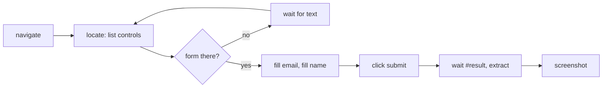
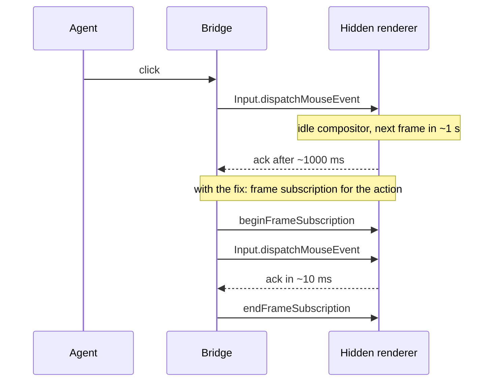

# Agent browser full-flow benchmark and the hidden-window frame stall

Date: 2026-10-18. Base: `main` at `3a7bb7a6`. Raw data: [flow-benchmark.json](flow-benchmark.json).

## What was measured

The previous benchmarks (#752) timed only two things: opening a new chat's browser and `inspect` on a loaded page. An agent's real task is longer, so this benchmark drives a whole flow through the real bridge (`startAgentBrowser`) in hidden Electron:

The fixture is a small single-page app (`scripts/agent-browser-flow-fixture.mjs`): 40 links and some prose, cacheable JS and CSS, a form rendered by script after a 120 ms API call (so an agent that looks too early has to wait and retry), and a confirmation after an 80 ms submit call.

Three scenarios are reported separately:

| Scenario | Meaning |
|---|---|
| process-first | first flow in a brand-new Electron process and profile, one per launch; which variant goes first alternates by launch |
| fresh-chat | a new chat in a running app: new driver, window, partition and empty HTTP cache, closed afterwards |
| warm-session | the same chat again: browser open, HTTP cache populated |

Each flow records tool calls, retries, reply text bytes (what the model reads), image bytes, fixture requests, per-step time and, through the new `onTiming` hook, startup phases: `window` (hidden window plus about:blank), `relay` (authenticated owned-page CDP relay), `spawn` (native process until its ready frame), `attach` (native `launch` over the relay, or Playwright page adoption), `navigate` and `summary`.

Conditions: Windows 11 (10.0.26300), AMD Ryzen 9 9950X3D (32 threads), 47 GiB, Electron 44.7.0 / Chromium 152.0.7977.130, native agent-browser 0.39.1 at the pinned revision, hidden 1100x760 window. It excludes the model, host/daemon dispatch and approvals: this is the bridge only. Nearest-rank percentiles.

## Finding: a hidden window renders about one frame a second

Startup was not the cost. The native browser was ready in about 60 ms, but the flow took 3.3 s, and two steps accounted for 2.9 s of it:

| Step (native, fresh chat, n=20) | p50 | p95 |
|---|---:|---:|
| click submit | 1001.11 ms | 1005.73 ms |
| screenshot | 1905.49 ms | 1918.75 ms |
| everything else together | about 415 ms | |

A CDP trace through the relay showed the click's first `Input.dispatchMouseEvent` taking 990 ms, while fill (`Input.insertText`) took 1 ms. Probes in a bare hidden `BrowserWindow`, without any driver, reproduced it: after the page goes idle, the next `requestAnimationFrame` fires 800-1000 ms later. Mouse input is acknowledged on the next frame, so a click waits about one frame. The native screenshot waits for two animation frames before `capturePage`, so it waits about two. `backgroundThrottling: false` and the Chromium switches `disable-renderer-backgrounding`, `disable-backgrounding-occluded-windows` and `disable-background-timer-throttling` made no difference. A frame subscription (`webContents.beginFrameSubscription`) kept frames coming at the normal rate, and so did a 1x1 `capturePage` with `stayAwake: true`. The page's `document.visibilityState` stayed `visible` and the window stayed hidden in every case.

## The change

`withFramesAwake` in `apps/desktop/src/main/agentBrowser.ts` subscribes to frames only for the duration of a `click` or `screenshot` on a hidden tab, then unsubscribes. Nothing stays subscribed between actions, a visible window is left alone, and other actions are untouched. `wakeFrames: false` turns it off, which is how the benchmark compares with and without it in the same process.

## Results: with and without the frame wake, alternated in one process

Native driver, `native-nowake` and `native` alternated sample by sample (12 fresh processes, then 20 fresh-chat and 20 warm-session rounds in one process).

| Metric | Before (no wake) | After (wake) |
|---|---:|---:|
| Whole flow p50 / p95, process-first (n=6 each) | 3377.57 / 3418.12 ms | 484.72 / 612.5 ms |
| Whole flow p50 / p95, fresh chat (n=20) | 3321.87 / 3345.81 ms | 466.29 / 489.61 ms |
| Whole flow p50 / p95, warm session (n=20) | 3242.25 / 3260.74 ms | 388.44 / 404.39 ms |
| Click submit p50 / p95, fresh chat | 1001.11 / 1005.73 ms | 10.86 / 13.5 ms |
| Screenshot p50 / p95, fresh chat | 1905.49 / 1918.75 ms | 37.66 / 56.07 ms |
| Tool calls per flow | 10 | 10 |
| Retries per flow (form not rendered yet) | 1 | 1 |
| Reply text per flow, fresh chat p50 | 6903 bytes | 6889 bytes |
| Screenshot per flow, fresh chat p50 | 303618 bytes | 303860 bytes |

The few-byte text difference is the session id echoed in the confirmation (`native-nowake` vs `native`), not a content change.

Startup phases on a fresh chat's first request (native with wake, n=20, p50 / p95): window 35.54 / 37.22 ms, relay 1.01 / 1.18 ms, spawn 17.47 / 19.72 ms, attach 6.45 / 7.82 ms, navigate 24.93 / 26.65 ms, summary 1.29 / 1.6 ms. The navigate step as a whole was 101.02 / 108.99 ms. In the first flow of a new process it was 153.33 / 182.77 ms. These phases do not change with the wake (it only applies to click and screenshot).

Fresh chat against warm session (native with wake): the flow was 466.29 against 388.44 ms p50. Almost all of the difference is the navigate step (101.02 against 17.14 ms p50). A warm session skips the window, relay, process and attach, and the HTTP cache served the JS and CSS (3 fixture requests instead of 5, 0 asset requests instead of 2). Locate, fill, submit, verify and capture cost the same in both. Locating the form (about 120-190 ms) and waiting for the confirmation (about 120 ms) are the fixture's own API delays.

### Playwright cross-check

Playwright is no longer the default driver. It was checked only to confirm that the stall belongs to the hidden window and not to the native driver. Four launches and 10 rounds:

| Metric | Before (no wake) | After (wake) |
|---|---:|---:|
| Flows that finished | 0 of 24 | 24 of 24 |
| Failure | `page.screenshot: Timeout 10000ms exceeded.` (24 of 24) | none |
| Click submit, all 25 samples including the warmup | 1008 to 2010 ms | 14.32 / 16.39 ms p50 / p95, fresh chat |
| Whole flow p50 / p95, fresh chat | did not finish | 628.84 / 709.81 ms |

Playwright's screenshot waits on frames that a hidden idle window does not produce, so without the wake it never finishes in 10 s.

## Pixels

The expanded native smoke (`scripts/agent-browser-native-smoke.mjs`) passes with and without the change. Its screenshot is 1359x872 both times, and the two images differ in 21 pixels, a 1x21 column at x=109: the text caret in the `#name` input, which blinks. Repeated screenshots after the change are pixel-identical, the window stays hidden and unfocused with 0 activations, and the foreground window is unchanged.

## What did not change, and limits

- Tool calls, retries and reply bytes are unchanged. The fix makes each call faster; it does not make an agent need fewer of them. That is the next item (compact snapshots and refs).
- One Windows machine. macOS and Linux compositors may throttle hidden windows differently; not measured.
- Sequential alternation within one process, not randomized. The effect (about 7x on the whole flow) is far outside the run-to-run spread, but small differences in other rows should not be read as effects.
- The `wait` action polls every 50 ms and does not depend on frames, so it did not stall.
- An idle hidden window still renders about one frame a second between actions. Only actions that wait on a frame are woken.

## Next

1. Compact interactive snapshots and element refs, measured with this same harness as a second strategy (tool calls, reply bytes, retries, time).
2. Repeat on macOS and Linux.
