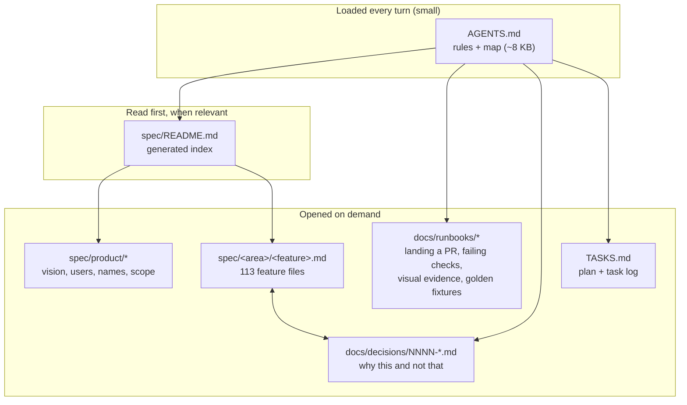
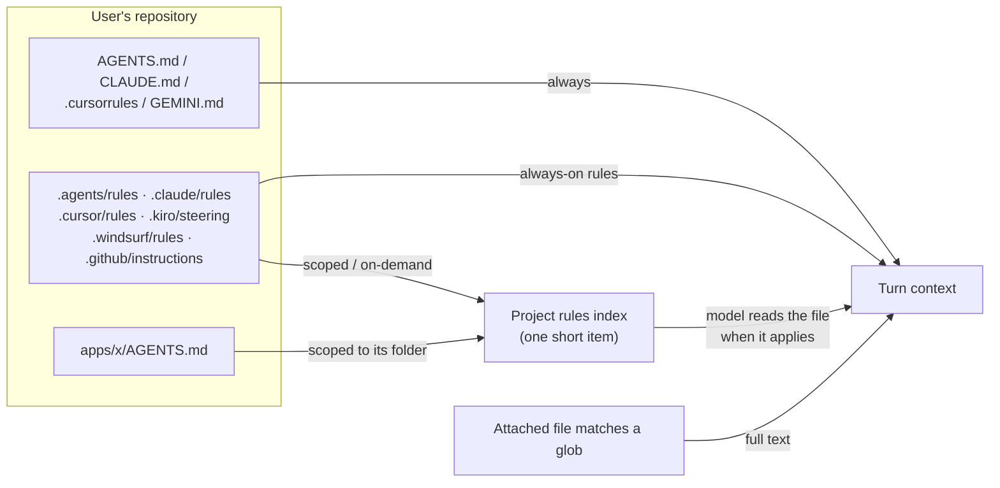

# Agent knowledge layout: specs, rules, runbooks and memory (October 2026)

**Question.** Nekko Agent keeps what agents need to know in three big files: `SPEC.md` (about 720 KB), `TASKS.md` (about 770 KB) and `AGENTS.md` (about 19 KB, loaded every turn). Is there a newer pattern than one spec file, and which of these patterns should Nekko Agent offer users for their own codebases, alongside the Mode panel and memory?

**Short answer.**

- No single standard has won. The tools have converged on three layers:
  1. A small, hand-written instruction file that is always loaded: `AGENTS.md`.
  2. Rules and skills scoped by path or by description, loaded only when relevant.
  3. Long documents (specs, decisions, runbooks) the agent opens on demand, through an index.
- Evidence from 2025–2026 says to keep the always-loaded layer small. A compact index of the documents does better than hoping the model goes looking.
- For this repo: SPEC.md is now one file per feature under `spec/`, with a generated index, AGENTS.md is a map plus the rules that apply to most changes, procedures live in `docs/runbooks/`, and decisions live in `docs/decisions/`.
- For users: Nekko now reads every major tool's rule format. Each chat can choose how much project guidance it takes and which memory it reads.

**How well this is sourced.** Each claim is marked:

- **[V]**: I read it in the primary source on 2026-10-22.
- **[S]**: from an official page, but seen only as a search snippet, because the proxy blocked the page itself.
- **[U]**: secondary source, or I could not verify it.

---

## 1. What the tools do now

### Instruction files and rules

| Tool | Always loaded | Loaded when it applies | How a rule says when it applies |
| --- | --- | --- | --- |
| **AGENTS.md** (open standard, governed by the Agentic AI Foundation under the Linux Foundation since Dec 2025) [S] | Root `AGENTS.md` | Nested `AGENTS.md`: the closest one to the edited file wins | The directory it sits in |
| **Claude Code** [V] | `CLAUDE.md` (and `AGENTS.md` natively since v2.1.277); `@imports` load at launch too | `.claude/rules/*.md` with `paths:`; subdirectory `CLAUDE.md`; skills | `paths:` (globs) is the only frontmatter field read. A skill's `description` stays in context and its body loads when invoked |
| **Cursor** [U] | `.cursor/rules/*.mdc` with `alwaysApply: true` | Rules with `globs`; agent-requested rules (description only); manual rules (@-mention) | `description`, `globs`, `alwaysApply`. Cursor Memories were removed in 2.1 (Nov 2025) in favour of rules [S] |
| **Kiro** [S] | `.kiro/steering/*.md` with `inclusion: always` (the default) | `fileMatch` + `fileMatchPattern`; `auto` (by description); `manual` | `inclusion`, `fileMatchPattern`, `name`, `description` |
| **GitHub Copilot** [S] | `.github/copilot-instructions.md`, `AGENTS.md` | `.github/instructions/*.instructions.md` | `applyTo` glob, plus `excludeAgent` (Nov 2025) |
| **Windsurf** [S/U] | `.windsurf/rules/*.md` with `trigger: always_on` | `glob`, `model_decision`, `manual` | `trigger`, `globs`, `description`; 12k characters per file |
| **Codex** [S] | `AGENTS.md`, root to working directory, concatenated, capped at 32 KiB | `AGENTS.override.md` per directory | Directory |

### Specs and plans

| Layout | Files | Workflow | Fits |
| --- | --- | --- | --- |
| **GitHub Spec Kit** [V] | `.specify/memory/constitution.md`, `specs/<NNN-feature>/{spec,plan,tasks}.md` (+ research, data-model, contracts) | constitution → specify → clarify → plan → tasks → implement; `/speckit-converge` is new in 2026 | New features with governance; organized by *when* a feature was built |
| **OpenSpec** [V] | `openspec/specs/<capability>/spec.md` is current behavior; `openspec/changes/<id>/{proposal,design,tasks}.md` + delta specs; `changes/archive/` | propose → apply → archive merges the `ADDED/MODIFIED/REMOVED` deltas into the specs | **Existing products with a living spec**; the closest match to our problem |
| **Kiro specs** [S] | `.kiro/specs/<feature>/{requirements (EARS), design, tasks}.md`, or `bugfix.md` for bugs | requirements → design → tasks gates | One feature at a time |
| **BMAD v6** [U] | PRD, architecture, epics, sharded story files | Role agents (PM, Architect, SM, Dev) | Heavier, process-led teams |
| **Cline Memory Bank** [S] | `memory-bank/{projectbrief, productContext, systemPatterns, techContext, activeContext, progress}.md` | All read at session start; updated on command | One developer's continuity on small projects |
| **ADRs** (MADR) | `docs/decisions/NNNN-title.md` | Append-only; supersede, never edit | *Why this and not that*, kept out of the spec |
| **Diátaxis** | tutorials / how-to (runbooks) / reference / explanation | Normal docs review | Human docs that agents can also read |

Birgitta Böckeler's taxonomy (martinfowler.com, Oct 2025) names three stances [S]:

- *spec-first*: Kiro, Spec Kit.
- *spec-anchored*: the spec is kept and evolves with the code. This is OpenSpec, and it is what Nekko's SPEC.md was trying to be.
- *spec-as-source*: Tessl, still experimental.

### Memory

| Strategy | Examples | Good | Bad |
| --- | --- | --- | --- |
| Hand-written, always loaded (procedural) | AGENTS.md, CLAUDE.md, steering `always` | Deterministic, reviewed, shared | Every token is paid every turn; drifts out of date |
| Scoped or on demand | `.claude/rules` `paths:`, Cursor globs, Copilot `applyTo`, Kiro `fileMatch`/`auto`, skills | Small baseline | Fires only if the trigger works. Vercel saw skills go uninvoked in 56% of runs [S]; Cursor glob rules reported flaky [U] |
| Agent-written files | Claude Code auto memory (`MEMORY.md` index, first 200 lines or 25 KB loaded, typed topic files) [V]; Codex memories (opt-in) [S]; Claude API memory tool; Managed Agents memory stores (Apr 2026) [S] | Transparent, editable, learns preferences | Personal and machine-local; goes stale; needs pruning |
| Validated memory | Copilot Memory: facts carry code citations re-checked against the branch, unused ones expire after 28 days (Jan 2026) [S] | Guards against stale facts | Locked to the platform |
| Memory services | mem0, Zep/Graphiti, Letta | Scale, personalization | Benchmarks disputed; Letta reports a plain file plus grep at 74% against mem0's 68.5% on LoCoMo [U] |

Vendor consensus in 2026:

- Must-follow rules go in reviewed files.
- Agent-written memory is a recall layer, not a rulebook (OpenAI says so explicitly for Codex [S]).
- Plain files beat opaque stores for coding agents.

## 2. What the evidence says

- **"Evaluating AGENTS.md"** (ETH Zurich, arXiv 2602.11988, ICLR 2026) [S]:
  - LLM-generated context files slightly *lowered* task success and raised cost by more than 20%.
  - Human-written files gave modest gains.
  - Agents do follow the instructions, so unnecessary requirements make tasks harder.
- **Vercel, "AGENTS.md outperforms skills"** (Jan 2026) [S]:
  - An ~8 KB docs index kept in AGENTS.md scored 100%, against at most 79% for the same knowledge as skills.
  - Passive, always-present *indexes* win for general knowledge; skills win for procedures the user invokes.
- **Chroma, "Context Rot"** (Jul 2025) [S]: reliability drops as input grows, long before the window is full, and near-miss distractors hurt most.
- **Anthropic's guidance** [V]: under 200 lines per CLAUDE.md, SKILL.md under 500 lines, and a 200-line / 25 KB cap on the memory index.

What follows for Nekko:

- A 720 KB spec can only ever be read in pieces, so the pieces need stable addresses and an index.
- The always-loaded file should hold rules most changes need, plus a map.

## 3. What this repo now does

- **`spec/`**: one file per feature, in 11 areas: product, chat, desktop, agents, context, models, code, automation, phone, platform, brand.
  - Each file starts with `title` and `area` frontmatter.
  - `spec/README.md` is generated by `scripts/spec-index.mjs`, with each file's size so an agent can see what a read costs. `npm test` fails if the index is stale.
  - `scripts/split-spec.mjs` did the split mechanically, so it can be rerun on a newer `SPEC.md`:
    - it rewrote every `SPEC.md#anchor` link to the new file and anchor;
    - it sent four anchors that were already dead to the index;
    - it left `SPEC.md` as a pointer.
  - A line-by-line check found all 1,113 content lines carried over. The only lines dropped were the two intro blockquotes, which the new README replaces.
- **`AGENTS.md`**: the rules most changes need and a table of where things are.
  - The procedures (worktrees and the merge queue, red checks, visual evidence, golden fixtures) moved verbatim into `docs/runbooks/`.
- **`docs/decisions/`**: a MADR-style template and ADR 0001, which records this change and the alternatives considered.
- **Not yet:**
  - `TASKS.md` stays one file.
  - Four feature files are still 40–70 KB and should be split further the next time they are edited.

Why not Spec Kit or OpenSpec outright?

- Spec Kit organizes by when a feature was built. Our problem is finding the *current* behavior of an area.
- OpenSpec's living-spec half is what we adopted. Its change-and-archive half is the natural next step for TASKS.md: `changes/<id>/{proposal,tasks}.md`, archived on merge.

## 4. What Nekko offers users

What shipped in the companion product PR (Mode panel → Approach):

**Project rules** (`Session.guidance`):

| Level | What the chat reads | When to pick it |
| --- | --- | --- |
| **Rules** (default) | Root guideline files; always-on rules from every tool's rule folder; one index item listing scoped rules (with their globs), description-only rules and subfolder `AGENTS.md` files. A scoped rule's full text goes in when an attached file matches. | Any repo that already has rules for Cursor, Claude Code, Kiro, Copilot or Windsurf: they work in Nekko unchanged |
| **Root files** | Root guideline files only (the behavior before this change) | A repo whose rule folders are noisy or written for another tool's quirks |
| **Off** | Nothing from the repository | A repo whose instructions you don't trust (prompt injection through `AGENTS.md` is a real vector) |

How each tool's frontmatter is read:

- **Always:**
  - `alwaysApply: true`
  - `inclusion: always`
  - `trigger: always_on`
  - `applyTo: "**"`
  - a Claude or Kiro rule with no scope
- **Scoped:** `paths`, `globs`, `applyTo` or `fileMatchPattern`. A subfolder `AGENTS.md` is scoped to `<folder>/**`.
- **On demand:** `description` together with `alwaysApply: false`, `inclusion: auto` or `trigger: model_decision`. A Cursor or Copilot file with only a description also counts.
- **Manual:** left out until attached.
- **Duplicates:** a rule whose text repeats one already read (a symlinked `.claude/rules`, for example) is dropped.

**Memory** (`Session.memory`):

| Scope | What the chat reads |
| --- | --- |
| **Everything** (default) | Global notes and the notes for the chat's folders |
| **Project** | Only the folders' notes. Keeps personal preferences out of a shared or client codebase |
| **Off** | None |
| *(incognito)* | None, whatever the setting says. Previously an incognito chat still read memory, which the spec listed as a gap |

Both settings:

- are stored in saved modes (a mode saved before they existed matches any value);
- are inherited by sub-agents and copied by fork;
- are applied the same way in the Context Inspector's preview.

### Options considered for later, with tradeoffs

| Option | What it would add | Pros | Cons / cost | Recommendation |
| --- | --- | --- | --- | --- |
| **Activate scoped rules from tool calls** | When a turn reads or edits a file matching a rule's glob, add the rule's text once (as Claude Code does) | Scoped rules stop depending on the model reading the index | Touches the tool loop in nekkod and the golden sets | **Next.** The index is the safe first half |
| **Memory as an index** | List note titles in the prompt and fetch a note's body on demand | Memory cost stays flat as notes grow (the Claude Code `MEMORY.md` pattern) | Needs a read-only memory tool, because notes live outside the workspace jail | Next, once a user has more than ~20 notes |
| **"This chat" memory** | Notes kept with one chat | Long tasks keep their own scratchpad | Overlaps with plans and compaction | Later |
| **Agent-written memory** | Propose a note at the end of a turn ("remember that …"), the user approves | Learns preferences | Research says agent-written instructions can *hurt* | Only with approval, and never into the repo |
| **Feature-folder spec methodology** | A fifth Spec panel methodology: `spec/<area>/<feature>.md` + index (this repo's layout), or OpenSpec's `specs/` + `changes/` | Lets users of large repos get what we just did | The Spec panel's artifacts are single files at the root today; needs a feature picker | Worth doing after one more month on our own layout |
| **Per-repo knowledge default** | Remember the guidance level per folder, not only per chat or mode | "This client repo is always Off" | Another settings surface | When users ask |

## 5. Sources

**Primary or official:**

- Claude Code docs: [memory](https://code.claude.com/docs/en/memory), [skills](https://code.claude.com/docs/en/skills), [large codebases](https://code.claude.com/docs/en/large-codebases) (read 2026-10-22)
- [OpenSpec](https://github.com/Fission-AI/OpenSpec) · [GitHub Spec Kit](https://github.com/github/spec-kit)
- [AGENTS.md](https://github.com/agentsmd/agents.md) · [Agentic AI Foundation](https://openai.com/blog/agentic-ai-foundation)
- Codex: [AGENTS.md guide](https://developers.openai.com/codex/guides/agents-md) and [memories](https://developers.openai.com/codex/memories)
- Kiro: [steering](https://kiro.dev/docs/steering/) and [specs](https://kiro.dev/docs/specs/index)
- [Cursor rules](https://cursor.com/docs/context/rules) · [Cursor Memories removed](https://forum.cursor.com/t/are-my-memories-gone/144057)
- Copilot: [custom instructions](https://docs.github.com/en/copilot/how-tos/copilot-cli/customize-copilot/add-custom-instructions), [`excludeAgent`](https://github.blog/changelog/2025-11-12-copilot-code-review-and-coding-agent-now-support-agent-specific-instructions/), [Copilot Memory](https://docs.github.com/en/copilot/concepts/agents/copilot-memory)
- [Cline Memory Bank](https://docs.cline.bot/features/memory-bank.md) · [Windsurf memories and rules](https://docs.windsurf.com/windsurf/cascade/memories.md)
- Claude: [memory tool](https://platform.claude.com/docs/en/agents-and-tools/tool-use/memory-tool) and [Managed Agents memory](https://platform.claude.com/docs/en/managed-agents/memory)
- [Evaluating AGENTS.md (arXiv 2602.11988)](https://arxiv.org/abs/2602.11988) · [Vercel: AGENTS.md outperforms skills](https://vercel.com/blog/agents-md-outperforms-skills-in-our-agent-evals) · [Chroma: Context Rot](https://research.trychroma.com/context-rot)
- [Anthropic: Effective context engineering](https://www.anthropic.com/engineering/effective-context-engineering-for-ai-agents) · [Böckeler: SDD tools](https://www.martinfowler.com/articles/exploring-gen-ai/sdd-3-tools.html) · [MADR](https://adr.github.io/madr/)

**Could not verify:**

- current Cursor frontmatter beyond community sources;
- the status of the AGENTS.md v1.1 frontmatter proposal;
- BMAD v6 and Tessl specifics;
- memory-benchmark numbers (disputed between vendors).

## 6. Next steps

1. Land the split PR and the product PR. Whichever lands second rebases. For the split, that means rerunning `node scripts/split-spec.mjs` on main's `SPEC.md`.
2. Split the four 40–70 KB feature files the next time each is edited.
3. Move `TASKS.md` to OpenSpec-style `changes/<id>/` folders, with "Part 1, Plan" going to `docs/architecture/` and its Key Technical Decisions to `docs/decisions/`.
4. Activate scoped rules from tool calls, then add memory as an index.
5. Measure: run the fixed evaluation set with guidance at Rules and at Root files on a repo with scoped rules, before making any rules-related default stronger.
