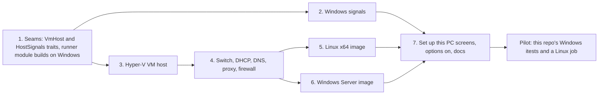

# CI runners on a Windows PC: design proposal

Status: **proposed 2026-11-11, waiting on Philip.** Issue [#2553](https://github.com/nekko-labs/nekko-agent/issues/2553). Decision record: [0082](../docs/decisions/0082-ci-runners-on-windows-use-hyper-v.md). Spec: [CI runners](../spec/automation/ci-runners.md#runner-options).

## The ask

> in the CI runners, let's show the different runner options, but have the apple ones disable when not on a mac. A windows machine should be able to do the windows and linux builds, run verification flows, etc.

The options half shipped with #2554: every computer lists macOS, Linux and Windows, and greys out what it cannot run. This report is the other half: the engine that lets a Windows PC take `Windows` and `Linux` x64 jobs (this repo's desktop builds, the Windows itests, the hidden renderer checks, the Rust tests) in throwaway VMs.

## What stays the same

Everything the Mac runner promises ([decision 0022](../docs/decisions/0022-ci-runners-vm-and-network.md)) holds on a PC:

- One job per fresh VM, deleted afterward. Job code never runs on the host.
- No host folders, clipboard or credentials in the guest. The job's single-use credential arrives on a read-only seed disk.
- The guest reaches the public internet only: never the LAN, the host, Tailscale, or anything behind a VPN.
- Your work comes first: the same priority modes and gates. Off and Pause all automations delete every VM within seconds.
- The supervisor, slots, providers (GitHub, GitLab), audit log, job lists, live log and UI are shared code. Only the VM host, the host signals and the image builders are new.

## Choices

### Virtualization: Hyper-V

| Option | Verdict |
| --- | --- |
| **Hyper-V** (built into Windows 11 Pro, Enterprise and Education) | **Chosen.** Real VMs with their own kernels, differencing disks for cheap clones, Gen 2 UEFI guests for both Windows and Linux, scriptable from PowerShell or WMI, no third-party install. |
| Windows Sandbox | Throwaway by design, but it boots a copy of the *host's* Windows (no golden image with our tools), allows one instance on most builds, and its NAT reaches the LAN with no filter we control. |
| WSL 2 for Linux jobs | Every distro shares one utility VM and kernel, mounts the host's drives by default and shares its network. Not a boundary for untrusted jobs. |
| VirtualBox / VMware | Third-party installs and licenses; they also fight Hyper-V for the hypervisor. |

Windows Home has no Hyper-V: once the engine lands, the options there will stay greyed with "Needs Windows Pro or Enterprise".

### Permission: the Hyper-V Administrators group

`nekkod` runs as the user, unelevated. Members of the local **Hyper-V Administrators** group can create, start and delete VMs and virtual switches without elevation. Setup asks once, through a UAC prompt, to add the user to that group and to install the firewall rules below, then asks them to sign out and in. Nothing else ever elevates. This is a new permission, so it waits on Philip's approval (standing rule).

### Guest network: an Internal switch and an explicit filtering proxy

On a Mac, `nekko-vm` hands each guest NIC's raw frames to a userspace NAT inside `nekkod`. Hyper-V has no equivalent attachment: a VM NIC is always on a virtual switch. Getting raw frames would take a packet driver (Npcap, WinDivert), a third-party kernel install we want to avoid.

Proposal:

1. One **Internal** virtual switch, `Nekko Runners`, on a fixed private subnet (`10.233.0.0/24`, the Mac guests' subnet). The host's vNIC on it is the gateway, `10.233.0.1`. No `NetNat` is created and Windows does not forward between interfaces by default, so packets addressed beyond the gateway go nowhere.
2. `nekkod` listens on the gateway address only: DHCP, DNS (forwarded to the physical interface's resolvers, with the Mac NAT's resolver rules) and an **HTTP CONNECT proxy**. The proxy resolves each destination itself and applies exactly the Mac NAT's deny list after DNS: public unicast only, never RFC 1918, CGNAT, link-local, multicast or any host or on-link address. Host sockets are bound to the physical interface (`IP_UNICAST_IF`), so VPN routes never carry job traffic, as on the Mac.
3. **Firewall rules** scoped to the switch's vNIC block inbound to every other host port on that interface. Windows Firewall lets a block beat any allow, so the rules block port ranges that exclude ours rather than block all and allow ours.
4. The images set the proxy for everything that honors it: `HTTPS_PROXY`/`HTTP_PROXY`, WinHTTP, Docker's daemon config, apt, the Actions runner (which reads the variables).

| Option | Verdict |
| --- | --- |
| **Internal switch + filtering proxy** | **Chosen.** No third-party driver; the host enforces it (no route, no NAT, firewall); fails closed. Cost: a tool that ignores proxy settings gets no network, which is visible and safe. |
| External switch, filter in the guest | The guest is untrusted, so its own firewall is no boundary. Rejected. |
| Internal switch + `NetNat` + Windows Firewall outbound rules | Windows Firewall does not filter NAT-forwarded traffic reliably, and the rules could not follow DNS answers. Rejected. |
| Packet driver + the Mac's userspace NAT | Same filter code on both hosts, but a third-party kernel driver and its license. Kept as the fallback if the proxy proves too leaky for real jobs. |
| Hyper-V Firewall (`New-NetFirewallHyperVRule`) | Documented for WSL and containers; its coverage of plain Hyper-V VMs needs checking before we lean on it. Possible later hardening, not the boundary. |

### Seeds and logs

- The JIT runner config (or GitLab toml) goes on a small **ISO** that `nekkod` writes, attached as a read-only DVD drive, as Linux guests on a Mac already do.
- The guest console goes to a host named pipe (`Set-VMComPort`), read into `vms/<name>/console.log` with the Mac's 1 MB cap. The live log and VM log work unchanged.

### Images

| Guest | Source | Build |
| --- | --- | --- |
| **Linux x64** | Canonical's Ubuntu 24.04 cloud image for Azure (a VHD), checked against `SHA256SUMS` | Convert to VHDX, boot once with a NoCloud seed (cloud-init installs Docker, git, build tools and the pinned runner, then disables itself), power off. Same script as the Mac's Linux image where it can be. |
| **Windows x64** | **Windows Server 2025 evaluation** (Philip, 2026-11-11), from Microsoft's Evaluation Center | Unattended install from the ISO with an `autounattend.xml` on a second ISO, then a provisioning script: a standard `runner` user with auto-logon, the pinned Actions runner, Git, Node, Rust, Visual Studio Build Tools; RDP, WinRM and SMB off. No sysprep: clones share the image's evaluation clock. |

The evaluation runs 180 days from the image's install. The image records its install date, the runner card warns 14 days before expiry, and **Rebuild image** starts a fresh one. Open: the evaluation license is for evaluation, not production use. Running our own CI on it is the kind of use it allows in spirit, but this needs a read of the license text before launch (as the Mac's [Apple license](../spec/automation/ci-runners.md#apples-license) section does).

### Host signals

| Gate | Windows source |
| --- | --- |
| Your activity | `GetLastInputInfo` |
| Power and battery | `GetSystemPowerStatus` |
| CPU, memory (minus job VMs) | `GetSystemTimes`, `GlobalMemoryStatusEx`, the VMs' own `vmmem` processes |
| Free disk | `GetDiskFreeSpaceExW` on the data folder's volume |
| Trusted network | The default gateway's MAC (`GetIpNetTable2`) |
| VPN | A tunnel adapter leading the default route (`GetAdaptersAddresses`, `GetBestRoute2`) |
| Heat, Low Power Mode | Not available: those gates are left out, said in settings |
| Security updates | Deferred: no gate in the first version |

## Labels

A PC registers `self-hosted, Windows, X64, <label>-windows` and `self-hosted, Linux, X64, <label>-linux`. Mac Linux VMs stay `ARM64`, so an x64 job never lands on a Mac and an ARM64 job never on a PC.

## Build order

Each layer is a PR with its own tests; the options UI turns a kind on only when the daemon reports it (`guests`), so nothing lights up early.

## Questions for Philip

1. Approve the Hyper-V Administrators group step and the firewall rules (a one-time UAC prompt)?
2. Approve the proxy-only guest network, accepting that tools ignoring proxy settings get no network?
3. The evaluation license question above: fine for the pilot, read before launch?
