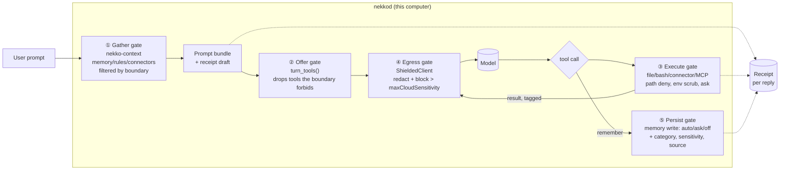
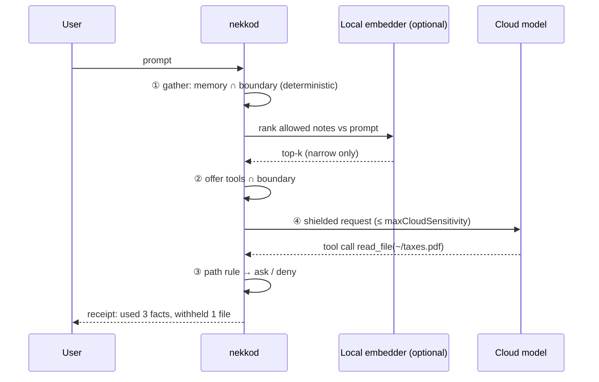

# Data Boundaries: restrict and reveal what the agent knows about you (design, 2026-10-23)

Status: **proposal**, not implemented. No spec file yet; one would go in `spec/context/data-boundaries.md` with the first implementation PR.

## 1. The ask

Two related capabilities:

1. **Restrict.** A per-chat *mode* that limits what the agent can reach and learn about the user: memory, files, shell commands, connectors and MCP, environment facts, and what leaves the computer.
2. **Reveal.** Show the user what the agent has learned about them (the profile), and what it actually *used* in each reply (receipts).

Plus two questions: does anyone else ship this, and do we need a pre-model that analyzes the prompt first?

## 2. What already exists (build on it, don't fork it)

| Piece | Where | What it already does | Gap for this feature |
| --- | --- | --- | --- |
| Privacy Shield | `crates/nekko-privacy`, `ShieldedClient` ([decision 0003](../docs/decisions/0003-pseudonymize-private-values-at-the-model-client.md)) | Pseudonymizes PII and secrets at the model-client seam; restores them on the way back | Pseudonymizes values in content it is given, but does not decide *which* content is gathered |
| Memory scope | `Session.memory` = `all \| project \| off`, `MemoryScope` in `nekko-context/gather.rs` | Per-chat memory read scope; incognito reads none | No per-category or per-note control; no write approval; no provenance |
| `remember` tool | `nekko-turn/src/plan.rs` | Agent saves facts about the user; a card shows each save | Writes immediately; nothing enforces "no secrets" except the model's own judgment |
| Context Inspector | Breakdown panel | Engine-built list of what enters the *next* prompt | Not persisted per reply; does not cover what tools read mid-turn |
| Guardrails | `nekko-tools/guardrails.rs` ([decision 0010](../docs/decisions/0010-guardrails-mode-auto-runs-only-read-only-commands.md)) | Read-only allowlist with a strict shell lexer | Only judges *what a command does*, not *which data it touches* (`cat ~/taxes.pdf` is "read-only") |
| Workspace jail | file tools | Confines file tools to the chat's folders | `bash` and background processes are unconfined; they also inherit the full daemon environment |
| Container sandbox | `crates/nekko-sandbox` | Docker, no network, `.env*` stripped from the copy | Heavy; needs Docker |
| Saved modes | `SavedMode`, Mode panel | One-click bundles of per-chat settings | Bundles exist, but nothing locks a bundle; automations created by the daemon don't apply the default mode |

**Conclusion:** most of the *enforcement points* already exist. What's missing is (a) one policy object that drives all of them consistently, (b) data-sensitivity awareness (which files and memory notes are sensitive, as opposed to which commands are risky), and (c) the reveal half.

## 3. Market scan

| Product | Restrict | Reveal | Enforced where |
| --- | --- | --- | --- |
| **ChatGPT** | Saved memories and chat-history reference toggles; Temporary Chat; "Don't mention this again" | Memory summary page; per-response **sources** (book icon) showing which memories or past chats shaped the reply, with a stated caveat that it may not show every source | Server, coarse |
| **Claude.ai** | Incognito; "Search and reference chats" toggle; project-scoped memory; memory off by default on Team/Enterprise | Settings → Memory, grouped by topic; view, edit, delete | Server, coarse |
| **Claude Code** | `permissions.deny` (e.g. `Read(./.env)`), sandboxed bash, MCP allow-lists | None for personal data | Client, path-level, per project |
| **Gemini Personal Intelligence** | Opt-in per connected app (Gmail, Photos…); off per chat; regenerate without personalization | "Attempts" to cite which connected sources it used | Server |
| **Microsoft 365 Copilot + Purview** | Admin DLP on prompts, sensitivity labels limit grounding sources, Agent 365 identity | Admin DSPM / audit, not for end users | Tenant admin policy |
| **Cursor** | Privacy Mode (retention); `.cursorignore` blocks the agent's file tools, but terminal and MCP bypass it | None | Client, partial |
| **Perplexity** | Memory on/off, incognito, delete memories | Memory list; users can't choose what gets saved | Server, coarse |
| **Research: CaMeL (DeepMind)** | Capability tags on every value (provenance plus allowed uses); policy checked at each tool call | Provenance is inherent | Interpreter around the LLM |

**Takeaways**

- Consumer assistants (ChatGPT, Claude, Gemini, Perplexity) have converged on the **reveal** pattern (a memory list plus "what this answer used") and **coarse** restrict switches: memory on/off, incognito, per-connector.
- Developer tools offer **path deny-lists**, and every one of them has the same hole: the shell bypasses the file-tool deny.
- Enterprise (Purview) does real **label-based DLP**, but it's admin-facing, not "me controlling what my agent knows about me".
- **Nobody ships a user-facing, enforced, per-chat data policy** that spans memory, files, shell, connectors and model egress, with receipts. Nekko can, because it's local-first and the daemon owns every seam: context gathering, tool offer, tool execution, model client and memory writes. That fits the existing Shield, Context Inspector and Guardrails story.

## 4. Proposed design

### 4.1 Concept: a Boundary is a compiled, locked policy

A **Boundary** is a named preset (or custom policy) that a chat runs inside. It is *not* a new parallel system. It **compiles down** to the per-chat fields that already exist (`memory`, `disabledTools`, `disabledConnectors`, `disabledMcpServers`, `privacy`, approvals), plus a few new ones. Unlike a saved mode, it is:

- **Locked for the agent:** no tool, sub-agent, workflow or automation can widen it. Children inherit it (fix the daemon-created-session gap).
- **Narrow-only against Settings:** like per-chat switches today, it never grants what Settings disallows.
- **Enforced deterministically** at each seam. The system prompt *explains* the boundary, but never *is* the boundary.

```ts
// packages/shared/src/data-boundary.ts (proposed)
export type Sensitivity = 'public' | 'personal' | 'sensitive' | 'secret';

export type MemoryCategory =
  | 'identity' | 'work' | 'preferences' | 'people'
  | 'health' | 'finance' | 'location' | 'other';

export interface DataBoundary {
  id: string;                       // 'open' | 'work' | 'need-to-know' | 'lockdown' | custom uuid
  name: string;
  memory: {
    read: 'all' | 'project' | 'off' | { categories: MemoryCategory[]; maxSensitivity: Sensitivity };
    write: 'auto' | 'ask' | 'off';  // 'ask' = pending-memory queue the user approves
    crossChatSearch: boolean;
  };
  files: {
    deny: string[];                 // globs, never readable (e.g. '**/.env*', '~/.ssh/**')
    askBeforeRead: string[];        // globs, readable only after approval ('~/Documents/Finance/**')
  };
  commands: 'guardrails' | 'read-only' | 'sandbox-only' | 'none';
  connectors: { allow: string[] | 'all' };   // by connector kind
  mcp: { allow: string[] | 'all' };          // by server id
  environment: {
    scrubEnv: boolean;              // allow-list env vars passed to bash/processes
    hideIdentity: boolean;          // username, hostname, timezone/locale out of prompt + Shield-hidden in paths
  };
  egress: {
    shield: 'off' | 'redact';
    maxCloudSensitivity: Sensitivity; // anything tagged above this never reaches a cloud model
  };
}
```

**Starter presets** (each is a row the user can clone and edit):

| Preset | Memory read / write | Files | Commands | Connectors | Egress |
| --- | --- | --- | --- | --- | --- |
| **Open** (today's default) | all / auto | jail + default deny (`.env*`, `~/.ssh`, keychains) | guardrails | all | shield per setting |
| **Work** | `work`, `preferences` / ask | + deny `~/Documents/Personal/**` | guardrails | work kinds only | redact |
| **Need-to-know** | off / off | attached files + workspace only | read-only | none | redact, cloud ≤ `personal` |
| **Lockdown** | off / off | attached files only | none (or sandbox-only) | none | local model only |

### 4.2 Where it's enforced: five gates



| Gate | Code seam | Enforcement |
| --- | --- | --- |
| ① Gather | `nekko_context` (`list_memory`, `project_guidance`, connector gather) | Memory filtered by category and sensitivity; connectors by allow-list; `hideIdentity` drops username and timezone from `PromptContext` |
| ② Offer | `nekko_turn::plan::turn_tools` / `scope.rs` | Same shape as `chat_mcp_tools`: add `chat_boundary_tools(tools, boundary)`. `remember` absent when `write: off`; `bash` absent when `commands: none` |
| ③ Execute | `nekko-tools` (file tools, `bash.rs`, `process.rs`), connector and MCP calls | Path deny for **both** file tools and bash (see 4.4); env allow-list; `askBeforeRead` uses the existing approval UI |
| ④ Egress | `nekko-privacy` `ShieldedClient` | Existing redaction, plus a **sensitivity ceiling**: content tagged above `maxCloudSensitivity` is withheld (replaced with a `[WITHHELD: sensitive file]` stub) or the turn is routed to a local model |
| ⑤ Persist | `remember` handler in `nekkod/src/turns.rs` | `auto` / `ask` (pending queue) / `off`; a local secret detector (reuse `nekko-privacy::detect`) **refuses** saves containing secrets: that rule is enforced, not just written in the tool description |

### 4.3 Reveal: the profile and per-reply receipts

**Memory provenance.** Extend the memory frontmatter (it already carries `tags`, `createdAt`, `updatedAt`):

```md
---
id: m_7f3a
title: Lives in Japan
scope: global
category: location
sensitivity: personal
source: session_01Q…#turn-14        # chat and turn where it was learned
learnedBy: remember                  # remember | user | import
lastUsedAt: 1761200000000
useCount: 12
---
Lives in Japan with permanent residency.
```

**"What Nekko knows about you"** (the Memory tab, grouped by category): each fact shows where it was learned (link to the chat turn), when it was last used, how many replies used it, and a sensitivity chip. Actions: edit, delete, *never use in cloud chats* (sets `sensitivity: sensitive`), and *don't learn this kind of thing* (a category-level write block).

**Per-reply receipt**, persisted in the transcript (ids and hashes only, no content duplicated):

```ts
interface ReplyReceipt {
  boundaryId: string;
  memory:      { id: string; title: string }[];
  guidelines:  { path: string }[];
  files:       { path: string; via: 'attached' | 'read_file' | 'grep' | 'bash' }[];
  connectors:  { kind: string; items: number }[];
  environment: ('os' | 'timezone' | 'username' | 'cwd')[];
  shielded:    Record<string, number>;          // counts by kind, never values
  withheld:    { kind: 'memory' | 'file' | 'connector' | 'tool'; ref: string; reason: string }[];
  learned:     { memoryId: string; status: 'saved' | 'pending' | 'refused' }[];
}
```

The UI is a small **"Used 3 facts · 2 files"** chip under each reply, which expands into the receipt. **Withheld** is the part competitors don't show: "this reply ran without your *finance* notes and without `~/taxes/2025.pdf` because of the *Work* boundary". It turns an invisible restriction into something the user can trust and adjust.

**Honesty clause** (the same caveat ChatGPT states): a receipt lists what the agent was *given*. It can't list what the model *inferred* (for example, guessing your location from a path). Say so in the UI.

### 4.4 The hard part: `bash` reads around file rules

Every competitor's path deny-list leaks through the shell, so we should solve this explicitly. Options:

| Option | How | Pros | Cons |
| --- | --- | --- | --- |
| **A. Path-aware lexer** | Extend the Guardrails reader: every path-like argument of an allowed command is resolved (links followed, as the workspace jail does) and checked against `deny` / `askBeforeRead`; anything unreadable → ask | Reuses the existing strict lexer; no new dependencies; works on all OSes | Not a real boundary: an approved `npm test` can still read anything |
| **B. OS sandbox for bash** | Landlock (Linux), Seatbelt `sandbox-exec` (macOS), AppContainer (Windows): deny-path rules enforced by the kernel | Real enforcement, including for approved commands and child processes | Three platform implementations; macOS sandbox-exec is deprecated-but-working |
| **C. Docker sandbox** | Existing `nekko-sandbox` | Already built and hardened | Needs Docker; heavy for everyday chats |
| **D. No shell** | `commands: none` | Trivially correct | Limits what the agent can do |

**Recommendation:** use A in every boundary (cheap, and it catches the common case), use D in Lockdown, and use B as a phase-3 hardening that replaces A's "best effort" with kernel enforcement. Also, **scrub the environment** now (env allow-list in `bash.rs` / `process.rs`), since today bash inherits every secret in the daemon's environment.

### 4.5 Sensitivity labels: where they come from

Enforcement needs labels on files and memory. Sources, cheapest first:

1. **User rules:** globs in the boundary, plus a "sensitive folders" list in Settings.
2. **Deterministic detectors:** the existing `nekko-privacy::detect` (cards, My Number, keys) marks a file or note as `secret` when it matches.
3. **Defaults:** `.env*`, `~/.ssh`, `~/.aws`, `~/.gnupg`, keychains, browser profiles, password-manager exports.
4. **Local classifier (optional, see §5):** categorizes memory notes *at write time*.

Labels on **tool results** (which make this a light version of CaMeL): a tool result inherits the highest label of the data it read. Gate ④ checks that label before the result is sent to a cloud model. That stops an "agent reads `taxes.pdf`, then the next request ships it to the cloud" flow even when the read itself was approved.

## 5. Do we need a pre-model to analyze the prompt?

**Short answer: not for enforcement. Optionally, yes, as a local, narrow-only helper.**

| Role for a pre-model | Verdict | Why |
| --- | --- | --- |
| **Decide what's allowed** (the gate) | ❌ Don't | An LLM gate is probabilistic and can be prompt-injected; the boundary must hold even when a model is fooled. Decision 0010 is the same lesson learned for commands. |
| **Classify memory at write time** (category, sensitivity) | ✅ Recommended | Off the hot path (runs once per `remember`), cached in frontmatter, and the user can see and correct it. A 1–3B local model is plenty. |
| **Need-to-know relevance** (pick which *allowed* notes this prompt needs) | ✅ Optional | It can only **narrow** a set the policy already allows, so a wrong answer costs quality, not privacy. Use **embeddings** (milliseconds) rather than an LLM; it also saves tokens. |
| **PII/NER in prose** (Shield phase 2) | ✅ Already planned | A local NER model catches names and addresses that regex misses. |
| **Injection / jailbreak screening** (Prompt Guard style) | ➖ Later | Useful as telemetry on *tool results*, not on the user's own prompt. It still can't be the security boundary. |
| **Any cloud pre-model** | ❌ Never | It would see exactly what we're keeping in (decision 0003). |

Design rules if one is added:

- **Narrow-only:** its output is intersected with the policy, never unioned.
- **Fail to policy:** if it's slow or broken, the turn proceeds on the deterministic boundary alone. Fail closed for memory selection (send the policy-allowed set only if relevance is unavailable, or none in Need-to-know); never fail open.
- **Local only:** reuse the local Model Server infrastructure (`nekko-decide`, local worker delegation).
- **Budget:** under 50 ms for embeddings on the hot path; LLM classification only on writes.



## 6. Phasing

| Phase | Scope | Size |
| --- | --- | --- |
| **1. Reveal first** | Memory provenance frontmatter; `remember` writes `source`; per-reply receipt (gather + tool reads); "Used N" chip; profile view with last used and use count | M. Mostly plumbing what Context Inspector already computes. Lowest risk, highest trust payoff. |
| **2. Boundary v1** | `DataBoundary` type, four presets in the Mode panel's Privacy column; gates ①②⑤ (memory categories, tool offer, `remember` ask/off and refusing secrets); env scrub; inheritance by sub-agents and automations; receipts show *withheld* | M–L |
| **3. Files and shell** | `deny` / `askBeforeRead` in file tools, plus the path-aware lexer for bash (option A); default sensitive-path list; tool-result labels | L |
| **4. Egress ceiling** | Gate ④ sensitivity ceiling, withheld stubs, auto-route to a local model | M |
| **5. Hardening** | Write-time local classifier; embedding relevance; OS sandbox for bash (option B); phone allow-list support | L |

## 7. Open questions and edge cases

- **Claude Agent chats** are run by Claude Code, so our gates don't apply. Options: write a generated `.claude/settings.json` `permissions.deny` plus `sandbox` for the chat, or refuse non-Open boundaries for Claude Agent chats and say so (the same honesty as the Shield panel).
- **Prompt cache:** changing a boundary mid-chat changes the system prefix. Acceptable; say so in the UI.
- **Tightening mid-chat:** content the model has already seen in this chat stays in its context. Offer "fork this chat under the new boundary" (or compact without the withheld items).
- **Sync:** boundaries and labels ride E2EE sync, like saved modes; receipts stay with the transcript.
- **Naming:** "Boundary" vs "Data mode" vs "Need-to-know". It should sit in the composer's privacy row next to Offline · Shield · Incognito.

## Sources

- OpenAI, [How does memory use past conversations](https://help.openai.com/en/articles/10303002-how-does-memory-use-pastconversations) and [Memory and new controls](https://openai.com/index/memory-and-new-controls-for-chatgpt/)
- Anthropic, [Memory announcement](https://www.anthropic.com/news/memory), [Managing memory in Claude](https://support.claude.com/en/articles/11817273-managing-memory-in-claude), [VentureBeat on Team/Enterprise memory and incognito](https://venturebeat.com/ai/anthropic-adds-memory-to-claude-team-and-enterprise-incognito-for-all)
- Google Gemini Personal Intelligence: [Search Engine Land](https://searchengineland.com/personal-intelligence-with-gemini-connect-your-searches-email-photos-and-youtube-history-467521), [gend.co](https://www.gend.co/blog/google-personal-intelligence-expands-empowering-more-users)
- Microsoft Purview for agents: [Atlan](https://atlan.com/know/microsoft-fabric/purview-controls-for-ai-agents/), [Zero Trust workshop: DLP for agent grounding](https://microsoft.github.io/zerotrustassessment/docs/workshop-guidance/AI/AI_179), [M365 Copilot memory (Message Center)](https://mc.merill.net/message/RM551195)
- Cursor: [forum on `.env` and `.cursorignore`](https://forum.cursor.com/t/env-file-question/60165), [Privacy Mode GDPR guide](https://www.gradually.ai/en/cursor-gdpr/)
- Perplexity memory: [MemoryPlugin blog](https://blog.memoryplugin.com/how-perplexity-memory-works/) (a competitor's write-up)
- CaMeL: [Defeating Prompt Injections by Design (paper)](https://css.csail.mit.edu/6.858/2026/readings/camel.pdf), [Simon Willison's commentary](https://simonw.substack.com/p/camel-offers-a-promising-new-direction), [InfoQ](https://www.infoq.com/news/2025/04/deepmind-camel-promt-injection)

Assumptions: the competitor details come from help pages and secondary coverage as of 2026-10; their menu paths and rollout states change often.
