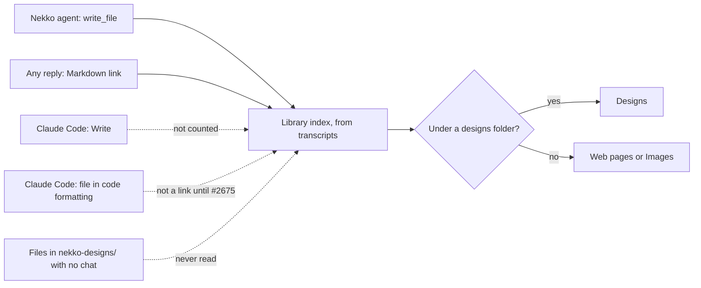
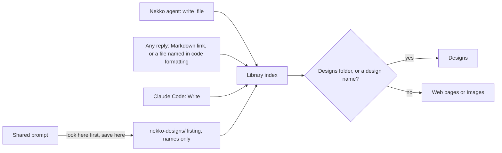

# Design canvases in Library, and how agents see and use them

2026-11-12. Issue #2677, decision [0089](../docs/decisions/0089-designs-are-files-in-the-projects-designs-folder.md).

## The request

> I noticed that claude designs aren't showing up under the library assets. we should be able to see canvas style designs in general, not just from claude. Let's make our canvas designs aware for agents to see and use, investigate our options for this, then implement

Read as three things:

1. Designs made in Claude Code chats are missing from Library. Find out why and fix it.
2. Library should show design canvases whoever made them. A design canvas here means one HTML file that lays several screens, states or options side by side, which is what Claude Code produces when asked for a design.
3. Agents, on any provider, should know where designs are so they can look at one and build from it.

## What was wrong

Checked against the 299 chats saved on one Mac (39 of them Claude Code chats).

| # | Cause | Evidence |
| --- | --- | --- |
| 1 | Library only counted `write_file` calls with a `path`. Claude Code records `Write` with a `file_path`. | 33 `Write` calls in the Claude Code chats, 0 listed. Two were HTML designs: `reports/ios-connection-strip-design.html`, `.scratch/provider-import-mockup.html`. |
| 2 | Library's other source is Markdown links in replies. Claude Code names files in code formatting instead. | "Design mock is done (\`reports/ios-connection-strip-design.html\`)". #2675 landed while this was in review and counts a page, image or PDF named that way as a link, so such a design is now listed, under Web pages. A design the reply never names still was not. |
| 3 | Only files under `nekko-designs/`, `design(s)/`, `mockup(s)/` or `prototype(s)/` counted as Designs. | Both designs above sit in `reports/` and `.scratch/`, so even once listed they would be Web pages. |
| 4 | Library only knew chats. | A design saved by the Design tab, a person, or a tool outside the app has no chat, so it never appeared. |
| 5 | Nothing told an agent where designs are. | The shared prompt said to save designs in `nekko-designs/`, not to look there. Claude Code chats do not get Nekko's prompt at all. |

How a design reached Library before, and what was missing:

## Options

| Option | What it is | For | Against |
| --- | --- | --- | --- |
| 1. Fix the index | Count Claude Code's `Write`; file a page or image as a design when its name says so. | Small, renderer only, fixes the report. | Nothing for designs with no chat. Nothing for agents. |
| 2. The designs folder is the contract | `nekko-designs/` is where designs live. Library lists the folder; the prompt tells agents to read and save there. | No new tool or store. Works for every provider, every harness and tools outside the app, because all of them can read and write files. | Agents see files only, not the Design board's notes. An agent that does not get the prompt (Claude Code) learns the folder from the project's own instructions. |
| 3. A `designs` tool | Engine tool to list and read designs (and notes), offered to Claude Code through the bridge. | Agents can ask what exists, wherever it was saved. Reaches Claude Code where policy allows. | The index lives in the renderer today and would have to move into the engine. Needs a Claude policy row, approval rules and fixtures. The largest change. |
| 4. An open canvas format | Make JSON Canvas, tldraw or Excalidraw the design type. | Portable, editable in other tools. | Models lay out poorly by coordinates; the app needs a renderer and editor; it cannot hold a working prototype. |
| 5. Import from Claude | Pull designs from Claude Design or claude.ai artifacts. | The person's existing Claude work appears. | No API to list a person's artifacts. Standalone Claude Design closes 2026-12-14. Claude only. |
| 6. Design board as the hub | The board adopts whatever is in the folder and follows edits; Library reads the board. | One place for people; fixes the board forking from its files. | The board is experimental and its store is in the engine with frozen fixtures. Worth doing, but it is not what makes designs visible. |

## Recommendation, and what was built

Options 1 and 2 now, 6 next (#2680), 3 after that (#2681).

A design stays an ordinary file. That is the one thing every model, harness and outside tool already shares, so nothing has to be kept in step, and it keeps Library's rule that no file is opened until it is picked.

Built in this change:

- **Library counts files Claude Code wrote.** `Write` is treated like `write_file`. Source folders, project housekeeping files and an agent's own notes under `.claude/` stay out. `Edit` and `Read` do not list a file.
- **Designs by name.** A page or image named `…design`, `…mockup`, `prototype`, `…wireframe`, `…concept`, `…canvas` (whole words, singular or plural) is a Design wherever it sits.
- **Library lists each project's `nekko-designs/` folder**, one level of subfolders deep, names only, up to 300 files. A design no chat mentions shows "<project> designs folder" in place of a chat and opens with **Open file**.
- **Agents are told.** One line in the shared prompt: designs live in `nekko-designs/` unless the project has its own convention; list it and build from a design that covers the work; save each new design there as one self-contained HTML file with its screens side by side (a design canvas); revise by editing the file. It costs 121 tokens per turn by the context fixture's count.

After, on the same data:

## What this does not do

- **Claude Code chats are not told about the folder by Nekko.** They follow the project's `AGENTS.md` or `CLAUDE.md`. A project that wants them to use the folder says so there. Fixing it in the app is option 3, or a context note where the Claude policy allows one (#2681).
- **Files Claude Code changes with `Edit` are not listed**, the same as `edit_file` today.
- **Designs outside the folder are found through their chat only.** The name rule files them correctly, but another agent will not find `reports/checkout-design.html` unless told.
- **A design in a chat's own worktree** is found through its chat, not through the folder listing, which looks at the saved project folder.
- **The Design board does not follow the folder yet** (#2680): an agent's new design does not appear on it, and an agent's edit to a concept's file is not shown.
- **Folder designs have no date.** The folder listing returns names only, so they sort after chat-made designs.

## Assumptions

- "Claude designs" means designs made in Claude Code chats inside Nekko Agent. The saved chats contain no call to Claude's Artifact tool, so there were no claude.ai artifacts to list.
- "Canvas style designs" means HTML design canvases, not a vector canvas file format. Option 4 covers the other reading.
- "Our canvas designs" means the designs Nekko Agent holds for a project: the files in `nekko-designs/`, which is also where the Design tab writes its concepts.

## Sources

- Library index: `apps/desktop/src/renderer/artifactsIndex.ts`, `views/ArtifactsView.tsx`.
- Claude Code tool calls as saved: `crates/nekko-harness/src/map.rs` (`tool_call`), and the saved chats under the app's data folder.
- Design board: `crates/nekko-workspace/src/design.rs`, `apps/desktop/src/renderer/views/DesignBoardView.tsx`, `packages/shared/src/design.ts`.
- Prompt: `crates/nekko-context/src/prompt.rs`. Bridge tools and policy: `crates/nekkod/src/harness.rs`, `claude_policy.rs`.
- Specs: `spec/desktop/library-and-first-visit-guide.md`, `spec/code/rich-responses-reports-and-design-workspace.md`, `spec/code/designing-draw-it-or-describe-it-design-tab.md`.
