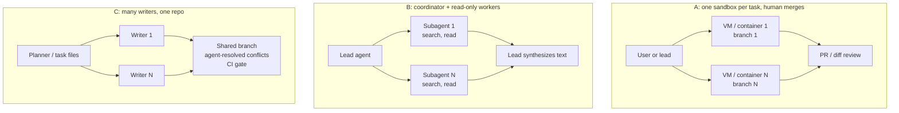
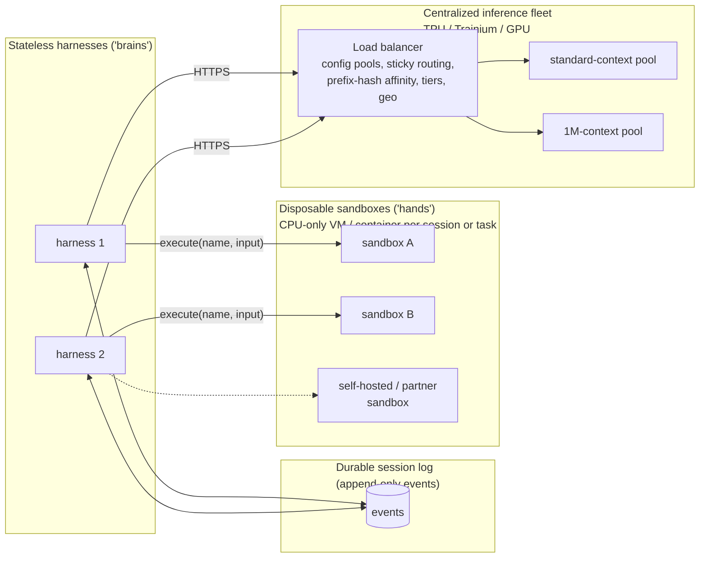
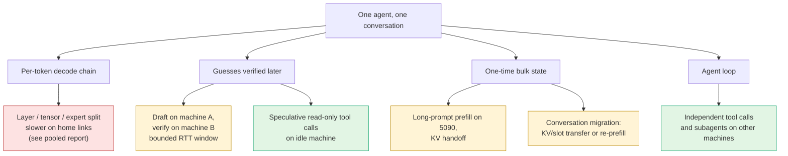
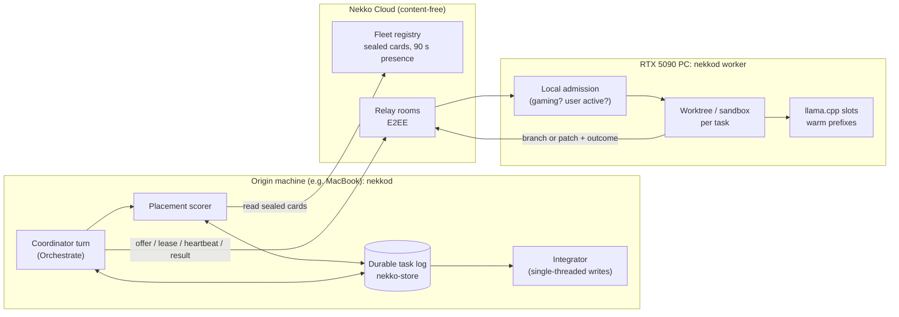
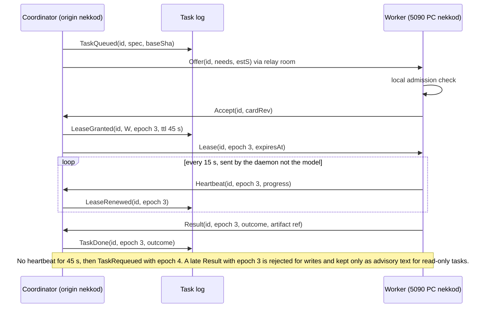
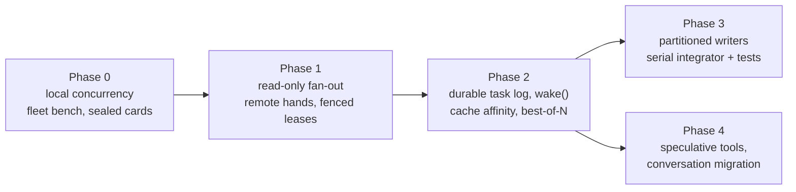
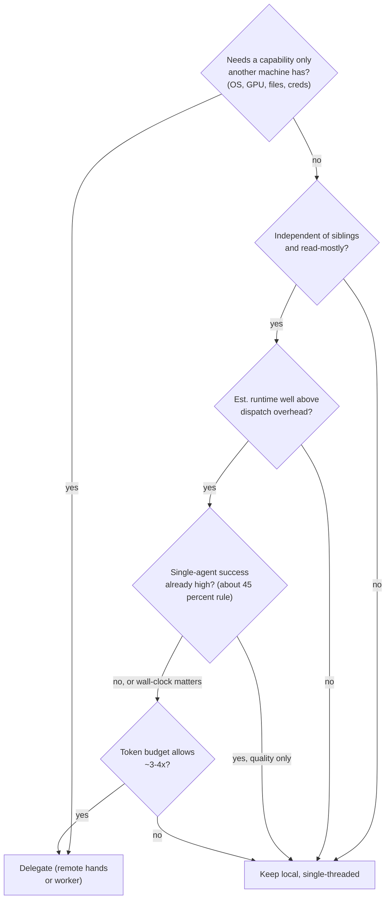

# Delegate tasks across the fleet, never tokens

**Others have built multi-machine agent delegation, but not the version Nekko is planning.** Cursor, Anthropic, OpenAI Codex, GitHub Agent HQ, Manus and Moonshot Kimi all fan one job out to many isolated cloud machines. A handful of young open-source tools (Sidefleet, apra fleet, cmesh) send tasks to a user's own Tailscale-connected computers. **No shipping product pairs an LLM coordinator that decomposes one task with placement onto the user's own mixed machines by capability.** That combination is the gap Nekko's Fleet would fill. The benchmarks show a sharp split. Breadth-first, read-heavy work improves: Anthropic reports **+90.2%** on its internal research eval [vendor], Google/MIT report **+80.9%** on parallelizable finance tasks [academic], and Kimi reports **up to 4.5x** faster wall-clock [vendor]. Those gains cost roughly **3-4x the tokens of a single agent**. Sequential work gets worse: **−39% to −70%** on sequential planning. Independent agents amplify errors **17.2x**, against **4.4x** when a central coordinator checks their work. Anthropic and OpenAI do not spread an agent across VMs by capacity. They run **one disposable CPU-only sandbox per session or task** and **centralize inference** on a separate accelerator fleet. That fleet is routed by configuration pools, sticky sessions and prompt-prefix hashes. One agent's token stream cannot be split into packets: decode is a strict serial chain. The parts of a single agent that can be split are whole subagents, *guesses* (speculative drafts and tool calls) and one-time bulk state (KV cache, long-prompt prefill). The measured single-agent gains from loop-level parallelism are **1.2-1.35x**. Nekko should build Fleet in this order: capability cards and measurement, then read-only fan-out and remote tool execution under fenced leases, then a durable session log with cache-affinity routing, and parallel writers last, behind a single-threaded integrator. On a two- or three-machine fleet the payoff is **capability and locality** (the GPU, the OS toolchain, the files and credentials that live on one machine), not raw parallelism.

Research date: 2026-11-28. Related: #2800. This report extends [Pooling compute across fleet computers](./pooled-fleet-compute-options-2026-11-14.md), which covers splitting one local model across the fleet: llama.cpp RPC, exo, MLX, DGX Spark and the network-latency math. That report concluded that layer and tensor splits make decode *slower* on home links and pay only for models that fit on no single machine. That material is linked here, not repeated.

**How to read the numbers.** Every figure carries a label. **[V]** means self-reported by the vendor that built the system. **[A]** means an academic paper or preprint. **[I]** means an independent third-party measurement. **[E]** means an estimate from this report's own arithmetic, not a measurement. **[S]** means the figure rests on search-result snippets because the primary page could not be reached. During research, **arxiv.org, cursor.com, research.google and developers.openai.com were unreachable**, as were blog.exolabs.net, simonwillison.net and superagent.sh. Cursor's architecture and throughput claims, the Google/MIT scaling paper's numbers, most 2026 arXiv preprints and OpenAI's Codex and prompt-caching docs therefore come from snippets and secondary coverage, not full-text reads. Anthropic's engineering posts were read in full.

## Cloud vendors fan out routinely; nobody targets the user's own machines

The idea is not new. What is new is the setting Nekko proposes. Commercial systems that delegate parts of an agent's work to other machines fall into three architectures. They differ mainly in where writes happen and how results come back.



| System | Unit placed on a machine | Coordination | Merge-back | Machines |
| --- | --- | --- | --- | --- |
| OpenAI Codex cloud | One task, or one of N attempts | User assigns | Human reviews diff/PR, picks the best attempt | Vendor cloud sandbox per task ([OpenAI](https://openai.com/index/introducing-codex/)) |
| GitHub Agent HQ / Copilot coding agent | One task per agent | "Mission control" dashboard | Designated branches, PR | Vendor cloud ([GitHub](https://github.blog/news-insights/company-news/welcome-home-agents/)) |
| Cursor cloud agents, `/in-cloud` | One agent per VM and branch | Local desktop app delegates | Branch/PR | Vendor cloud VM ([Cursor talk](https://claude.com/code-with-claude/session/sf-giving-coding-agents-their-own-computers-how-cursor-built-cloud-agents); [changelog, S](https://cursor.com/changelog/cloud-in-agents-window)) |
| Anthropic Research | Subagents (search) | Opus lead, Sonnet workers | Lead synthesizes text | Vendor ([Anthropic](https://www.anthropic.com/engineering/multi-agent-research-system)) |
| Manus Wide Research | ~100 full Manus instances, each with its own VM | Controller only; subagents never talk | Controller synthesizes | Vendor cloud ([Manus](https://manus.im/blog/manus-wide-research-solve-context-problem)) |
| Kimi K2.5 Agent Swarm | Up to 100 subagents | RL-trained orchestrator | Orchestrator synthesizes | Vendor ([tech report, S](https://arxiv.org/html/2602.02276v1)) |
| Claude Managed Agents | Specialist agents; sandboxes can be self-hosted | Lead delegates | Lead | Brain in Anthropic cloud, hands anywhere ([docs](https://platform.claude.com/docs/en/managed-agents/overview)) |
| Anthropic C compiler | 16 agents, one Docker container each | None: lock files in git | Pull, merge, push to shared upstream | One operator's infra ([Anthropic](https://www.anthropic.com/engineering/building-c-compiler)) |
| Cursor long-running experiment | Hundreds of workers | Recursive planners, judge | Same branch | Unknown whether one host or many ([S](https://cursor.com/blog/scaling-agents)) |

### The two most instructive experiments both needed oracles and hierarchy

Anthropic's C compiler run is the best-documented case of many parallel writers. **Sixteen Claude Opus 4.6 agents**, each in its own container, cloned a bare repo and claimed work by writing lock files such as `current_tasks/parse_if_statement.txt`. Git push ordering resolved races: the second claimant had to pick another task. There was **no orchestrator and no inter-agent channel beyond git**. Over about two weeks the run used **~2,000 sessions, ~2B input and 140M output tokens and just under $20,000** [V]. It produced a ~100k-line Rust compiler that builds Linux 6.9 on three architectures and passes ~99% of most test suites ([Anthropic](https://www.anthropic.com/engineering/building-c-compiler)). The lesson for Fleet is in the failures. Parallelism was easy while there were many independent failing tests. The Linux kernel build was one monolithic task, and "all agents hit the same bug and overwrote each other's fixes." The fix was to use GCC as a known-good oracle and shard files across agents. The post's own conclusion is that verifiers "must be nearly perfect" ([Anthropic](https://www.anthropic.com/engineering/building-c-compiler)). Its lock-file scheme is a lease with no expiry: a crashed agent's lock would linger, and the post does not say how stale locks were cleared.

Cursor's experiment runs the other way [V, S]. Flat peers with dynamic locking failed. Agents avoided hard problems, held locks too long and churned, and **20 agents delivered the throughput of 2-3**. The design that worked had a hierarchy: planners that recursively spawn sub-planners, workers that "don't communicate with any other planners or workers," and a judge that ends each cycle so the next one starts fresh. Hundreds of workers pushed to one branch "with minimal merge conflicts" for close to a week and produced a >1M-line, ~1,000-file browser ([Cursor, S](https://cursor.com/blog/scaling-agents); [ZenML summary](https://www.zenml.io/llmops-database/scaling-multi-agent-autonomous-coding-systems)). The snippets do not show how conflicts stayed minimal, how many machines ran the workers, or what it cost.

Cognition is the useful skeptic. Its 2025 "Don't Build Multi-Agents" argued that subagents without the full trace make conflicting implicit decisions ([Cognition](https://cognition.ai/blog/dont-build-multi-agents)). In April 2026 it narrowed the claim: what works is "agents contribute intelligence while **writes stay single-threaded**," for example a context-lookup subagent or a separate review agent. The original concerns "still hold today for parallel-writer swarms" ([Cognition](https://cognition.ai/blog/multi-agents-working)). GitHub gives the same advice in operational form: parallel agents touching the same files create merge conflicts, so "be thoughtful about partitioning work" ([GitHub](https://github.blog/ai-and-ml/github-copilot/how-to-orchestrate-agents-using-mission-control/)).

### Home-fleet prior art exists, but a human does the decomposing

On user-owned machines the prior art is young, self-reported open source from 2025-2026, almost all of it built on Tailscale plus git worktrees. **Sidefleet** runs a control plane plus a worker per machine. It routes each task to **the least-busy machine that has the repo and the agent installed** and gives each task its own worktree and branch ([listing, S](https://www.everydev.ai/tools/sidefleet/llms.txt)). **apra fleet** is an MCP server that runs agents "across your real machines" ([Product Hunt](https://www.producthunt.com/posts/apra-fleet)). **cmesh** does policy-gated delegation over Tailscale ([listing](https://awesome.ecosyste.ms/projects/github.com%2Fsomoore%2Fcmesh)). **fleetSpark/fleet** coordinates "through git" ([GitHub](https://github.com/fleetSpark/fleet)). **Perry**, **StarAgent** and **Firetower** are remote workspaces and dashboards rather than schedulers ([Perry](https://github.com/Gricha/perry); [StarAgent](https://raw.githubusercontent.com/SiriusNEO/StarAgent/main/README.md); [Firetower](https://www.producthunt.com/products/firetower)). None publishes usage or performance numbers. In all of them a human assigns the tasks: there is no LLM coordinator splitting one request.

The closest first-party precedents each cover half of Nekko's design. **Claude Code Remote Control** is an account-relayed window into a session that keeps running on the user's own machine and reconnects after sleep. That is architecturally close to Nekko Cloud Relay, but it steers a session; it does not delegate between machines ([Claude Code docs](https://code.claude.com/docs/en/remote-control.md)). **Cursor 3.7's `/in-cloud`** lets a local desktop agent hand a subtask to a cloud VM "on its own VM and branch, so your local workspace stays clean" ([Cursor changelog, S](https://cursor.com/changelog/cloud-in-agents-window)). **Claude Managed Agents** lets the "hands" (sandboxes) run on customer infrastructure while the "brain" stays in Anthropic's cloud ([docs](https://platform.claude.com/docs/en/managed-agents/overview); [Trilogy AI](https://trilogyai.substack.com/p/the-plumbing-wars-are-claude-managed)). Nekko's combination is a local coordinator, the user's own GPU and OS-specific machines as workers, an account relay, and placement by capability. Nothing surveyed ships that.

### Build systems solved the placement half a decade ago

The parts that are not agent-specific come from distributed builds. In Bazel's Remote Execution API an *Action* carries everything needed to reproduce a run: inputs live in **content-addressable storage**, results are cached by action hash, and **platform requirements** travel with the action ([REAPI](https://pkg.go.dev/github.com/bazelbuild/remote-apis/build/bazel/remote/execution/v2)). Bazel **falls back to local execution** on a miss or an error ([Bazel](https://bazel.build/remote/caching)). BuildBuddy executors "advertise their platform properties (such as OS and architecture)" to the scheduler ([BuildBuddy](https://www.buildbuddy.io/blog/bazels-remote-caching-and-remote-execution-explained)). Temporal now wraps agent loops as deterministic workflows, with model and tool calls as retryable activities on pull-based workers ([Temporal docs](https://docs.temporal.io/develop/python/integrations/openai-agents)). A2A Agent Cards standardize a JSON capability manifest per agent ([AAIF](https://aaif.io/blog/a2a-v1-0-a-builder-s-guide-part-1-discovery-tasks-and-clients)). Several pieces transfer directly: capability matching, content-addressed task inputs (commit SHA plus patch plus prompt plus tool manifest), local fallback, pull-based workers behind NAT, and caching of the *deterministic* sub-steps (builds, tests). Hermeticity does not transfer. An agent run is not reproducible, so a "cache hit" on an agent's output means nothing. Best-of-N plus a verifier is the agent-era substitute.

## Benchmarks reward breadth, punish sequence, and bill 3-4x tokens

Every lab or vendor speed and quality figure found is self-reported, and none was measured on a fleet of consumer machines. With that caveat the evidence is consistent: delegation pays when subtasks are independent and read-mostly, and it costs a predictable token multiplier.

| Claim | Number | Label | Source |
| --- | --- | --- | --- |
| Opus lead + Sonnet subagents vs single Opus, internal research eval | **+90.2%** | V | [Anthropic](https://www.anthropic.com/engineering/multi-agent-research-system) |
| Tokens: agent vs chat / multi-agent vs chat | **~4x / ~15x**, so ~3-4x vs a single agent [E] | V | [Anthropic](https://www.anthropic.com/engineering/multi-agent-research-system) |
| Share of BrowseComp variance explained by token usage alone | **80%** (95% with tool-call count and model) | V | [Anthropic](https://www.anthropic.com/engineering/multi-agent-research-system) |
| Research time cut by parallel subagents and parallel tools | **up to 90%** | V | [Anthropic](https://www.anthropic.com/engineering/multi-agent-research-system) |
| Centralized multi-agent vs single, parallelizable finance | **+80.9%** (80.8% in v2) | A, S | [arXiv 2512.08296](https://arxiv.org/abs/2512.08296) |
| Every multi-agent variant on sequential planning (PlanCraft) | **−39% to −70%** | A, S | [arXiv 2512.08296v1](https://arxiv.org/abs/2512.08296v1) |
| Error amplification: independent / decentralized / hybrid / centralized | **17.2x / 7.8x / 5.1x / 4.4x** | A, S | [arXiv html](https://arxiv.org/html/2512.08296v1) |
| Coordination returns turn negative above single-agent success of | **~45%** | A, S | [arXiv 2512.08296v1](https://arxiv.org/abs/2512.08296v1) |
| Kimi swarm wall-clock vs single agent (wide search) | **up to 4.5x** faster | V | [Kimi](https://www.kimi.com/blog/kimi-k2-5) |
| Kimi BrowseComp single to swarm | **60.6% to 78.4%**, but Qwen3.5 hits 78.6 without a swarm | V | [Hugging Face](https://huggingface.co/blog/mlabonne/kimik25) |
| Cursor flat lock-based peers | **20 agents = 2-3 agents** of throughput | V, S | [Cursor](https://cursor.com/blog/scaling-agents) |
| LLMCompiler parallel tool DAG vs ReAct / vs native parallel calls | **up to 3.7x / up to 1.35x** latency | A | [arXiv 2312.04511](https://arxiv.org/abs/2312.04511) |
| CodeMonkeys parallel samples: oracle coverage vs selected | **69.8% vs 57.4%** on SWE-bench Verified | A | [arXiv 2501.14723](https://arxiv.org/html/2501.14723v1) |
| ChatDev correctness on ProgramDev (MAST) | **33.33%** | A, S | [Berkeley Sky](https://sky.cs.berkeley.edu/project/mast/) |
| Cross-agent vs same-agent PR-pair textual conflict rate (33,596 PRs) | **41.7% vs 19.8%** | Unverified blog | [Vaughan](https://codex.danielvaughan.com/2026/07/28/agent-pr-merge-conflicts-concurrent-coding-agents-codex-cli-worktree-isolation-coordination-defence/) |
| Conflict-aware scheduling planner, scripted scenarios | clean integration **1/9 to 9/9**, conflicts **13 to 0** | A, S, small n | [arXiv 2610.07261](https://arxiv.org/abs/2610.07261) |
| Coordination topology alone | shifts scores **>30 points**, can **double** wall-clock | A, S | [arXiv 2607.27877](https://arxiv.org/pdf/2607.27877) |
| Parallel split of a ~30 min coding task | **~16 min**, more tokens | I, n=1 | [LogRocket](https://blog.logrocket.com/splitting-across-ai-agents/) |
| 2-agent split of tiny edits | **5 s vs 6 s**, token bill nearly doubled | I, n=1 | [DevDojo](https://devdojo.academy/en/blog/parallel-coding-agents-what-breaks-at-merge) |

### Quality gains track tokens spent, not cleverness

Anthropic's own data supports the most deflationary reading. **Token usage alone explained 80% of BrowseComp variance**, and upgrading the model beat doubling the token budget ([Anthropic](https://www.anthropic.com/engineering/multi-agent-research-system)). Multi-agent research works largely by spending more tokens in parallel, in separate context windows. The Google/MIT study (180 configurations: five architectures across three model families) adds the boundaries [A, S]. Centralized coordination wins big on parallelizable work and loses badly on sequential planning. Its returns turn negative once the single agent already succeeds about 45% of the time ([arXiv 2512.08296](https://arxiv.org/abs/2512.08296)). That saturation finding matters for Nekko's model choices. As local models improve, coordination adds less *quality* on tasks one agent already handles, and its value shifts to wall-clock time and context-window relief. Kimi's case shows how fragile vendor quality claims are. The swarm's BrowseComp jump from 60.6% to 78.4% is matched by Qwen3.5 at 78.6 using the same discard-all context strategy and no swarm at all ([Hugging Face](https://huggingface.co/blog/mlabonne/kimik25)). The 4.5x speedup claim is sturdier than the quality claim.

Anthropic also lists where multi-agent setups fit poorly: tasks where all agents need the same context, tasks with many inter-agent dependencies, real-time coordination, low-value work, and "**most coding tasks**" ([Anthropic](https://www.anthropic.com/engineering/multi-agent-research-system)). That is the lab with the strongest commercial reason to sell fan-out, steering its own customers away from parallel coding writers.

### Wall-clock gains are real but bounded by dispatch cost and stragglers

The well-measured latency wins sit *inside* one agent. LLMCompiler's DAG-planned parallel tool calls reach up to 3.7x over ReAct, but only **1.35x over native parallel function calling**, so most of the gain is already available from a runtime that issues independent tool calls concurrently ([arXiv 2312.04511](https://arxiv.org/abs/2312.04511)). Across agents, the published wall-clock figures (Anthropic's "up to 90%," Kimi's 4.5x) are vendor-reported and come from wide search. Several 2026 parallel-coding preprints explicitly do **not** measure real provider wall-clock time and use logical critical-path estimates instead ([arXiv 2608.00947, S](https://arxiv.org/pdf/2608.00947)).

Agentic-RL infrastructure supplies a transferable rule, though not a number for Nekko. The "rollout infrastructure tax" study finds that **fixed startup costs dominate short trajectories and per-action overhead dominates long ones**, so rankings of execution substrates flip with trajectory length ([arXiv 2607.01415, S](https://arxiv.org/abs/2607.01415)). Cloud sandboxes advertise 25-500 ms starts [V]. The only independent measurement found was a *resume*: **662 ms for E2B and 2,347 ms for a Modal snapshot** ([LogRocket](https://blog.logrocket.com/comparing-ai-agent-sandbox-platforms-e2b-modal-daytona-and-more/)). A Nekko "cold start" means waking a laptop, syncing a repo and loading a model, so **seconds to minutes [E]**. A subtask should leave the originating machine only when its runtime clearly exceeds that overhead.

Heterogeneity adds a straggler problem. Batch-1 decode is memory-bandwidth-bound, and device rankings flip by model: one user's AMD GPU beat an M2 Pro by 80% on Llama 3.1 8B but lost on Phi-3 mini [anecdotal] ([DEV](https://dev.to/newtorob/an-amd-gpu-beat-my-mac-on-llama-8b-the-same-gpu-lost-on-phi-3-233c)). A fan-out finishes when its slowest machine finishes. Placement therefore has to use *measured* tokens per second for the specific model on each machine, not hardware class. The upside is that running N subagents on *different* machines gives near-linear aggregate decode throughput for local models. Running N on one machine shares its bandwidth, so each one slows down [E]. Cross-machine fan-out helps local inference more than it helps cloud APIs. On a single consumer GPU, greedy allocation starves lighter concurrent workloads ([ConsumerBench, A](https://arxiv.org/html/2506.17538v1)). The 5090 PC's gaming session and an agent worker will fight unless admission control intervenes.

### Failure modes recur across every source

Five failure modes show up repeatedly. **Clobbering** comes first: parallel writers on a monolithic task overwrite each other (Anthropic's kernel build). **Risk-averse churn** in flat swarms is second, along with lock bottlenecks, as in Cursor's 20-for-2-3. Third is **error amplification** without a central verifier: 17.2x vs 4.4x. Fourth is **serial collapse**, where the orchestrator quietly falls back to sequential work; a reviewer reported it in Kimi's swarm ([DataCamp, secondary](https://datacamp.com/tutorial/kimi-k2-agent-swarm-guide)). Fifth is **cost blowup**: Anthropic's early system spawned **50 subagents for simple queries** ([Anthropic](https://www.anthropic.com/engineering/multi-agent-research-system)). MAST's taxonomy of 1,600+ traces across seven frameworks puts most failures in specification, inter-agent misalignment and verification, not raw model capability ([arXiv 2503.13657, S](https://arxiv.org/html/2503.13657v3)). Best-of-N has its own ceiling: the CodeMonkeys gap between "some sample was right" and "we picked the right one" is **~12 points** without strong tests ([arXiv 2501.14723](https://arxiv.org/html/2501.14723v1)). Nekko's own [Orchestrate investigation](./orchestrate-investigation.md) hit a local version of the verification problem. A worker capped at its output limit returned text that the coordinator treated as success, until the engine began recording `partial` outcomes.

**No benchmark measures agent delegation across a heterogeneous fleet of consumer machines.** Scheduling efficiency, straggler impact and repo-sync and relay overhead are all unmeasured. Nekko will have to build its own harness. AA-AgentPerf-Local measures agentic throughput on one local OpenAI-compatible server and is a plausible per-node baseline ([Artificial Analysis](https://artificialanalysis.ai/es/articles/aa-agentperf-local)).

## Labs distribute disposable CPU sandboxes and centralize the model

The founder's assumption is partly right. Anthropic and OpenAI do run huge numbers of agent sandboxes in parallel. But the "agent" is not one thing spread across VMs by spare capacity. It splits into three parts that scale differently, and only the cheap part is distributed per task.



### Anthropic separates session, brain and hands

Anthropic's April 2026 engineering post on Managed Agents states the design outright. The **session** is an append-only event log. The **harness** ("brain") is the loop that calls Claude and routes tool calls. The **sandbox** ("hands") is where code runs. Each can be swapped independently ([Anthropic](https://www.anthropic.com/engineering/managed-agents)). The first version put everything in one container, so a container failure lost the session. In the redesign "the harness leaves the container." It reaches sandboxes only through a generic `execute(name, input) → string` interface, and `provision({resources})` creates a container only when a tool needs one. The containers "became cattle." Harnesses are stateless and resume from the log through `wake(sessionId)`, so "scaling to many brains just meant starting many stateless harnesses, and connecting them to hands only if needed." Because a sandbox is just a tool, "brains can pass hands to one another," and a hand can be a container, a phone or an emulator. Decoupling cut **p50 time-to-first-token by ~60% and p95 by over 90%**, because inference no longer waits for a container to boot [V]. Credentials never enter the sandbox: git tokens are wired into the remote at init, and MCP OAuth tokens sit in a vault behind a proxy. "The harness is never made aware of any credentials" ([Anthropic](https://www.anthropic.com/engineering/managed-agents)). Self-hosted sandboxes and partner sandboxes (Cloudflare, Daytona, Modal, Vercel) can supply the hands ([Claude Platform docs](https://platform.claude.com/docs/en/managed-agents/self-hosted-sandboxes); [Cloudflare](https://developers.cloudflare.com/sandbox/coding-agents/claude-managed-agents/)).

Claude Code on the web uses the other pattern. Each session gets an isolated cloud sandbox, and the CLI harness observably runs *inside* it, governed by a "cloud environment" that sets network, variables and setup script ([docs](https://code.claude.com/docs/en/cloud-environments.md)). The isolation technology is not documented. A 2025 reverse-engineering write-up reported gVisor ([cw00h, S](https://cw00h.github.io/posts/2025/10/claude-code-web-sandbox)). One direct inspection of a Claude Code cloud session on 2026-11-28 showed something different [O, single sample, undocumented]. That session ran as a Firecracker microVM: PID 1 was `/process_api --firecracker-init`. It had 4 vCPU and ~15 GB of RAM, **no GPU**, outbound HTTPS through a local egress proxy, and inference reached over the network at `api.anthropic.com`. Either way, the sandbox is a cheap CPU box and the model lives elsewhere.

### Inference is one heterogeneous fleet, routed by configuration and stickiness

Anthropic serves Claude on Google TPUs, AWS Trainium and NVIDIA GPUs, and says it "never reduce[s] model quality due to demand, time of day, or server load" ([postmortem](https://www.anthropic.com/engineering/a-postmortem-of-three-recent-issues)). That postmortem is the best public window into routing. Some Sonnet 4 requests were misrouted to servers configured for the upcoming **1M-token context window**, which proves there are separate pools per configuration. A load-balancer change pushed the misrouting to **16% of Sonnet 4 requests at the worst hour**. Because routing is "**sticky**," follow-ups tended to land on the same wrong pool, and **~30% of Claude Code users** saw at least one misrouted message ([postmortem](https://www.anthropic.com/engineering/a-postmortem-of-three-recent-issues)). A separate bug hit only the TPU stack, which shows the same model runs as different compiled stacks per accelerator. Capacity is managed with chip contracts measured in gigawatts and hundreds of thousands of Trainium2 chips ([Anthropic](https://anthropic.com/news/expanding-our-use-of-google-cloud-tpus-and-services); [About Amazon](https://aboutamazon.com/news/aws/aws-project-rainier-ai-trainium-chips-compute-cluster/)). Geography is a request parameter: the `inference_geo` default lets a request run "in any geography for optimal performance and availability" ([docs](https://platform.claude.com/docs/en/manage-claude/data-residency)). Spinning up agent VMs is not how capacity is managed.

OpenAI's pattern matches [S]. Each Codex task "runs in its own cloud sandbox environment, preloaded with your repository" ([OpenAI](https://openai.com/index/introducing-codex/)). Agent internet access is off by default behind an egress proxy, and the post-setup container state is cached and invalidated when setup scripts or secrets change ([Codex docs, S](https://developers.openai.com/codex/cloud/environments)). On the inference side, OpenAI documents machine-level routing. Requests route by `prompt_cache_key`, with a prefix hash as the secondary key, and a cache hit needs both a shared prefix and the same machine ([prompt caching, S](https://developers.openai.com/api/docs/guides/prompt-caching)). Azure documents the overflow rule: beyond ~15 requests per minute for one prefix-and-key pair, requests spill to other machines and miss the cache ([Microsoft Learn](https://learn.microsoft.com/azure/foundry/openai/how-to/prompt-caching)). That is cache-affinity routing with a per-replica heat cap. Service tiers (Flex, Priority renamed "Fast," Batch) are queue priorities on a shared fleet ([Flex, S](https://developers.openai.com/api/docs/guides/flex-processing); [Fast mode](https://openai.com/api-priority-processing/)).

| Distributed per task/session | Centralized and shared | Not publicly confirmed |
| --- | --- | --- |
| CPU-only sandbox (VM/container/microVM) | Model inference on TPU/Trainium/GPU pools | Host scheduler and bin-packing for sandboxes |
| Workspace and repo checkout, setup cache | Session event log (Managed Agents) | Continuous batching, prefill/decode disaggregation |
| Tool execution, egress-proxied network | Credentials vault and git/MCP proxies | Warm-pool sizes, overcommit policy |
| Subagents in parallel *inference calls* (often in one sandbox) | Routing: config pools, sticky sessions, prefix hash, tiers, geography | Why routing is sticky (cache affinity is plausible, not stated) |

### A home fleet collapses the brain-hands split, so placement must co-optimize

The labs can treat the hands as cattle because hands are cheap and far from expensive accelerators. On Nekko's fleet the RTX 5090 PC is both the best inference box and a tool host with its own OS, files and toolchains, and the MacBook sleeps when its lid closes. Several lab patterns transfer intact. Keep a **durable session log separate from the harness**, so a task can resume anywhere. Make tool workspaces disposable and provision them lazily. Keep **credentials on the machine that owns them**, behind a proxy. Route **follow-ups to the machine already holding the conversation's prefix/KV**, spilling when that machine is hot. Route by **capability pools** (which models and context sizes are loaded where), the way Anthropic routes by context window. What does not transfer is the assumption that inference placement and tool placement are independent. Fleet placement has to solve both at once.

## One agent splits at the loop, not at the token

"Token packet distribution" fails for a structural reason. Token *t+1* needs the logits of token *t*, which need the KV cache of every earlier token. So decoding one sequence is a strictly serial chain of forward passes. Splitting that chain across machines by layer or tensor keeps one machine busy at a time and adds a network hop per token. The [earlier pooled-compute report](./pooled-fleet-compute-options-2026-11-14.md) showed that this makes decode slower than the best single machine on any home link. Real parallelism exists only *across* sequences, *inside* one forward pass, or by *guessing* future work and verifying it later.



| Technique | Crosses machines? | Best evidence | Measured gain | Fit for M1 Max + RTX 5090 |
| --- | --- | --- | --- | --- |
| Layer/tensor/expert split | Yes | [Pooled report](./pooled-fleet-compute-options-2026-11-14.md); [vLLM wide-EP](https://vllm.ai/blog/2025-12-17-large-scale-serving) | Decode slower at home; EP is InfiniBand-only | Only for models that fit nowhere alone |
| MTP / EAGLE / n-gram speculation | No | [SpecForge, S](https://arxiv.org/html/2603.18567); [llama.cpp PR #23269](https://github.com/ggml-org/llama.cpp/pull/23269) | EAGLE-3 up to 4.79x on 70B, data centre [A] | Highest-leverage single-agent latency lever |
| Distributed draft/verify | Yes | [DSD, S](https://arxiv.org/abs/2511.21669); [Speculation at a Distance, S](https://arxiv.org/abs/2606.25091) | Up to 1.1x over baselines (DSD) [A] | LAN-feasible, modest, custom engine work |
| Prefill/decode disaggregation | Yes, KV handoff | [exo Spark + M3 Ultra](https://www.tomshardware.com/software/two-nvidia-dgx-spark-systems-combined-with-m3-ultra-mac-studio-to-create-blistering-llm-system-exo-labs-demonstrates-disaggregated-ai-inference-and-achieves-a-2-8-benchmark-boost) | 2.8x end-to-end, 8B, 8k prompt, 10GbE [V] | Rarely: the 5090 wins both phases when the model fits |
| KV/prefix cache shipping | Yes, once | [CacheGen](https://arxiv.org/abs/2310.07240v6) | 3.2-3.7x lower context-load delay [A] | Useful for moving a conversation |
| Parallel tool calls (DAG) | Yes | [LLMCompiler](https://arxiv.org/abs/2312.04511) | 1.35x over native parallel calls [A] | Yes, latency-tolerant |
| Speculative tool execution | Yes, agent level | [TomasuLLM, S](https://arxiv.org/abs/2609.38201); [PASTE, S](https://arxiv.org/html/2603.18897v1) | 1.31x SWE-bench, 1.35x Terminal-Bench; −48% tool latency [A] | Yes, works over a relay |
| Diffusion LLMs | No | [Mercury 2](https://rits.shanghai.nyu.edu/ai/inception-launches-mercury-2-diffusion-powered-reasoning-at-1000-tokens-per-second/); [DiffusionGemma claims](https://dev.to/xoomar/1000-tokens-a-second-diffusiongemma-breaks-llm-math-22l7) | ~1,000 tok/s; >700 tok/s claimed on a 5090 [V] | Single-machine speed; agent quality unassessed |

### Guess-and-verify is the only token-level split that tolerates distance

Speculative decoding is the one token-level technique that survives a network hop, because the verifier checks *k* drafted tokens in one batched pass. The 2025-2026 literature bounds it tightly [A, S]. "Speculation at a Distance" finds that distributed speculation beats plain decoding only inside an RTT window set by target speed, acceptance rate and drafting time. If one machine can host both models, co-located speculation has lower latency than synchronous distributed speculation ([arXiv 2606.25091](https://arxiv.org/abs/2606.25091)). DSD's multi-device edge-cloud system reports only **up to 1.1x** over baselines ([arXiv 2511.21669](https://arxiv.org/abs/2511.21669)). A home LAN at 0.2-1 ms RTT sits deep inside the window. Take a 70B Q4 target on the Mac at roughly 8-11 tok/s, so ~90-125 ms per verify step. Moving the draft to the 5090 frees only the draft's share of Mac bandwidth: **~1-2% for a 1B draft, ~10% for an 8B draft [E]**. The real upside is letting the 5090 run a larger, higher-acceptance draft at no cost to the Mac, plausibly **10-30% over co-located speculation, unmeasured [E]**. When the target fits on the 5090, everything belongs on the 5090; its ~4.5x bandwidth advantage beats any split. llama.cpp's speculative path is in-process. No implementation with draft and target on different hosts was found. Its new MTP drafting (merged 2026-05-19) is self-described as "highly suboptimal" for now ([PR #23269](https://github.com/ggml-org/llama.cpp/pull/23269)).

### Bulk state moves once; it does not stream per token

Prefill/decode disaggregation is mature in data centres (DistServe, Splitwise, Mooncake, SGLang, llm-d), where it improves goodput under many concurrent users and its main cost is KV transfer ([arXiv 2607.28633, S](https://arxiv.org/html/2607.28633v1)). The only consumer-grade demo is exo's DGX Spark doing prefill and an M3 Ultra doing decode over 10GbE: **4.34 s Spark alone, 6.42 s Mac alone, 2.32 s combined** for Llama-3.1 8B with an 8k prompt and 32 output tokens. It streamed KV layer by layer to overlap transfer with prefill [V] ([Tom's Hardware](https://www.tomshardware.com/software/two-nvidia-dgx-spark-systems-combined-with-m3-ultra-mac-studio-to-create-blistering-llm-system-exo-labs-demonstrates-disaggregated-ai-inference-and-achieves-a-2-8-benchmark-boost)). It worked because one box was compute-strong and the other bandwidth-strong. The 5090 is stronger at *both* phases for any model it can hold, so the pattern rarely helps Nekko. The KV math shows why the link matters [E]. Llama-3.1-8B at FP16 is ~128 KB of KV per token, so an 8k context is ~1 GB. That takes **~9 s over 1GbE, ~0.9 s over 10GbE**; Q8 KV halves it and CacheGen-style compression cuts another ~3.5-4x ([CacheGen](https://arxiv.org/abs/2310.07240v6)). The practical version for Nekko is **conversation migration**. When a chat moves machines, or many subagents share a long fixed system-prompt and tool-schema prefix, a one-time KV transfer or a re-prefill on the faster machine avoids repeated work. llama.cpp supports slot save and restore. Whether those files are portable between Metal and CUDA builds is **unverified**.

### The agent loop is where a second machine helps one agent

The only category where a second machine speeds up *one* agent without a fast link is loop-level parallelism. TomasuLLM runs tool calls out of order and commits them in order. It reports **1.31x on 100 SWE-bench Verified tasks and 1.35x on 28 Terminal-Bench 2.0 tasks**, with zero false accepts in audited commits ([arXiv 2609.38201, S](https://arxiv.org/abs/2609.38201)). PASTE's pattern-aware speculative tool execution cuts tool latency **48%** and preempts speculative jobs under contention ([arXiv 2603.18897, S](https://arxiv.org/html/2603.18897v1)). Speculative Actions reports ~20% end-to-end latency reduction at up to 55% prediction accuracy, with misses discarded at no correctness cost ([summary](https://hungchun0201.github.io/agentic-ai-survey/papers/speculative-actions/index.html)). All of these were measured on a single host. The fleet mapping is a design inference. The main model runs on the fastest machine for that model. A small speculator on the idle machine predicts and pre-runs *read-only* next steps (searches, file reads, `git status`, test discovery). Each step crosses the network once, so even a relayed Tailscale path is acceptable. Side-effecting tools must never be speculated without an in-order commit gate.

## Build Fleet in five phases, readers before writers

Nekko's starting point shapes the design. Orchestrate already has a coordinator and worker roles and records spawn-scoped worker outcomes (`returned`, `partial`, `failed`, `interrupted`, `unknown`). Workers get their own task without the parent plan and cannot delegate further. But the daemon **runs worker tool calls one at a time**, and `maxParallel` (default 2, bounded 1-12) is advisory ([spec](../spec/chat/orchestrate-approach.md)). The fleet registry already publishes **sealed** descriptors with a **90-second server-clock presence lease**, and it forbids model names, local URLs and tokens in plaintext fleet metadata ([fleet spec](../spec/phone/account-synced-computer-fleet.md)). Nekko Cloud Relay is end-to-end encrypted. Its account channel carries only presence, topic nudges and **sealed device-to-device signals of at most 16 KB**, and room sockets go offline after 55 s of silence ([relay spec](../spec/platform/nekko-cloud-relay.md)). Those three facts set the constraints. Capability cards must be sealed. Task payloads larger than a signal need a data path over the room connection or a direct link. And Nekko should get local concurrency right before it goes cross-machine.



### Phase 0: make local parallelism real and measure the fleet

Fan-out across machines cannot beat fan-out that is serialized locally. The first change is for the daemon to run independent worker tool calls and worker turns concurrently, up to `maxParallel`, and to report actual concurrency, which also exposes "serial collapse." The second is a **fleet benchmark harness**. It should measure per-model decode and prefill tok/s on each machine (extending `nekko-bench`), wake-to-ready time, repo-sync time per MB, model load time, relay versus direct round-trip time, and the end-to-end overhead of a no-op delegated task. The third is a **sealed capability card** inside the existing descriptor. A2A's Agent Card is a reasonable schema reference ([AAIF](https://aaif.io/blog/a2a-v1-0-a-builder-s-guide-part-1-discovery-tasks-and-clients)), but A2A publishes cards in plaintext at a well-known URL, which Nekko's fleet rules forbid. Fast-changing load signals (queue depth, user activity, warm prefixes) should go as sealed signals over the account channel, not as descriptor revisions. Each descriptor publish must increment the revision by exactly one, and descriptors are sized for identity, not telemetry.

| Placement signal | Hard / soft | Where it lives | Why (prior art) |
| --- | --- | --- | --- |
| Online, presence lease fresh | Hard | Registry 90 s lease, relay presence | Expired lease must never be runnable (fleet spec) |
| OS, arch, toolchains (Xcode, MSVC, CUDA), signing identities | Hard | Sealed card | Bazel/BuildBuddy platform properties |
| Owner consent to share, data class of inputs | Hard | Settings, task spec | "Sharing off until the owner turns it on"; credentials stay local (Anthropic) |
| Repo present and head SHA, worktree capacity | Hard or soft | Sealed card | Sidefleet "has the repo" |
| Model installed / loaded, context size, measured tok/s **for that model** | Hard / soft | Sealed card + bench | Rankings flip by model; context-window pools (Anthropic) |
| Free VRAM/RAM, running tasks vs slots | Soft | Sealed signal | Sidefleet "least-busy" |
| User active, heavy foreground app (game), on battery, thermal | Admission (worker decides) | Local only | ConsumerBench GPU starvation |
| Warm prefix / KV slot for this conversation | Soft | Sealed signal | OpenAI prefix routing, Anthropic stickiness |
| Route and RTT (LAN, Tailscale direct, relay) | Soft | Measured | Tailscale DERP-relayed paths add 20-100+ ms; Nekko relay RTT unmeasured ([pooled report](./pooled-fleet-compute-options-2026-11-14.md)) |

The scoring function should estimate **time to completion in seconds**, not an abstract score, so that it composes with dispatch overhead and gives the origin machine a fair comparison. A sketch:

```ts
type Route = "local" | "lan" | "tailscale-direct" | "relay";

interface ModelStat { id: string; loaded: boolean; loadS: number; prefillTokS: number; decodeTokS: number; ctx: number }
interface MachineCard {
  id: string; os: "macos" | "windows" | "linux"; online: boolean; presenceExpiresAt: number;
  toolchains: Set<string>; repos: Map<string, { headSha: string }>;
  models: ModelStat[]; runningTasks: number; slots: number; p50TaskS: number;
  warmPrefixes: Set<string>; route: Route; rttMs: number; syncMBps: number;
  admission: "accept" | "background-only" | "refuse"; // decided by the worker itself
}
interface TaskSpec {
  originId: string; kind: "read" | "test" | "write" | "research";
  needs: { os?: MachineCard["os"]; toolchains?: string[]; minCtx?: number };
  model?: string; repoId?: string; baseSha?: string; deltaMB: number; // bytes to ship if SHA missing
  promptTokens: number; prefixHash?: string; estOutputTokens: number; estTurns: number;
  dataClass: "origin-only" | "fleet-ok"; priority: "interactive" | "background";
}

const LEASE_HEADROOM_MS = 30_000;

export function estimateSeconds(t: TaskSpec, m: MachineCard, now: number): number | null {
  // Hard constraints: return null, never a large number, so they can't be "outbid".
  if (!m.online || m.presenceExpiresAt - now < LEASE_HEADROOM_MS) return null;
  if (t.dataClass === "origin-only" && m.id !== t.originId) return null;
  if (m.admission === "refuse") return null;
  if (m.admission === "background-only" && t.priority === "interactive") return null;
  if (t.needs.os && m.os !== t.needs.os) return null;
  if (t.needs.toolchains?.some((x) => !m.toolchains.has(x))) return null;
  const model = t.model ? m.models.find((x) => x.id === t.model) : undefined;
  if (t.model && (!model || model.ctx < (t.needs.minCtx ?? 0))) return null;

  // Soft costs, all in seconds.
  const queue = m.runningTasks >= m.slots ? m.p50TaskS : 0;
  const sync = t.repoId && m.repos.get(t.repoId)?.headSha !== t.baseSha ? t.deltaMB / m.syncMBps : 0;
  const warm = model && !model.loaded ? model.loadS : 0;
  const prefillTokens = t.prefixHash && m.warmPrefixes.has(t.prefixHash) ? t.promptTokens * 0.1 : t.promptTokens;
  const contention = 1 + m.runningTasks / Math.max(1, m.slots); // batch-1 decode shares bandwidth [estimate]
  const infer = model ? prefillTokens / model.prefillTokS + (t.estOutputTokens * contention) / model.decodeTokS : 0;
  const net = m.route === "local" ? 0 : (t.estTurns * 2 * m.rttMs) / 1000;
  return queue + sync + warm + infer + net;
}

// Remote must win clearly, or the task stays home (hysteresis against thrash and straggler risk).
export function place(t: TaskSpec, fleet: MachineCard[], now: number) {
  const scored = fleet.map((m) => ({ m, s: estimateSeconds(t, m, now) })).filter((x) => x.s !== null) as { m: MachineCard; s: number }[];
  const local = scored.find((x) => x.m.id === t.originId);
  const best = scored.sort((a, b) => a.s - b.s)[0];
  if (!best) return { decision: "unplaceable" as const };
  if (local && best.m.id !== local.m.id && !(best.s < local.s * 0.8 && local.s - best.s > 20)) return { decision: "local" as const, machine: local.m };
  return { decision: best.m.id === t.originId ? ("local" as const) : ("remote" as const), machine: best.m, estS: best.s };
}
```

The 0.8 ratio and 20-second floor are placeholders until Phase 0 measures real dispatch overhead. The contention factor and the 10% re-prefill cost of a warm prefix are estimates to replace with measurements. Two alternatives deserve mention. A **learned or bandit placer** (as Google/MIT fit coordination choices to 87% accuracy) could beat hand-tuned costs, but it needs a history that a two-machine fleet takes months to accumulate. A **human "Run on" pick** (Sidefleet, the pooled report's "Auto / this computer / gomi") is predictable and is the right override and fallback.

### Phase 1: read-only fan-out and remote hands, under fenced leases

The first cross-machine feature should be the one the evidence calls uncontroversial: **read-only subtasks** (codebase exploration, research, review, test runs) whose results return as text or artifacts for the coordinator to synthesize. No merge is needed, and Cognition's "writes stay single-threaded" holds by construction. Alongside it, Nekko should ship **remote hands**: the coordinator's model stays where it is and calls an `execute(tool, input)` that runs on another machine. Running a Windows build or a CUDA test on the PC from a Mac chat is exactly Anthropic's "many hands" interface ([Anthropic](https://www.anthropic.com/engineering/managed-agents)). Remote hands need no model on the worker, are deterministic enough to cache like Bazel actions, and deliver the capability-and-locality win immediately.

| Dispatch option | Pros | Cons | Verdict |
| --- | --- | --- | --- |
| Coordinator pushes to a chosen machine | Simple, central ranking | Ignores worker-local state (game, user present); NAT needs an existing socket anyway | Insufficient alone |
| Worker pulls from a queue (Temporal, BuildBuddy) | Worker controls admission; works behind NAT | Coordinator loses ranking control; needs polling or long-lived streams | Good for background jobs |
| **Offer, accept, lease** | Coordinator ranks, worker admits, lease bounds failure | One extra round trip | **Recommended** |

Leases replace the C compiler's expiry-less lock files. The authority is the coordinator's durable task log. Each grant carries a monotonically increasing **fencing epoch**. A stale worker's heartbeats and results are rejected, so a laptop that wakes after its task was reassigned cannot clobber the new attempt.



```rust
#[derive(Clone, Copy, PartialEq, Eq)]
pub struct Epoch(u64);

pub enum State {
    Queued { attempt: u32 },
    Leased { worker: DeviceId, epoch: Epoch, expires_at: Instant, attempt: u32 },
    Done { outcome: Outcome, epoch: Epoch },   // Outcome = Returned | Partial | Failed | Interrupted | Unknown
    Abandoned { attempts: u32 },
}

impl Task {
    pub fn grant(&mut self, worker: DeviceId, now: Instant, log: &mut Log) -> Option<Epoch> {
        let State::Queued { attempt } = self.state else { return None };
        if attempt >= self.max_attempts { self.state = State::Abandoned { attempts: attempt }; return None; }
        self.next_epoch.0 += 1;                       // fencing token, never reused
        let epoch = self.next_epoch;
        self.state = State::Leased { worker, epoch, expires_at: now + self.ttl, attempt };
        log.append(Event::LeaseGranted { task: self.id, worker, epoch });
        Some(epoch)
    }
    pub fn heartbeat(&mut self, from: DeviceId, epoch: Epoch, now: Instant) -> Result<(), Reject> {
        match &mut self.state {
            State::Leased { worker, epoch: e, expires_at, .. } if *worker == from && *e == epoch => {
                *expires_at = now + self.ttl; Ok(())
            }
            _ => Err(Reject::StaleLease),             // worker must stop and discard its worktree
        }
    }
    pub fn tick(&mut self, now: Instant, log: &mut Log) {
        if let State::Leased { expires_at, attempt, epoch, .. } = self.state {
            if now >= expires_at {
                log.append(Event::LeaseExpired { task: self.id, epoch });
                self.state = State::Queued { attempt: attempt + 1 };
            }
        }
    }
    pub fn complete(&mut self, from: DeviceId, epoch: Epoch, outcome: Outcome, log: &mut Log) -> Result<(), Reject> {
        match self.state {
            State::Leased { worker, epoch: e, .. } if worker == from && e == epoch => {
                log.append(Event::TaskDone { task: self.id, epoch, outcome }); // idempotent on (id, epoch)
                self.state = State::Done { outcome, epoch }; Ok(())
            }
            State::Done { epoch: e, .. } if e == epoch => Ok(()), // duplicate delivery via relay retry
            _ => Err(Reject::StaleLease),
        }
    }
}
```

Three details matter in practice. First, **heartbeats come from the daemon, not the model**. A 20-minute build is alive even though no tokens flow, so the TTL can sit just under the relay's 55-second dead-socket threshold. Second, a worker that knows it is about to sleep (a macOS sleep notification, a Windows shutdown) should send **`Yield`** so the task requeues immediately instead of after a full TTL. Third, worker outcomes reuse Orchestrate's existing labels. A reassigned task records `interrupted` for the old epoch, and the coordinator never infers success from silence, which is the exact lesson of the [Orchestrate investigation](./orchestrate-investigation.md).

Where the lease authority lives is a real choice. **Coordinator-held** is simplest, keeps all content local, and matches today's in-process Orchestrate, but when the coordinator's laptop sleeps, every task pauses. **Cloud-held** leases (the registry already runs server-clock leases) survive coordinator sleep, at the cost of putting task metadata, even if sealed, through Nekko Cloud and adding a dependency on the API. **Adopting Temporal** gives durable workflows for free but brings a server, a programming model and an operational burden far out of proportion to a two-machine fleet, and its durability does not cover MCP servers ([Temporal docs](https://docs.temporal.io/develop/python/integrations/openai-agents)). The recommendation is coordinator-held leases in Phase 1, with the state machine written so a cloud-held authority can replace it later.

### Phase 2: a durable session log, resumable anywhere, with cache-affinity routing

Phase 2 adopts Anthropic's session/brain/hands separation. Every delegated task streams an **append-only event log** (prompt, tool calls, tool results, model outputs, outcome) back to the coordinator's store. The log, not the worker's process, is the source of truth. The worker's worktree and llama.cpp slot are cattle. A task whose worker vanishes is resumed through a `wake(taskId)` that replays the log on another machine, or on the same machine when it returns. A resumed task should restart from a **progress checkpoint the agent writes itself**, not from raw replay: the C compiler's agents kept README and progress files so that fresh agents could orient themselves ([Anthropic](https://www.anthropic.com/engineering/building-c-compiler)), and Cursor found that *rewriting* a scratchpad beat appending to it ([Cursor, S](https://cursor.com/blog/self-driving-codebases)).

| Log placement | Pros | Cons |
| --- | --- | --- |
| Coordinator machine only | Local-first, no new cloud surface | Lost if the origin machine is lost mid-task; phone sees it only through that machine |
| Replicated through sealed `/v1/sync` | Survives the origin; phones can watch; enables coordinator migration | Upload volume, needs the sharing consent model, sync latency |
| Worker-held, pulled on demand | Least traffic | Worker loss loses the record; contradicts "hands are cattle" |

Cache-affinity routing belongs here as well, because it depends on knowing which machine holds which conversation. OpenAI and Azure show the shape: route by a cache key and prefix hash, then spill when the holder is hot ([OpenAI, S](https://developers.openai.com/api/docs/guides/prompt-caching); [Microsoft Learn](https://learn.microsoft.com/azure/foundry/openai/how-to/prompt-caching)). For Nekko, a follow-up turn or a resumed task prefers the machine whose llama.cpp slot already holds its prefix. Subagents that share a long fixed system and tool-schema prefix gain from being co-located. The tradeoff is that co-located batch-1 decodes share memory bandwidth, so co-locate for **prefill-heavy, short-output** workers and spread **decode-heavy** ones. The `prefixHash` term in the scorer encodes this. **Best-of-N attempts** fit Phase 2 as well. Running two or three isolated attempts of one subtask on different machines needs no merge and costs N-fold tokens, and it pays only when a test suite can pick the winner. Without strong tests, expect the ~12-point coverage-versus-selection gap.

### Phase 3: parallel writers behind a single-threaded integrator

Parallel writers come last, because every source that made them work had a near-perfect oracle and explicit partitioning. The merge options:

| Strategy | Who uses it | Pros | Cons | Use when |
| --- | --- | --- | --- | --- |
| Text synthesis by the lead | Anthropic Research, Manus, Kimi | No write conflicts | Read-only only | Phase 1 default |
| Branch per task, human PR | Codex, Copilot, Cursor cloud | Safe, auditable | Human is the bottleneck; conflicts surface late | User-facing default for writes |
| **Partition at plan time + worktree per task + serial integrator with test gate** | Cognition's single-threaded writes; GitHub partitioning advice; NP-Bench planner | Conflicts prevented up front; one writer to main; regressions caught per patch | Needs file/module ownership map and a fast test subset; integrator is a serial step | **Recommended for automated writes** |
| Shared branch, agents resolve conflicts, CI gate | Anthropic C compiler, Cursor experiment | Highest throughput | Needs a near-perfect oracle; clobbering on monolithic tasks | Large, test-dense repos only |
| Best-of-N + judge/tests | Codex attempts, CodeMonkeys | No merge | N-fold cost; selection gap | Hard single subtasks with good tests |

The recommended path works like this. The coordinator's plan assigns each write subtask an **ownership set** (files or modules) and refuses to run two subtasks in parallel when their sets intersect; the NP-Bench preprint reports conflicts falling from 13 to zero with such a scheduler [A, S, small n] ([arXiv 2610.07261](https://arxiv.org/abs/2610.07261)). Each worker writes to `fleet/<task>/<epoch>` in its own worktree, based on a content-addressed `baseSha`. The **integrator** on the origin machine applies patches one at a time. For each patch it rebases if needed, runs a deterministic fast test sample (the C compiler used 1% and 10% samples), and accepts or rejects it with a terse, grep-able reason that goes back to the coordinator. A rejected patch becomes a new subtask, not an agent-resolved conflict. A separate **review agent**, Cognition's pattern, can sit in front of the integrator. Workspace transfer has three options: fetching from a shared remote (requires pushing work-in-progress), a **git bundle over the room connection** (self-contained, content-addressed, recommended), or remote file access by tool (no sync, but a round trip per read).

### Phase 4: single-agent latency experiments

Only after the above should Nekko spend engine work on making one agent faster across machines, in this order: per-machine MTP and draft speculation (no fleet needed); read-only **speculative tool execution** on the idle machine with in-order commit; **conversation migration** by slot transfer or re-prefill on the faster machine; then a cross-host draft/verify experiment only for Mac-resident models too large for the 5090. Prefill/decode disaggregation and expert parallelism over home links should stay off the roadmap.



A delegation gate keeps all phases honest. A subtask leaves the origin machine only if the answer to every question in this flow is favourable:



## Assumptions, open questions and next steps

| Assumption | Why it matters | How to check |
| --- | --- | --- |
| Fleet is 2-3 machines: M1 Max 64 GB laptop (sleeps) and RTX 5090 PC (sometimes gaming) | Parallel width is small, so capability beats throughput | Fleet registry counts per account |
| Most fleet inference is local, so cost is time and power; hosted workers still bill ~3-4x tokens | Changes how aggressive fan-out may be | Per-route token accounting |
| The relay room connection can carry multi-MB git bundles at useful speed | Determines workspace-transfer design | Measure; the 16 KB limit applies to account-channel signals, room throughput is unmeasured |
| Dispatch overhead is seconds to minutes | Sets the delegation threshold | Phase 0 harness |
| llama.cpp slot files are not portable between Metal and CUDA | Conversation migration may need re-prefill | Test save on Mac, restore on PC |
| Snippet-sourced numbers (Cursor, Google/MIT, 2026 arXiv, OpenAI docs) match their primary sources | Several headline figures rest on them | Re-read primaries from a network that reaches them |

| Next step | Success criterion |
| --- | --- |
| Make daemon worker tool calls and worker turns concurrent up to `maxParallel`, and report actual concurrency | Two independent read-only workers finish in ~max(t1, t2), not t1 + t2, on one machine |
| Build the fleet bench: per-model tok/s per machine, wake-to-ready, no-op delegation round trip over LAN, Tailscale and relay | Published table for MacBook and PC; scorer constants replaced with measurements |
| Specify the sealed capability card and the fast-signal format inside existing descriptor and account-channel rules | Spec merged; no plaintext model names or URLs |
| Prototype remote hands: `execute` of a build/test on the PC from a Mac chat, with offer/accept/lease and fencing | Lid-close mid-task requeues within one TTL; stale result rejected in a test |
| Read-only fan-out across two machines on a fixed set of repo-exploration and review tasks, against single-agent baseline | Wall-clock, tokens, and quality judged on the same tasks; report straggler share |
| Durable task log and `wake(taskId)` with agent-written checkpoints | Kill the worker mid-task, resume on the other machine, outcome correctly labelled |
| Partition-aware writer prototype with serial integrator on one test-dense repo | Zero integrator conflicts on overlapping plans; regression rate below single-agent baseline |

## Conclusion

Prior art and benchmarks both say that the unit of distribution is the *task*, and that the profitable tasks are the ones that read, search, test or run on hardware the origin lacks. Splitting one agent's token stream never pays on home links. Splitting its writes needs oracles most repos do not have. The labs' clouds are not a model for capacity-based agent placement either: they run cattle sandboxes and a single, sticky, cache-aware inference fleet. Nekko's fleet has no such separation, because its best GPU is also a tool host, so its scheduler has to weigh model warmth, files, toolchains and user presence together. No surveyed system does that well, which makes it Nekko's design problem and its differentiation.

For a fleet of two or three personal computers, delegation's best value is not parallel speed. It is letting a chat on the laptop use the 5090, the Windows toolchain or the files on another machine as if they were local, safely, resumably and with honest outcomes. That changes what to optimize. Fencing, admission control, a durable log and measured placement constants will decide whether Fleet feels reliable. Fan-out width will not. A design that ships remote hands and read-only fan-out first can earn trust with the low-risk work the evidence supports, and gather the per-machine measurements that later phases need.

## Sources

Primary vendor and lab material: [Anthropic, multi-agent research system](https://www.anthropic.com/engineering/multi-agent-research-system) · [Anthropic, C compiler with parallel Claudes](https://www.anthropic.com/engineering/building-c-compiler) · [Anthropic, Managed Agents: brain and hands](https://www.anthropic.com/engineering/managed-agents) · [Anthropic, postmortem of three issues](https://www.anthropic.com/engineering/a-postmortem-of-three-recent-issues) · [Anthropic, Claude Code sandboxing](https://www.anthropic.com/engineering/claude-code-sandboxing) · [Claude Managed Agents docs](https://platform.claude.com/docs/en/managed-agents/overview) · [Self-hosted sandboxes](https://platform.claude.com/docs/en/managed-agents/self-hosted-sandboxes) · [Data residency / inference_geo](https://platform.claude.com/docs/en/manage-claude/data-residency) · [Claude Code agent teams](https://code.claude.com/docs/en/agent-teams) · [Claude Code Remote Control](https://code.claude.com/docs/en/remote-control.md) · [Claude Code cloud environments](https://code.claude.com/docs/en/cloud-environments.md) · [OpenAI, Introducing Codex](https://openai.com/index/introducing-codex/) · [Codex cloud environments (snippet)](https://developers.openai.com/codex/cloud/environments) · [OpenAI prompt caching (snippet)](https://developers.openai.com/api/docs/guides/prompt-caching) · [Azure prompt caching](https://learn.microsoft.com/azure/foundry/openai/how-to/prompt-caching) · [OpenAI Flex (snippet)](https://developers.openai.com/api/docs/guides/flex-processing) · [OpenAI Fast mode](https://openai.com/api-priority-processing/) · [Cursor, scaling agents (snippet)](https://cursor.com/blog/scaling-agents) · [Cursor, self-driving codebases (snippet)](https://cursor.com/blog/self-driving-codebases) · [Cursor 3.7 changelog (snippet)](https://cursor.com/changelog/cloud-in-agents-window) · [Cursor cloud agents talk](https://claude.com/code-with-claude/session/sf-giving-coding-agents-their-own-computers-how-cursor-built-cloud-agents) · [Cognition, Don't Build Multi-Agents](https://cognition.ai/blog/dont-build-multi-agents) · [Cognition, Multi-Agents: What's Actually Working](https://cognition.ai/blog/multi-agents-working) · [GitHub Agent HQ](https://github.blog/news-insights/company-news/welcome-home-agents/) · [GitHub mission control](https://github.blog/ai-and-ml/github-copilot/how-to-orchestrate-agents-using-mission-control/) · [Manus Wide Research](https://manus.im/blog/manus-wide-research-solve-context-problem) · [Kimi K2.5 blog](https://www.kimi.com/blog/kimi-k2-5) · [Kimi K2.5 tech report (snippet)](https://arxiv.org/html/2602.02276v1).

Academic and preprint material (most arXiv items read as abstracts or snippets only): [Kim et al., scaling agent systems](https://arxiv.org/abs/2512.08296) · [LLMCompiler](https://arxiv.org/abs/2312.04511) · [MAST](https://arxiv.org/html/2503.13657v3) · [CodeMonkeys](https://arxiv.org/html/2501.14723v1) · [NP-Bench scheduling planner](https://arxiv.org/abs/2610.07261) · [Coordination modes in multi-agent coding](https://arxiv.org/pdf/2607.27877) · [Claim Plane](https://arxiv.org/pdf/2608.00947) · [Rollout infrastructure tax](https://arxiv.org/abs/2607.01415) · [ConsumerBench](https://arxiv.org/html/2506.17538v1) · [DSD](https://arxiv.org/abs/2511.21669) · [Speculation at a Distance](https://arxiv.org/abs/2606.25091) · [SpecForge / EAGLE-3](https://arxiv.org/html/2603.18567) · [CacheGen](https://arxiv.org/abs/2310.07240v6) · [TomasuLLM](https://arxiv.org/abs/2609.38201) · [PASTE](https://arxiv.org/html/2603.18897v1) · [Speculative Actions summary](https://hungchun0201.github.io/agentic-ai-survey/papers/speculative-actions/index.html) · [PD transfer overhead](https://arxiv.org/html/2607.28633v1).

Infrastructure and home-fleet material: [Bazel REAPI](https://pkg.go.dev/github.com/bazelbuild/remote-apis/build/bazel/remote/execution/v2) · [Bazel remote caching](https://bazel.build/remote/caching) · [BuildBuddy](https://www.buildbuddy.io/blog/bazels-remote-caching-and-remote-execution-explained) · [Temporal + OpenAI Agents SDK](https://docs.temporal.io/develop/python/integrations/openai-agents) · [A2A v1.0 guide](https://aaif.io/blog/a2a-v1-0-a-builder-s-guide-part-1-discovery-tasks-and-clients) · [Sidefleet (snippet)](https://www.everydev.ai/tools/sidefleet/llms.txt) · [apra fleet](https://www.producthunt.com/posts/apra-fleet) · [cmesh](https://awesome.ecosyste.ms/projects/github.com%2Fsomoore%2Fcmesh) · [fleetSpark/fleet](https://github.com/fleetSpark/fleet) · [Perry](https://github.com/Gricha/perry) · [StarAgent](https://raw.githubusercontent.com/SiriusNEO/StarAgent/main/README.md) · [LogRocket sandbox comparison](https://blog.logrocket.com/comparing-ai-agent-sandbox-platforms-e2b-modal-daytona-and-more/) · [LogRocket parallel agents](https://blog.logrocket.com/splitting-across-ai-agents/) · [DevDojo merge failures](https://devdojo.academy/en/blog/parallel-coding-agents-what-breaks-at-merge) · [exo Spark + M3 Ultra (Tom's Hardware)](https://www.tomshardware.com/software/two-nvidia-dgx-spark-systems-combined-with-m3-ultra-mac-studio-to-create-blistering-llm-system-exo-labs-demonstrates-disaggregated-ai-inference-and-achieves-a-2-8-benchmark-boost) · [llama.cpp MTP PR #23269](https://github.com/ggml-org/llama.cpp/pull/23269) · [Hugging Face on Kimi K2.5](https://huggingface.co/blog/mlabonne/kimik25) · [AA-AgentPerf-Local](https://artificialanalysis.ai/es/articles/aa-agentperf-local).

Internal: [Pooling compute across fleet computers](./pooled-fleet-compute-options-2026-11-14.md) · [Orchestrate investigation](./orchestrate-investigation.md) · [Orchestrate approach spec](../spec/chat/orchestrate-approach.md) · [Account-synced computer fleet spec](../spec/phone/account-synced-computer-fleet.md) · [Nekko Cloud Relay spec](../spec/platform/nekko-cloud-relay.md).

Research notes behind this report, one file per question, with every finding sourced: [fleet-agent-orchestration-prior-art-2026-11-28/](./fleet-agent-orchestration-prior-art-2026-11-28/).
