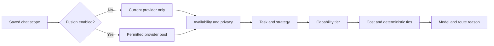

# Fusion router: design and implementation

Tracking: [#2731](https://github.com/nekko-labs/nekko-agent/issues/2731) · [editable four-frame design](../nekko-designs/fusion-router-design.html) · [behavior contract](../spec/chat/fusion-routing-and-model-tiers.md) · [setup guide](../docs/fusion-routing.md).

## Findings

The delegation guard used `autoModel` as permission for cloud-to-local routing, and `auto-local` could independently opt into that transition. The composer separately used `autoProviderSwitch` for cross-provider picks. This made model selection, provider permission, and subagent preference disagree.

The implementation separates three decisions:

A strategy or saved preference never grants permission. Both existing session flags must be explicitly true for Fusion. The daemon checks saved consent, exact/saved/resumed routes, and canonical provider scope rather than trusting a caller's parent snapshot. Automatic local preferences fall back within the current provider when Fusion is off; exact cross-provider requests fail visibly.

## Design choices

| Axis | Implementation | Trade-off |
| --- | --- | --- |
| Provider scope | Pinned/Auto stay on the configured provider; Fusion explicitly permits switching | Exact saved cross-provider preferences now require Fusion, even if they previously ran without it. |
| Strategies | Balanced, Economical, Quality first, Local first, Capacity fallback | Deterministic and explainable; not measured latency or model-based task classification. |
| Capability | Small / Medium / Large / Frontier, shared suggestion rules and provider-scoped overrides | Workload-relative suggestions, not universal performance claims. Unknown models need manual classification for tier routing. |
| Subagents | Independent target tier, exact tier then nearest smaller, never above parent | With no eligible automatic choice, inherit parent; explicit picks never silently fall back. |
| Compatibility | Preserve legacy single-provider Auto ranking and headless messaging Auto | Avoids changing established picks merely because new tiers were introduced. |
| Privacy | Existing cloud-only, offline/incognito, endpoint and Claude Code restrictions win | Fusion does not remove privacy defaults; some users must explicitly change those settings separately. |

The native phone apps do not expose the new controls. Claude Code tier targets map to its supported Haiku/Sonnet/Opus aliases; no Frontier CLI alias is invented. Headless messaging has no new cross-provider scheduler.

## Verification record

- Desktop build and typecheck passed; shared/desktop suites passed 4,608 tests before three additional focused strategy regressions were added. The focused Fusion suite passes those additional cases.
- Isolated production-component Electron fixtures passed 36 assertions at 1200px/390px in light and dark: provider lock explanation, tier options, Medium preference persistence without consent, explicit Fusion enabling, Auto disabling switching, strategy persistence, manual classification/reset, readable model names, and no overlap between routing rows and the expanded footer.
- Matching baseline images use frozen renderer/shared source at `4d94c2e22`. Sixteen native renderer PNGs and paired scroll GIFs are captured; they are evidence of the production components with a synthetic bridge, not OS chrome or real inference. Narrow light/dark captures were inspected and initial layout failures fixed. Wide/scroll inspection and final daemon tests are pending at this revision.
- A full daemon unit run had 740 passing, 5 ignored and one failing context-preview golden. The identical 4438/4480 versus 4191/4233 token mismatch was reproduced on the unchanged base and filed as [#2736](https://github.com/nekko-labs/nekko-agent/issues/2736). The assertion was not changed or disabled.
- Final daemon checks use a worktree-private copy-on-write Cargo target after a shared-cache collision with the base comparison. No cached failure is counted as verification.

No live provider inference, installed Claude Code compliance, native phone controls, or packaged-app behavior is claimed. The sandbox denies external network and uses synthetic catalogs/settings plus disposable profiles; it does not interact with the user's running app or real chats.

## Next steps

Finish isolated Rust regressions and evidence inspection, publish and verify media in the linked PR, resolve required checks, and land. A model-based classifier, measured latency/load policies and native phone editors are future extensions, not hidden implemented features.
