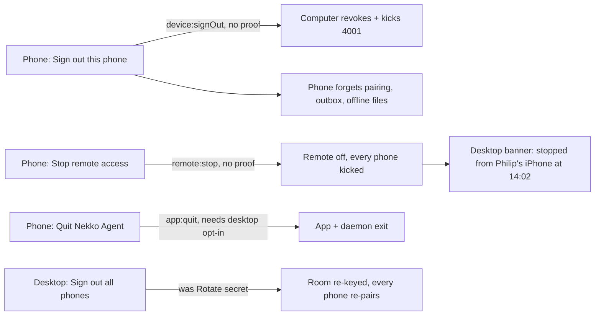
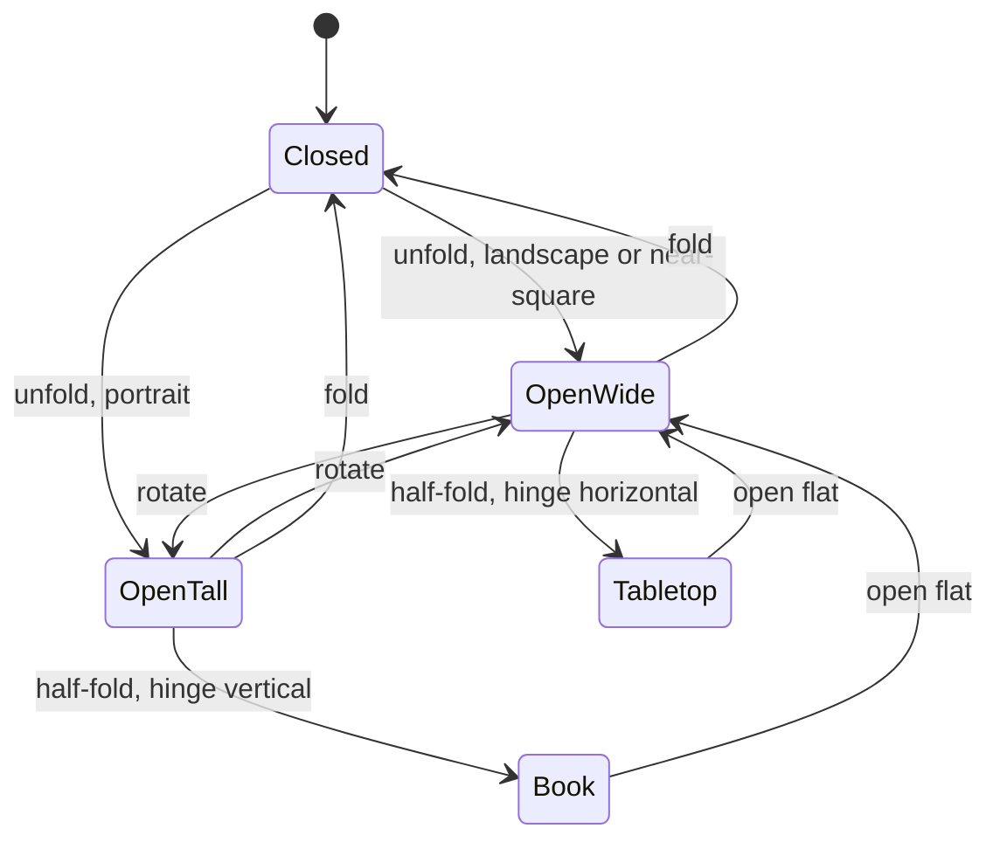

# Hardware keys, step-up and folding phones: design notes (2026-10-24)

Companion to the two specs and decisions landed with this report. The specs say what the product does; this says how the pieces fit, the alternatives weighed, and what to watch out for.

- Spec: [hardware keys, step-up and remote sign-out](../spec/platform/hardware-keys-step-up-and-remote-sign-out.md), decision [0018](../docs/decisions/0018-the-computer-is-the-relying-party-for-step-up.md), tasks SK-1..12.
- Spec: [folding phones](../spec/phone/folding-phones-two-chats-and-monitors.md), decision [0019](../docs/decisions/0019-folding-phones-get-panes-not-a-new-app.md), tasks FD-1..11, prototype [folding-phones-layout-prototype.html](folding-phones-layout-prototype.html).

## 1. Step-up: where the second factor sits

Today's phone request is already two layers deep (end-to-end sealing, then the Change proof). Step-up is a third proof inside the same sealed frame, verified by the same gate, after the first two.

```mermaid
sequenceDiagram
    participant P as Phone (FIDO2 client)
    participant R as Relay (ciphertext only)
    participant G as Computer gate (phone.rs)
    participant V as step_up.rs
    P->>R: sealed req security:challenge
    R->>G: forward
    G-->>P: sealed { challenge, methods: [key, totp] }
    Note over P: Face ID signs the Change proof;<br/>key touch (NFC/USB-C) signs the FIDO2 assertion<br/>over challenge + rpId = nekko-computer:<installId>
    P->>R: sealed req session:setOptions {mode: yolo}<br/>proof{ts,sig} + stepUp{assertion}
    R->>G: forward
    G->>G: class = agent, mode raise → Change proof ✔
    G->>V: verify(assertion, challenge, credential)
    V-->>G: ok (counter 41 → 42) / step-up-invalid / -stale / -replayed
    G-->>P: result or refusal sentence
```

The desktop path is the same without the relay: renderer asks main for a challenge, calls `navigator.credentials.get`, and sends the assertion with the guarded IPC call; main hands both to the daemon's verifier.

### Why the computer is the relying party

| | Nekko Cloud as RP | Computer as RP (chosen) | Extend Change proof |
| --- | --- | --- | --- |
| Needs an account / internet | yes | no | no |
| Second factor the phone does not hold | yes | yes | **no** |
| Credential list on Nekko Labs servers | yes | no | no |
| Works for Local Web UI and Cloud machines | yes | yes (daemon verifier) | partly |
| Passkey sync across devices | yes | irrelevant (per computer) | n/a |
| One key on three computers | one credential | three credentials | n/a |

WebAuthn's origin rule is the one practical wrinkle. In Electron the renderer has a fixed app origin, so `rp.id` can be any string the main process accepts as long as the renderer's origin is what the verifier expects; the verifier checks `clientDataJSON.origin` against the known origins (the app origin, `http://localhost:<port>` for the Local Web UI). On iOS and Android the platform FIDO2 clients require an associated domain or asset links for *web* relying parties, but **security keys and platform passkeys with an app-scoped `rp.id`** work through the app paths (`ASAuthorizationSecurityKeyPublicKeyCredentialProvider`, Credential Manager with the app's own origin in the privileged-app allowlist). SK-6 and SK-7 must prove this on hardware early; if Android's Credential Manager insists on a web origin for security keys, the fallback is the FIDO2 API (`com.google.android.gms.fido.fido2`), which takes an app-scoped RP.

### Alternatives for "other MFA"

- **TOTP**: kept, as the no-hardware fallback and the second method that satisfies the two-methods rule.
- **Push approval to another paired phone** ("approve this on your other phone"): attractive, zero new hardware, but it is the same trust domain (another paired device) and needs a cross-device protocol. Noted as a later option, not in SK.
- **SMS / email**: no sender on a local computer, phishable. Out.
- **Nekko Cloud account MFA**: separate feature (Supabase identity).

### Safety exits, deliberately unguarded



The asymmetry is the point: a guarded action lets an attacker *gain* something, so it needs the factor; a safety exit only lets an attacker *remove* access, which the owner repairs at the computer. A step-up on the exit would mean the owner who lost their key cannot stop a compromised phone.

### Watch-outs

- **Counter semantics**: some platform passkeys always report counter 0. Treat "both zero" as fine and "stored > 0 and new ≤ stored" as a clone signal; never refuse a counter-less authenticator outright.
- **Five-minute reuse window**: per surface and per action class, same as the Change signer. Do not share it between phone and desktop.
- **Two-methods rule UX**: the first registration flow must make the second method feel like part of the same step, or owners will stop at one key.
- **Recovery codes**: hash them (Argon2id or scrypt) in `security.json`; show once; offer *Print*.
- **Lock phones switch**: it writes every device's `access.change = false`; remember the previous state per device so turning it off restores a phone that was already Change-off.

## 2. Folding phones: posture, not device



| Posture | Panes | Divider | Keyboard |
| --- | --- | --- | --- |
| Closed | 1 | none | normal |
| Open, wide | 2 side by side | hinge, or draggable 35–65 | focused pane only; other pane keeps full height |
| Open, tall (vertical) | 2 stacked, primary on top | hinge, or draggable | focused pane; the other shrinks above it |
| Tabletop (half, hinge horizontal) | 1 in flex: transcript up, composer down | the hinge | lower half |
| Book (half, hinge vertical) | 2 side by side | the hinge | focused pane |

### Sources of posture

| Platform | Width class | Hinge | Half-open |
| --- | --- | --- | --- |
| iOS today | `horizontalSizeClass` + window aspect | none exposed | none exposed |
| iOS folding model | same | the SDK's fold API when Apple ships it; one function `hingeSource()` to swap | same |
| Android | `calculateWindowSizeClass` | `FoldingFeature.bounds` (`isSeparating` on Surface Duo) | `FoldingFeature.State.HALF_OPENED` + `orientation` |

The iOS posture model is written against the iPad first (every open posture, no hinge) so it is testable now; the hinge is one input. The Android model is testable with the emulator's foldable profiles today.

### Pane host, both platforms

```mermaid
flowchart TB
    subgraph PanesHost
      direction LR
      P1[Pane 1: Chat A] --- D[divider / hinge] --- P2[Pane 2: Chat B | Monitors | Chats | any route]
    end
    Posture --> PanesHost
    Arrangement[(remembered per computer)] --> PanesHost
    PanesHost -->|closed| Single[one column, focused pane's route]
```

Two chats on one phone share one `RelayClient`; requests are already keyed by chat id, so the only new state is a second `ChatModel` / `ChatController` and a focus owner for the keyboard. The Monitors pane is a route, so it also appears as a tab on closed phones: the feature is not foldable-only.

### Alternatives weighed

- **Separate foldable layout tree**: two of every view; rejected (decision 0019).
- **Device list**: wrong on the next phone; rejected.
- **Two computers at once**: wanted eventually, but it is a second connection with its own battery and reconnect rules. Named out of scope; the pane model does not preclude it.
- **Three panes on tablets**: the desktop's Agent board already answers that; not for phones.

### Watch-outs

- **Hinge avoidance**: no control may sit under the hinge line in tabletop; assert against `FoldingFeature.bounds` in tests.
- **Keyboard**: only the focused pane's composer may take it; the unfocused pane must not scroll under it.
- **Posture change animation**: move panes, do not rebuild them, so scroll positions survive (acceptance test).
- **Speed contract**: two streaming chats double Markdown rendering; keep the unfocused pane's rendering on the same budget as the Live Activity (step + last line) when the phone is thermally throttled. Measure before shipping (perf-history entry).
- **App lock**: the cover window already sits above everything; both panes are under it.

## 3. Suggested order and ownership

| Layer | Tasks | Who |
| --- | --- | --- |
| Shared policy + Rust verifier + safety exits | SK-1..3, FD-1..2 | Philip or an agent session; lands first, unblocks every client |
| Desktop + Local Web UI | SK-4..5 | Matt |
| iPhone | SK-6, SK-8, FD-3..6 | Philip |
| Android | SK-7, SK-8, FD-7..9 | Matt |
| Cloud machines, docs, hardware | SK-9..12, FD-10..11 | Davide (cloud), Travis (docs page copy and screenshots) |

Each layer is its own PR stack per the landing runbook; nothing in SK depends on FD or the reverse.

## Sources

- WebAuthn Level 3, W3C: authenticator data, signature counter, rpIdHash rules.
- Apple, *Supporting security key authentication using physical keys* (AuthenticationServices).
- Android, *Credential Manager* and `androidx.window` *FoldingFeature* guides; Samsung *Flex mode* guidance.
- RFC 6238 (TOTP).
- This repo: decision 0012, `packages/shared/src/phone-access.ts`, `apps/ios/App/Platform/SecureEnclaveChangeSigner.swift`, `apps/ios/App/Views/RootView.swift`, `apps/android/.../lock/Authenticator.kt`.
