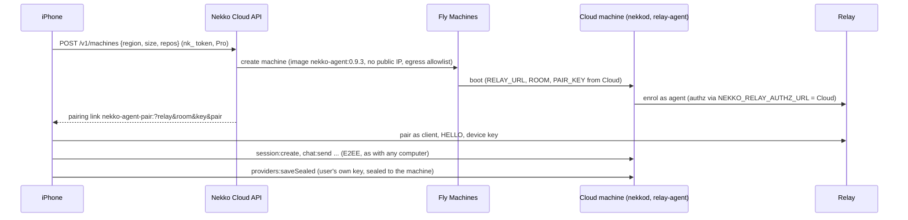

# iPhone chat modernisation, tappable computers, providers from the phone, and Nekko Cloud machines (design proposal, 2026-10-24)

What Philip asked for on 2026-10-24, what the iPhone app and the engine do today, and a design for each item with the options weighed. The HTML prototype beside this file (`ios-chat-modernization/index.html`, self-contained, light and dark) shows the screens at iPhone width.

**Request, paraphrased:** bring the iPhone chat closer to the desktop. Keep the chat bubbles. Watch notifiers and the cards for what the agent is doing (subagents) should match the desktop's borderless style. Modernise the conversations list. Make computers tappable, opening a details page (latency, models, providers and the rest). Let the user set up model providers for the computer from the phone, if possible. New feature: use cloud models directly from the phone without a computer, on a sandboxed cloud machine, the way Claude Code on the web, Devin and others work.

Status: **proposal, nothing built.** Two items (§5, §6) revise product decisions already recorded in the spec; they need a decision record before code.

## 1. Where the iPhone app is today

| Surface | Today (`apps/ios/App/Views`) | Gap against the desktop |
| --- | --- | --- |
| Prompt and reply bubbles | `BlockView` `.user` / `.assistant`: accent bubble right, plain Markdown left (`ChatView.swift:343-372`) | None. Kept as is. |
| Tool steps | One bordered card per call: `surface` fill, 1 pt `line` stroke, radius 12, monospaced label, chevron to expand output (`ChatView.swift:375-408`) | Desktop rows have no border and no fill: a caret, a small accent glyph, one line of mono text (`components/agent-console/ActivityGroup.tsx` `StepRow`). |
| Subagents (`spawn_agent`) | The same bordered tool card, labelled **Delegate** (`Transcript.swift:250`); no child status, no model chip, no group | Desktop: group header, one row per child with Working / Waiting / Completed / Failed, a model chip, children behind a 1 px left rule (`SubagentCue.tsx`, `ActivityGroup.tsx:77`). |
| Watches (`arm_watch`, the wake-up) | Not rendered: the arming call is a tool card and the wake-up arrives as a user bubble | Desktop: binoculars row, *Watching PR #555 · wakes on any PR change or after 1h*, a *then ·* subline, a live chip (countdown, overdue, triggered), and a *Watch triggered* row instead of a bubble (`WatchRow.tsx`, `spec/agents/watch-rows-and-subagent-models.md`). |
| Approvals and questions | Bordered cards with an accent stroke (`ApprovalCard`, `QuestionCard`) | These two need the user, so they keep a card; the desktop reserves colour for approvals too (`ToolCard.tsx:7-11`). |
| Chats list | `List(.insetGrouped)`: Needs you, then one section per project, Completed folded; rows with title, preview, relative time, badge (`ChatsView.swift`) | Grouping already matches the desktop's Agents panel (project groups, accented headings since #940). Visually it is stock iOS grouped cells; the desktop rows carry a status glyph, model and PR facts. |
| Computers | `ComputersView`: a list; a tap opens an action sheet (Connect, Rename, Open at launch, Forget) (`SettingsView.swift:6-72`) | Nothing to look at: no latency, models, providers, hardware or version. Diagnostics live on the separate *Connection* screen. |
| Providers | Read only: `providers:list` reaches the phone as `{id, kind, label, enabled}` (`PHONE_PROVIDER_VIEW`, `packages/shared/src/phone-access.ts:474`); `providers:save`, `providers:remove`, `providers:importCliAuth` are in `PHONE_DENIED_FOREVER` (lines 176-188) | Decided 2026-10-19 (*Full phone access*, `spec/phone/native-ios-app.md`): provider keys never reach a phone. §5 keeps that property while granting the ask. |
| Cloud | Settings → Nekko Cloud: sign in, E2EE sync, read synced chats, approve devices (`CloudViews.swift`, `crates/nekko-cloud`) | No compute. `spec/product/scope-boundaries.md` says *Cloud never runs your shell/filesystem tools on our servers*. §6 revises that. |

What a phone may already ask a computer (`packages/shared/src/phone-access.ts:97-164`, enforced by `crates/nekko-remote/src/phone.rs`): `app:info` (version, platform, edition), `providers:list`, `models:list` (id, provider, name, loaded), `settings:get` (the phone projection), `limits:get`, `usage:summary`, `workspace:list`, `terminals:list`, `tasks:list`, `workflows:list`, `logs:list`, and the chat, files, git and terminal channels. Nothing returns hardware, model-server state, latency or uptime to a phone today, though the daemon answers all of it to the desktop (`machine:profile`, `engine:status`, `system:stats`, `gpu:stats`; `crates/nekkod/src/machine.rs`, `model_server.rs`).

## 2. The chat: agent rows without borders

**Keep:** the user bubble (accent fill, radius 18), the reply (plain Markdown), the composer, Stop while a run goes, the reasoning fold.

**Change:** every row that describes the agent's work becomes the desktop's one-line row. Anatomy, shared by all five kinds:

| Row | Left (16 pt fixed box) | Label | Right | Expands to |
| --- | --- | --- | --- | --- |
| Tool step | check, cross, raised hand, or the running dots | monospaced, one line, ellipsis | count chip; chevron only when there is output | code well, 280 pt max, horizontal scroll (today's) |
| Subagent group | running dots or check | *N subagents · M working*, semibold | parent model chip | child rows, indented 24 pt behind a 1.5 pt `line` rule |
| Subagent child | status mark | **Title** · one-sentence activity (the desktop's bounded summary) | model chip, quiet | task text and result, bounded scroll |
| Watch | binoculars (accent) | **Watching PR #555** · wakes on any PR change or after 1h, then a *then ·* line | live chip: `in 42 min` / `overdue 3 min` (warning) / `due · waiting for the chat` / `retrying` / `triggered` (quiet) / `cancelled` / `failed to wake` (danger) | the arming call's output and the PR link |
| Watch triggered | bolt (accent) | **Watch triggered** · PR #555 changed (checks pending) | time, 11 pt tabular | the full wake-up text |

Rules copied from the desktop so the two feel like one product:

- **Chips** (`WatchClockChip`, `SubagentCue`): small text, 4 pt corners, a 1 pt line, no fill; only the line's tone changes. On the phone 11 pt instead of 10 px, for Dynamic Type.
- **Running dots live in a fixed box** before the text, so neither moves as the third dot lands (`styles.css` `.dots`).
- **Neutral colour for tools, colour for approvals only.** Tool rows are `inkSoft` / `inkFaint`; the approval card keeps a warm tint and a risk chip, but loses its stroke.
- **Groups stay closed while they contain a `spawn_agent`**, open while a plain tool run streams.

**Touch targets.** A 30 pt row is under Apple's 44 pt minimum; the tap target is the whole row width with 7 pt of vertical slack on each side (`.contentShape`), and VoiceOver reads label, status and whether output is shown, as the current card does.

**Engine work this needs** (the only new channel for §2):

- `session:watches` on the phone allowlist as a Read channel, with a phone view that drops the continuation prompt (the desktop channel never returns it either). The arming call is already in the transcript.
- The wake-up message: today it reaches the phone as a user block with the `Agent watch` prefix. The transcript builder (`Transcript.swift`) recognises the prefix and renders the row; the desktop does the same (a presentation hint, not provenance), so no wire change.
- Subagent child status: the desktop derives Working / Waiting / Completed / Failed from local events and the child's summary (`composer-containment-and-compact-subagent-activity.md`). The phone gets `agent:event` already; it needs the child's `sessions:summaries` row, which it also has. The model chip's three-way fallback (child model, call's `model_id`, parent's) is a pure function worth sharing as a golden.

**Options weighed**

| | A. Port the desktop rows (proposed) | B. Keep cards, drop the stroke only | C. Collapse everything into one "Working…" line |
| --- | --- | --- | --- |
| Parity with desktop | Yes | Partial | No |
| Information while a run goes | Full (per step, per child, per watch) | Full | Poor: you cannot see which child is stuck |
| Effort | ~3 views, 1 channel, Transcript changes | 1 view | 1 view |
| Risk | Dynamic Type on dense rows | None | Loses the watch chip entirely |

## 3. Conversations: the desktop's grouping, without stock cells

The structure already matches the desktop (Needs you, then project groups, Completed folded, search, Continue card). The modernisation is visual plus one piece of information:

- **The computer becomes the title's companion.** A pill in the leading toolbar slot with its state dot, name and round trip (`38 ms`) replaces the bare `desktopcomputer` icon. It opens today's `ComputerMenu`, and each computer in it opens its page (§4).
- **Flat rows on the paper**, hairline separated, in place of `.insetGrouped`. Group headings take the desktop's treatment from #940: 15 pt semibold in the accent, counts on the right (`3 active · 12 done`). This is `List(.plain)` with `listRowSeparatorTint(palette.line)` and custom section headers; no custom scroll view.
- **A glyph column** (22 pt) says what the chat is doing before the title is read: the running dots, a raised hand in the warning colour for an approval or question, binoculars for an armed watch, a check for done, a clock for a chat with prompts waiting on the phone. The desktop's `StatusIcon` uses rocket / question / warning / Zz; the phone keeps its own vocabulary because the same glyphs appear in its transcript rows (§2).
- **Facts under the preview** as quiet chips: Working / Needs you (as today), the PR and its checks (`pr:sessionList`, already allowed), *On this iPhone* for phone chats, *Watching* when a watch is armed (`session:watches`).
- **Continue** stays at the top as the one tinted block on the screen; the desktop uses `bg-accent-soft` for the active row the same way.
- **Not changed:** swipe actions, context menu, search, pull to refresh, the saved-list note, the pending-chat rows, the iPad split.

What this costs the computer: nothing new beyond `session:watches`; round trip is measured on the phone (§4).

## 4. A computer, opened

Tapping a computer in *Computers* (or the pill on Chats) pushes a page instead of an action sheet. Connect, Rename, Open at launch and Forget move to an *Edit* menu and the swipe actions.

**Sections, top to bottom**

1. **Hero:** name, state dot, OS and version (`app:info` + `machine:profile.platform/release`), *Opens at launch*.
2. **Four tiles:** Round trip with a 10-minute sparkline; Model server (loaded of total, memory bar); Up (daemon uptime, paired N days ago); Today (spend, tokens, local share, from `usage:summary`, already allowed).
3. **Models** (`models:list`): each with its provider, loaded state, tok/s when the server reports it, and *Default* / *Load*. Load is a change-class call (`model:load`, to be allowed with a Face ID proof); Default sets the phone's own new-chat default, which exists already.
4. **Providers** (`providers:list`): label, kind, how it authenticates (*API key · set on Studio*, *llama.cpp · Metal*), and an enabled switch. The switch is a new change-class channel `providers:setEnabled(id, bool)`: it changes one boolean and nothing else, which is why it is not `providers:save`. *Add a provider* is §5.
5. **Hardware:** chip, cores, memory (total and free), GPUs with temperature.
6. **Connection:** route and relay (opens today's *Connection* screen with its checks and log), and *This iPhone's access: Read and Change* as the computer has set them.

**Engine work:** one new Read channel, `machine:summary`, served by nekkod from what it already computes: `machine:profile` (chip, cores, RAM, unified, GPUs, backends, engine build), `engine:status` (resident models, memory, `startedAt`), `system:stats` and `gpu:stats` (live load, temperatures), `runtime:status` per local provider (version, tok/s), `app:info`. The phone projection (`PHONE_MACHINE_VIEW`) lists fields by name as the other views do, and leaves out paths, serial numbers, user names, disk layout and IP addresses. Golden parity as for the other phone views.

**Latency** is not an engine channel. The phone measures it: `RouteProber` already times DNS, TCP and the relay hello for *Check routes*; the page sends a lightweight `app:info` every 30 s while visible and records the round trip, so it works on any computer version and on a cloud machine. Desktop `remote:*` channels stay denied to phones.

**Options for latency**

| | Phone-measured (proposed) | New `ping` channel | Relay-reported |
| --- | --- | --- | --- |
| Works on old computers | Yes | No | No |
| Measures what the user feels (phone to engine) | Yes | Yes | No (relay hop only) |
| Cost | None | A channel and a golden | Relay change |

## 5. Providers from the phone: carry a key, never hold one

**The constraint.** On 2026-10-19 Philip decided provider keys stay out of a phone's reach, and `providers:save` is in `PHONE_DENIED_FOREVER`. The request asks to revisit this. The design below keeps the property that matters (a phone never stores, reads back or relays a usable key, and the computer never returns one) while letting the user type a key on the phone.

**Flow** (prototype §4)

1. On a computer's page, *Add a provider* opens a sheet: a grid of kinds (the desktop's `ProviderChoices`: Anthropic, OpenAI, OpenRouter, Gemini, Ollama on this computer, OpenAI-compatible; ChatGPT subscription is left out, see below), an API key field (paste, or scan a QR from the provider's page later), a label.
2. **Face ID** through the existing Secure Enclave change proof (IO-33).
3. The phone **seals the key to the computer's device public key** (HPKE with P-256, the primitives `nekko-sync` and `SyncCrypto.swift` already carry) and calls a new change-class channel `providers:saveSealed({id, kind, label, baseUrl?, sealedKey})`. The relay sees ciphertext inside the E2EE frame; the phone's logs and saved transcripts never contain the key.
4. The computer opens the seal with its own key, runs `providers:testConfig`, stores the key in its keychain as `providers:save` does, and answers `{ok, models: [...]}` or the provider's error text. The phone shows the models it can now pick.
5. Optional second gate, **Approve on the computer**: a switch under *Remote access → What phones can do*, on by default for the first provider a given phone adds, showing a notice on the desktop that the owner clicks once. Off, the Face ID proof alone is enough.

**Why a new channel and not un-denying `providers:save`.** `providers:save` takes a plaintext `ProviderConfig` and returns the full provider list including `tokenKey` and `baseUrl`; allowing it would need redaction on both sides and would put plaintext on the phone. `providers:saveSealed` is narrow: a phone can add or replace a key, never read one. `providers:remove` stays denied (removing is destructive and the desktop can do it); `providers:setEnabled` (§4) covers turning one off.

**What stays out**

- **Subscriptions.** The ChatGPT OAuth flow needs a browser on the computer and keeps its token there; Claude plan sign-in is already removed by policy (`scope-boundaries.md`). The sheet says *Sign in on the computer* for those.
- **Local runtimes.** *Ollama on this computer* and *OpenAI-compatible* take a base URL and no key; the computer refuses loopback addresses it cannot reach itself, as `providers:discover` does.
- **Keys the computer already holds.** Never listed, never shown as masked text; the row says *API key · set on Studio*.

**Spec changes this implies:** `PHONE_DENIED_FOREVER` keeps `providers:save`, `providers:remove`, `providers:importCliAuth`; the *Full phone access* decision gains a paragraph on sealed provider setup; a decision record under `docs/decisions/` names the boundary (*a phone may carry a sealed key to a computer; it may never hold or read one*).

**Options weighed**

| | A. Sealed key, phone types it (proposed) | B. Phone opens a desktop prompt, key typed on the computer | C. Un-deny `providers:save` with redaction |
| --- | --- | --- | --- |
| Works with the computer unattended | Yes | No (someone must be at it) | Yes |
| Key ever on the phone | In memory for one call, never stored | Never | Plaintext on the wire inside E2EE, and in memory |
| Nekko Labs or the relay can see it | No | No | No |
| New engine surface | 1 channel, 1 view | 1 notification channel | Redaction on 2 channels, risk of leaks in logs |
| Honours the 2026-10-19 decision | In spirit (needs a record) | Fully | No |

## 6. Nekko Cloud machines: a computer you pair with

**The constraint.** `spec/product/scope-boundaries.md` and `spec-web-and-hosted.md` §4.1 say Cloud never runs tools on Nekko's servers; the cloud is sync, relay and billing. `TASKS.md` PF21 kept *cloud runners* as the phone's later half, and PF14 step 4 plans a multi-tenant nekkod. This request adds hosted compute, so the boundary becomes: *Cloud never runs tools on your computer; a cloud machine runs them in its own jail, which you can see and delete.*

**The shape that costs least: a cloud machine is a computer.** The Docker image the repo already publishes (nekkod and the Local Web UI, `NEKKO_SANDBOX=workspace-jail`) started in the existing **relay-agent mode** (`apps/local-web-ui/src/relay-agent.ts`: `RELAY_URL`, `ROOM`, `PAIR_KEY`; prints a pairing link) on a **Fly Machine** in the user's region. To the phone it is another computer: the same pairing keys, the same E2EE frames, the same allowlist, the same chat, approvals, watches, git and PR screens, and the same details page (§4). Nekko Cloud only mints the machine and hands the phone its pairing link.

**What the machine is**

- **Image:** the root `Dockerfile` plus `git`, `gh`, Node, Python and the common toolchains; digest-pinned, versioned with the app. One size to start (2 vCPU, 4 GB, 20 GB disk); more later.
- **Isolation:** one Fly Machine per user per machine (a microVM, stronger than the local Docker jail); no public IP; egress allowlist of github.com and the user's providers' hosts; `workspace-jail` inside. Nekko Labs operators have no shell into it by policy, and chats sync out E2EE so the machine holds no long-lived plaintext.
- **Repositories:** cloned at start through the GitHub App the repo already uses for PR stacks, scoped to repositories the user allows on the machine's page.
- **Models:** the user's own keys, sealed to the machine exactly as in §5 (Nekko Labs never holds them); a local model server on the machine is possible later on bigger sizes. Nekko-paid credits are a billing question, not a design one.
- **Lifecycle:** start on first chat (Fly cold start is seconds); stop after 15 min idle; delete after 7 days unused; the page shows *Sleeps in 12 min* and *Hours this month*. Stopping keeps the disk; deleting is explicit.
- **Plan:** Pro and Team, metered by machine hours (the draft tiers in `spec-web-and-hosted.md` §6 need a row for it).

**Phone changes:** *New chat* gains a **Runs on** picker: a paired computer, *Nekko Cloud* (creates a machine when none is running), *This iPhone*. The chat's computer pill shows a cloud glyph. The cloud machine's details page adds Repositories, Sandbox, Hours and *Stop and delete*. Settings → Nekko Cloud gains *Machines*.

**Options weighed**

| | A. Per-user Fly Machine running the existing image in relay-agent mode (proposed) | B. One multi-tenant nekkod (PF14 step 4) with a sandbox per chat | C. Rent a third-party sandbox API (E2B, Modal, Daytona) and bridge it |
| --- | --- | --- | --- |
| Phone protocol work | None | New tenant id on the wire, per-channel enforcement | A whole new client path |
| Isolation | microVM per user | Docker per chat inside a shared daemon; tenant bugs are cross-user bugs | Vendor's |
| Engine work | Egress allowlist, GitHub clone at boot, Cloud API to mint and bill | Large (every channel scoped, fair scheduling) | Large (a second executor) |
| Idle cost | Zero when stopped (Fly stop) | A shared daemon always on | Vendor's pricing |
| Where the user's key lives | Sealed to the machine | In the shared daemon's store | Vendor-side or bridged |
| Time to a demo | Weeks | Months | Weeks, with a dependency |

A is proposed because the relay-agent mode and the Docker image already exist and the phone needs no new protocol. B remains the right shape if Cloud later serves a browser app to thousands of users; A does not block it. The decision of 2026-10-13 (*one shared multi-tenant nekkod*) was taken for the hosted browser edition, not for per-user compute; this proposal is a different product surface and should get its own record.

**What this does not do:** it does not reach the user's computers (a cloud machine is never paired with them), it does not run connectors with the user's desktop credentials, and it does not store chat plaintext outside the machine (sync is E2EE).

## 7. Order of work

1. **§2 rows and `session:watches` on the phone** (one PR, iOS + shared + nekko-remote golden). Visual evidence: isolated simulator captures, light and dark, Dynamic Type large.
2. **§3 list** (one PR, iOS only).
3. **§4 details page with `machine:summary`** (two PRs: engine channel and phone view; then the screen).
4. **§5 sealed provider setup** (decision record first; then engine channel; then the sheet).
5. **§6 cloud machines** (decision record and the spec boundary change first; then Cloud API, image and Fly plumbing; then the phone's *Runs on* picker and machine page).

## 8. Spec and docs touched when each lands

- `spec/phone/native-ios-app.md`: rows, list, details page, sealed providers; `spec/phone/your-agent-in-your-pocket-the-ios-and-android-app.md`: the Computers paragraph and *Starting a chat*.
- `spec/phone/phone-access-classes-and-relay-replay-protection.md`: `session:watches` (Read), `machine:summary` (Read), `providers:setEnabled`, `providers:saveSealed`, `model:load` (Change).
- `spec/product/scope-boundaries.md` and `spec-web-and-hosted.md` §4.1: the compute boundary. New `docs/decisions/` records for §5 and §6.
- `docs/hub`: the phone page and a new *Nekko Cloud machines* page when §6 ships.

## Sources

- iOS app: `apps/ios/App/Views/ChatView.swift`, `ChatsView.swift`, `SettingsView.swift`, `ConnectionView.swift`, `CloudViews.swift`, `NewChatView.swift`; `apps/ios/App/Platform/Theme.swift`; `apps/ios/Protocol/Sources/NekkoProtocol/Transcript.swift`, `Wire.swift`, `RouteProber.swift`.
- Desktop: `apps/desktop/src/renderer/styles.css` (tokens 1228-1341, `.dots` 1948-1966), `components/agent-console/WatchRow.tsx`, `SubagentCue.tsx`, `ActivityGroup.tsx`, `ToolCard.tsx`, `components/WorkspaceCard.tsx`, `views/agentPanelView.ts`, `components/providers/ProviderChoices.tsx`, `AddProvider.tsx`.
- Shared and engine: `packages/shared/src/phone-access.ts`, `models.ts`, `ipc.ts`, `pairing-link.ts`; `crates/nekko-remote/src/phone.rs`; `crates/nekkod/src/machine.rs`, `providers.rs`, `model_server.rs`; `crates/nekko-sandbox/src/lib.rs`; `crates/nekko-cloud/src/lib.rs`; `apps/local-web-ui/src/relay-agent.ts`; `apps/relay-server/src/server.ts`; root `Dockerfile`, `docker-compose.yml`.
- Spec and plans: `spec/agents/watch-rows-and-subagent-models.md`, `spec/chat/composer-containment-and-compact-subagent-activity.md`, `spec/phone/native-ios-app.md` (*Full phone access*, IO-33), `spec/product/scope-boundaries.md`, `spec-web-and-hosted.md` §4 and §6, `TASKS.md` PF14 step 4 and PF21, `docs/REMOTE.md` *Headless agents*.
