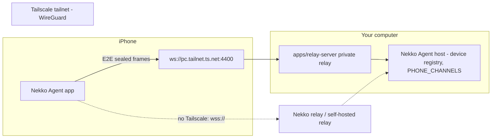

# Native iOS app: competitive reference (Orca and others), 2026-10-16

What the main mobile clients for coding agents do, how they connect, and what the native Nekko Agent iPhone app ships in response. Research was done on 2026-10-16. apps.apple.com and onorca.dev could not be fetched from the research environment, so App Store wording comes from search snippets, and everything else from public repos and docs. Each claim is marked **confirmed** or **inferred**.

## Orca (Stably AI)

Orca is a free, MIT-licensed "agent development environment" for macOS, Windows and Linux. It runs many CLI agents in parallel, each in its own git worktree: Claude Code, Codex, OpenCode, Grok, Cursor CLI, Copilot, Amp, Goose and others. Its phone app, "Orca IDE" (`com.stably.orca.mobile`), is a **React Native / Expo** thin client. Since 0.0.55 (2026-10-13), most of its screens arrive as over-the-air updates from the paired desktop. Source: github.com/stablyai/orca (`mobile/`, `cloud/`).

**Connection (confirmed in code).**
- Pairing is a QR code holding the endpoint, a device token and the desktop's public key.
- On the LAN, the phone connects directly to `ws://<desktop>:6768`.
- Away from home, it goes through a hosted relay on GCE ("cells" assigned by a "director") that splices the two outbound WebSockets.
- Traffic is end-to-end encrypted with tweetnacl box (X25519 + XSalsa20-Poly1305). The desktop's key is pinned, and a changed key forces re-pairing.
- Push goes through a separate Cloud Run gateway.
- There is no Tailscale path and no SSH from the phone.

**Mobile features (confirmed unless noted).**
- Several hosts, plus a connection log and a troubleshooting screen.
- Worktree list.
- A terminal mirror (xterm in a WebView, with a keyboard).
- A native chat view per agent: streaming, reasoning, tool cards, inline sub-agents.
- Tool permission approvals and questions.
- Stop, and queued messages.
- Starting an agent from the phone.
- Diff review with line comments.
- Source control and PR screens (the exact actions are inferred).
- File browser and Markdown and media preview.
- A browser screencast.
- Quick commands, accounts and usage.
- Dictation: recorded on the phone, transcribed on the desktop.
- Photo attachments.
- Push for "finished" and "needs input".
- Reconnecting on cellular.

**Not present:** Live Activities, widgets, Apple Watch, Shortcuts / App Intents, background modes.

## Others

| App | Connection | What sets it apart |
| --- | --- | --- |
| Claude app Remote Control (Anthropic) | CLI makes outbound HTTPS to Anthropic's API; QR or session list; short-lived scoped credentials | Two-way sync with the terminal; push when an action is needed; optional Trusted Devices (Face ID / passkey re-auth); paid plans only |
| Codex in ChatGPT (OpenAI) | QR to Codex for Mac through an authenticated relay; no open ports or VPN | All threads, approvals, model switch, new tasks, live terminal/diff/test screenshots |
| Happy (open source) | `happy` CLI wraps claude/codex; E2EE sync server (TweetNaCl) | Hand the session back and forth between terminal and phone; history while the terminal is offline |
| Omnara | Laptop or cloud | Voice agent, localhost previews, worktrees, local → cloud hand-off when the laptop sleeps |
| VibeTunnel | Mac app; Tailscale Serve (private) or Funnel / ngrok | Any terminal in a browser or native iOS app, session recording |

## Table stakes vs differentiators

**Table stakes**, where every serious client has them. All of these ship in this version:
- QR pairing with E2EE.
- Reachable from cellular with no port forwarding.
- Session list with live state.
- Streaming chat with tool cards.
- Approvals and questions inline.
- Stop and queue.
- New session and model switching.
- Reconnect and history re-read.
- Push.
- Photos and dictation.

**Common but not universal:**
- Diffs, files and terminal. Nekko's computer refuses these channels to phones by design (`PHONE_ALWAYS_DENIED`), so adding them is a security decision for the owner, not a client feature. See the decisions below.
- Git and PR actions, worktree management, usage display.

**Differentiators that nobody, Orca included, has shipped:**
- **Live Activities / Dynamic Island with Allow / Deny.** Built in this version.
- **Actionable notifications** (Allow / Deny on the notification). Built.
- **Native SwiftUI.** Orca, Happy and Omnara are React Native or cross-platform. Built.
- **Tailscale-first private transport**, with the phone able to tell you whether Tailscale is on. Built. Orca has only LAN or its own relay.
- **App lock with redaction** of notifications and the Lock Screen (Anthropic's Trusted Devices is the nearest equivalent). Built.
- Apple Watch approvals, Shortcuts / Siri intents, Home Screen widgets, iPad multi-pane. Not built on 2026-10-16; most have shipped since. See the status table below.

## Status on 2026-10-17

Each Orca and Codex phone feature, mapped to what the native apps ship now. "Decision" means the owner has to choose before anything is built. "Device" means it's built and tested in CI, but not yet tried on a real phone or watch.

| Feature (who has it) | iPhone | Android | Where |
| --- | --- | --- | --- |
| QR, paste and link pairing with E2EE (all) | Built | Built | #630, AN-1 |
| Tailscale route, with "is Tailscale on?" (VibeTunnel only) | Built | Built | #667, TailnetStatus |
| Private relay on the computer (none) | Built (desktop) | Built (desktop) | PH4 |
| Several computers, connection log and troubleshooting (Orca) | Built | Built | #677, #678 |
| Chats, streaming, reasoning, tool steps (all) | Built | Built | |
| Markdown in replies (all) | Built | Built | #694 |
| Approvals and questions inline (all) | Built | Built | |
| Stop and queue (Orca, Codex) | Built | Built | |
| New chat with model, folder and tools (Codex, Orca) | Built | Built | |
| Photos and dictation (Orca) | Built | Built | #695 (Android photos) |
| Read-only diffs (Orca, Codex) | Built, off by default | Built, off by default | #670, #673 |
| Comment on a diff (Orca) | Built: "Ask about this change" | Built | #675 |
| Accept or revert changes, file browser, terminal (Orca, Codex) | Decision | Decision | `PHONE_ALWAYS_DENIED`; reports/phone-readonly-changes-proposal.md |
| Push for "finished" and "needs you" (all) | Built; needs the APNs key | Built locally; FCM (AN-6) needs the service account | Credentials |
| Push on Tailscale-only setups (none) | Decision | Decision | PH6, reports/free-push-tailscale-proposal.md |
| Nearby computers without a QR code (none) | Listed under *On this network*; pairing still by code (decision) | Listed under *On this network*; pairing still by code (decision) | #732 (desktop, off by default), #735; tap-to-pair: reports/phone-discovery-pairing-proposal.md |
| Chat list while the computer is unreachable (Happy) | Built, opt-in | Built, opt-in | #706, #702 |
| Live Activities and the Dynamic Island with Allow / Deny (none) | Built | n/a | IO-6 |
| Actions on notifications (none) | Allow (Face ID) and Deny | Deny only; Allow is a decision | #697 |
| Home Screen and Lock Screen widget (none) | Built | Built | #654, #688 |
| Siri, Spotlight and Shortcuts: "What needs me?", "Ask my computer" (none) | Built | n/a | #696 |
| Quick Settings tile (none) | n/a | Built | #708 |
| New chat from Control Center, the Action button, the icon or the launcher (none) | Built | Built | #721, #725, #692 |
| Share into a new chat (none) | Built | Built | IO-8, AN-11 |
| Apple Watch: counts glance and complication (none) | Built | n/a | #726, #729 |
| Apple Watch: approve from the watch app (none) | Decision; mirrored notifications work today | n/a | |
| iPad split view (Codex) | Built | n/a | |
| App lock with redaction (Anthropic's Trusted Devices) | Built | Built | |
| Git, PR and worktree actions, usage (Orca) | Not built | Not built | Phone access to these channels is a decision |
| Browser screencast, live terminal (Orca, Codex) | Decision | Decision | Part of files and terminals |
| Store builds (all) | Blocked: signing and TestFlight | Blocked: signing and Play | IO-7, AN-9 |
| Tried on real devices | Device | Device | IO-5, AN-5 |

## Connection approach

Tailscale first, the Nekko relay second, and the same protocol as Android.

- **The wire is identical to Android's:** relay v2 with a sealed HELLO, PBKDF2 → AES-GCM, and the one-time code never resent. A fixture shared with the agent's WebCrypto pins it, and a live test runs the Swift client against the real relay and a headless agent.
- **Transport rule (PH1):** plain `ws://` is allowed only toward Tailscale, the LAN or the simulator's loopback. Everything else must be `wss://`.
- **Compared with Android:** Android allows `ws://` only to `*.ts.net` names, through its network security config. On iOS, ATS adds local networking, so a LAN relay also works. iOS can also detect Tailscale from its interface addresses (100.64.0.0/10) and explain a failure.
- **Compared with Orca:** Orca's own relay is required off-LAN. Nekko needs no hosted service when Tailscale is present, and the hosted relay (PH5) is the fallback.

## Recommendations and next steps

1. **Ship order:** macOS CI green with screenshots, then a physical-iPhone pass, then TestFlight. That needs the signing team, a bundle id decision, and the APNs key on the relay.
2. **ActivityKit push updates from the relay**, so Live Activities stay current while the app is suspended. Today they update only while the app runs. The relay already sends APNs, so this adds the `liveactivity` push type and per-activity tokens.
3. **Decide on diffs and files for phones.** A read-only `changes:list` / `file:read` view under `PHONE_SESSION_VIEW`-style limits would close the biggest gap with Orca and Codex.
4. **PH4 "Relay on this computer"** in the desktop, so Tailscale pairing needs no terminal command.
5. Then: an Apple Watch approval glance, App Intents ("Ask my computer…"), and iPad split view.

## Sources

- https://github.com/stablyai/orca (README, `mobile/`, `cloud/`, releases)
- https://apps.apple.com/us/app/orca-ide/id6766130217 (search snippets only)
- https://code.claude.com/docs/en/remote-control
- https://9to5mac.com/2026/05/14/openai-brings-codex-control-to-chatgpt-for-iphone-and-android/
- https://apps.apple.com/app/id6748571505 (Happy), https://apps.apple.com/app/id6748426727 (Omnara)
- https://github.com/amantus-ai/vibetunnel
