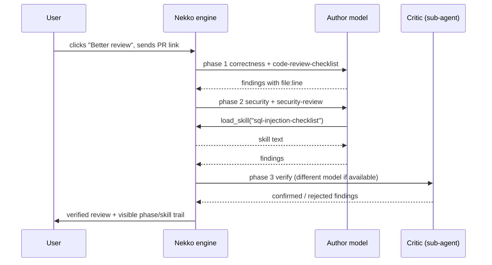
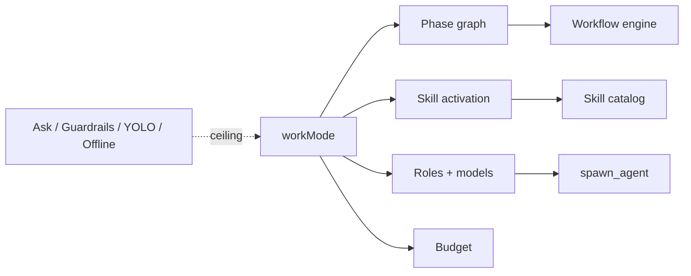

# Modes: one click for a better chat, without remembering skills

Status: **design proposal, not implemented.** Nothing in this document exists in the app yet.

## Problem

Today a skill reaches a chat only when the user invokes it: `/name` in the composer or the + menu's Skill flyout (`packages/host/src/skills.ts` installs a skill into "the `/` menu and the Skills tab"). Users forget which skills exist and when to use them, so installed skills go unused. A skill on its own also improves little: what makes curated packs such as gstack or superpowers effective is the **harness** around the text (phases, separate roles, gates, budgets), not the prompt text alone.

## User intent

> The user should not have to remember skills. They click a button (Design, Best output, Better review, ...) and the chat works that way, with the right skills loaded at the right time.

## Decisions

1. **A Mode is a harness recipe, not a skill bundle.** It declares phases, roles, models, budgets and which skills apply where. Nekko's engine runs it.
2. **Build the engine, borrow the content.** The engine (phases, gates, roles, budgets) is Nekko's, because it must speak to guardrails, `spawn_agent`, capture and PRs. Content (review checklists, design principles, TDD/spec-first methods) is adapted from proven public work, attributed via `basedOn` and license-checked, as the marketplace already does. We do not "install ECC" into a chat.
3. **Modes never touch permissions.** Ask / Guardrails / YOLO says *what is allowed*; a Mode says *how much effort to spend*. They are independent and a Mode cannot loosen guardrails, enable tools the user disabled, or override Offline / Incognito.
4. **Naming.** `ChatSession.mode` already means the permission mode (`packages/shared/src/chat.ts:223`), and the composer strip already shows "mode". The new field must not reuse it: use `workMode` in code. The UI label is an open question (see below).

## How skills activate without the user typing them

| Activation | Mechanism | Reliability | Context cost |
|---|---|---|---|
| **Always** | Loaded at chat start while the Mode is on | Guaranteed | Paid every turn: keep tiny |
| **Phase-bound** | The engine injects the skill when it enters that phase, drops it after | Guaranteed (code-driven) | Only during the phase |
| **Model-chosen** | Only `name + description` is in the prompt; the model calls a `load_skill` tool for the full text | Depends on the model | One line per skill until loaded |

Rule of thumb: **phases are code-driven, specifics are model-chosen.** Anything the Mode's promise depends on must be phase-bound or always-on; never rely on a small local model remembering to load it.



The chat shows a compact trail ("Phase: security · skill: security-review") so users learn what ran without memorizing anything. The `/` menu stays for manual extras: a Mode is a default, not a cage.

## Mode definition (proposed shape)

```yaml
id: better-review
label: Better review
description: Several focused reviewers, then a verifier that drops false positives.
cost: { tokens: "~3x", time: "~2x" }   # shown on the button before enabling
always: [cite-lines]
phases:
  - id: correctness
    skills: [code-review-checklist]
  - id: security
    skills: [security-review]
  - id: tests
    skills: [test-coverage]
  - id: verify
    role: critic          # runs as a separate sub-agent
    model: different      # a different model than the author when one is available
    gate: findings-cite-lines   # findings without file:line are dropped
available: [sql-injection-checklist, react-perf, a11y-check]   # model-chosen
budget: { maxPhaseRepeats: 2 }
```

Skills referenced by a Mode resolve against the existing catalog (`MARKET_SKILLS`, Vaizer, imported `SKILL.md`). **Enabling a Mode installs what it needs**; the user never installs its skills one by one.

## Mapping onto what already exists

| Mode concept | Existing foundation | Gap |
|---|---|---|
| Per-chat selection, saved default | `specMethodology` on `ChatSession` and `Settings` | New `workMode` field + default |
| Phases, routes, bounded loops, PASS/FAIL gates | Workflow engine (`packages/shared/src/workflows.ts`, daemon-run since 2026-10-12) | Run a phase graph *inside one chat's turn* rather than as a separate workflow run |
| Skills | `SkillDef`, `MarketplaceSkill`, `listInstalledSkillDefs()` | Phase-bound injection; `load_skill` tool for model-chosen loading |
| Critic / verifier roles | `spawn_agent` with explicit provider/model routing | "Different model" selection policy |
| Cheap vs strong model | Auto model (`autoModel`, `autoQuality`) | Per-role model choice |
| Permission ceiling | Ask / Guardrails / YOLO, disabled tools, Offline | None: Mode reads these, never writes them |
| Prompt parity | `packages/core/src/agent/prompt.ts` ↔ `crates/nekko-context/src/prompt.rs` | Any Mode prompt text must land in both, golden regenerated |



## Proposed first Modes

| Mode | What actually changes | Why it is first / later |
|---|---|---|
| **Better review** | Specialized reviewers + a verifier that drops uncited or unconfirmed findings | **First**: measurable (precision/recall on seeded bugs), low risk, high value |
| **Design** | Prototype → capture → critique → revise (2-3 rounds), before/after shown | **First**: very demonstrable; reuses capture and `nekko-designs/` |
| Best output | Plan → draft → critic with another model → revise; optional best-of-N | After the engine is proven |
| Ship | Spec → implement → test → evidence → PR (AGENTS.md as a procedure) | After; needs PR integration polish |
| Deep research | Required sources, cross-check, report | After |
| Fast | Single pass, cheap model | Trivial once the field exists; useful contrast |

## Evaluation: a Mode ships only if it beats the default

Each Mode gets a small fixed task set run against the plain chat on the same models:
- **Better review**: repositories with seeded bugs; measure found / false positives / missed, plus tokens and wall time.
- **Design**: fixed briefs; blind pairwise preference plus the captured screenshots.

A Mode that does not beat the default on its own metric does not ship. The measured cost (tokens, time) is what the button displays; results go into `docs/perf-history.md` where they are performance numbers.

## Discovery

- **Suggested Mode**: when a prompt matches a Mode ("review this PR"), offer it as one chip ("Use Better review?"). One click, nothing to remember. Never switched on silently.
- **Save as Mode** (later): turn how a chat worked into a reusable Mode, so the library grows from real use.

## Security and privacy

- Mode content is third-party text entering the system prompt: pin it to a version/commit, show a diff before updates, and treat it as data, not authority.
- A Mode cannot change permission mode, tools, Offline, Incognito, connectors or guardrail rules. Hooks/scripts from external packs are out of scope.
- Phase sub-agents inherit the chat's permission ceiling and provider restrictions; a "different model" never means silently switching to a cloud provider in an Offline or local-only chat.
- Over a paired phone, a Mode would be one more allowlisted session option (as `mode` is today), expanded on the computer.

## Open questions (user / product decisions)

1. **UI name**: "Mode" collides with Ask / Guardrails / YOLO in the composer strip. Options: rename the permission control to "Permissions" and use "Mode" here, or call this "Style" / "Work mode" / "Approach".
2. **Default**: no Mode (today's behavior) or a light default?
3. **Cost display**: estimate from the eval runs, or live counter only?
4. **Community Modes**: in scope for v1 or later?

## Next steps

1. Settle the UI name and the default.
2. Implement `workMode` + phase-bound skill injection + `load_skill`, with Better review as the only Mode.
3. Build the Better review eval set; ship only if it beats the default.
4. Add Design, then the rest.

## Sources

- Code: `packages/shared/src/chat.ts`, `skills.ts`, `skills-market.ts`, `spec.ts`, `workflows.ts`; `packages/host/src/skills.ts`.
- External packs referenced as inspiration only (verify current names and licenses before adapting): Everything Claude Code, gstack, obra/superpowers, anthropics/skills, BMAD Method, GitHub Spec Kit.
