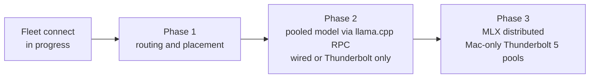

# Pooling compute across fleet computers: options

Research date: 2026-11-14. Tracking: #2800. Question from Philip: build something like Apple's and NVIDIA's "home array" of computers, pool compute across the PCs in the Nekko fleet, and if possible run one local model split into segments across machines.

The machines this is sized for:

- **MacBook Pro**, M1 Max, 64 GB unified memory, Thunderbolt 4.
- **`gomi`**, Windows, RTX 5090 with 32 GB VRAM. System RAM and ports are not recorded.

They reach each other over the home network and over Tailscale.

## Summary

1. **Splitting one model across these two machines works today but rarely pays.** llama.cpp's RPC backend does it, and Nekko already ships it.
   - Nekko's pinned llama.cpp build on the Mac includes `ggml-rpc-server` and `llama-server --rpc`.
   - A layer split lets you run a model that fits on neither machine alone: about 80 GB of GPU-resident memory pooled, against about 48 GB or 32 GB alone.
   - Decode (writing the answer) gets **slower**, not faster, than the best single machine. Over Wi-Fi or Tailscale it is poor.
2. **Apple's and NVIDIA's home clusters depend on a fast private link and one vendor.**
   - Apple: Thunderbolt 5 RDMA plus MLX.
   - NVIDIA: DGX Spark pairs over 200 Gb ConnectX-7.
   - The M1 Max has Thunderbolt 4 and the PC is a Windows CUDA box, so neither stack applies as built.
3. **The highest-value first step is fleet-aware routing, not splitting.** Send each chat, sub-agent or background job to the best machine in the fleet. This needs the fleet "connect" work now in progress, and nothing new in llama.cpp.

Recommendation, in phases:

1. Routing and placement across the fleet.
2. An opt-in "pooled model" built on llama.cpp RPC, wired or Thunderbolt only, for models that fit nowhere alone.
3. MLX distributed for Mac-only pools, once there are two or more Thunderbolt 5 Macs.

## What Apple and NVIDIA actually ship

**Apple (shipping)**

- **RDMA over Thunderbolt 5.**
  - Arrived in macOS 26.2 (December 2025).
  - Supported on Thunderbolt 5 Macs: M4 Pro/Max MacBook Pro, M4 Pro Mac mini, Mac Studio, and the M5 Max/Ultra Mac Studio announced 2026-08-25 with up to 512 GB.
  - Jeff Geerling measured inter-Mac latency dropping from about 300 µs to under 50 µs.
- **MLX distributed.**
  - Backends: ring (plain TCP), MPI, JACCL (Thunderbolt 5 RDMA, needs every pair cabled directly) and NCCL (CUDA).
  - WWDC26 session 233 showed tensor parallelism as MLX LM's default. Pipeline parallelism "doesn't speed up single-token inference".
- **Apple's speed claims.**
  - Apple claims up to 3x on four Macs. No independent benchmark was found.
  - An independent four-M3-Ultra run of DeepSeek V3.1 671B went from 21.1 to 32.5 tok/s, about 1.5x on four nodes.
- **Fit for us:** the M1 Max cannot use RDMA, and MLX's fast path is Mac-only.

**NVIDIA (shipping)**

- **DGX Spark.**
  - GB10, 128 GB unified memory, two ConnectX-7 ports at up to 200 Gb/s.
  - NVIDIA Sync clusters up to three units cabled directly, or four through a switch.
  - A 64 GB model arrived 2026-10-23 at $4,999. Pricing for the 128 GB model is inconsistent across reports.
  - An independent two-Spark test found the pair behaves as a memory pool (llama.cpp RPC), useful mainly for models too big for one unit.
- **DGX Station GB300:** up to 748 GB coherent memory, listed around $95k to $100k. No clustering product was found for it.
- **Dynamo:** open source, multi-node data-centre serving (KV-aware routing, prefill/decode split). It targets Kubernetes clusters, not mixed home machines.
- **GeForce:** no NVIDIA feature pools GeForce PCs. None shipped and no credible rumour was found.

## Open-source ways to split one model

| Project | Mac + Windows CUDA together | Transport | Split | State | License |
| --- | --- | --- | --- | --- | --- |
| **llama.cpp RPC** (`ggml-rpc-server`, `--rpc`) | Yes: each node uses its own backend (Metal, CUDA, Vulkan) | TCP; RDMA (RoCE, Thunderbolt 5) since PR #20590, 2026-04 | Layer split by default, `-sm tensor` exists, `-ts` sets shares | README calls it a proof of concept, "fragile and insecure"; actively improved | MIT |
| **exo** | No: NVIDIA only via a community fork; Windows unconfirmed; Mac and Linux nodes don't join one cluster | Thunderbolt 5 RDMA, Ethernet, Wi-Fi | Tensor + pipeline, topology-aware | v1.0.71, fast-moving, app-centric | Apache-2.0 |
| **MLX distributed / mlx-lm** | Mac only (NCCL is a separate CUDA cluster) | Ring TCP, MPI, JACCL | Tensor (default), pipeline | Apple-maintained, needs SSH and identical install paths | MIT |
| **distributed-llama** | CPU on all three OSes, experimental Vulkan, no CUDA | Ethernet | Tensor; node count a power of 2; q40 weights only | Active | MIT |
| **prima.cpp** | Linux, macOS, Windows; CUDA only on GPU | TCP | "Piped-ring" over a llama.cpp fork | ICLR 2026 research code. Its speedups are for weak devices, not a 5090 | Not verified |
| **Petals** | PyTorch swarm | Internet P2P | Pipeline | Last release 2023 | Apache-2.0 |
| **vLLM + Ray** | CUDA Linux only; no native Windows; Metal multi-node is groundwork | NCCL | Tensor + pipeline | Mature on data-centre NVIDIA | Apache-2.0 |
| **LocalAI P2P** | Wraps llama.cpp RPC | libp2p discovery, then RPC | Federated (route whole requests) or worker (layer split) | Experimental | MIT |
| **GPUStack** | Schedules across mixed workers; cross-vendor sharding not confirmed | HTTP | Mostly placement and replicas | Active | Apache-2.0 (not rechecked) |
| **Ollama** | No native multi-node inference found | n/a | n/a | Third-party routers do request balancing | MIT |

**Measured results for llama.cpp RPC**

- **Same speed for a model that fits locally.** Two DGX Sparks ran gpt-oss-20b at 76.7 tok/s over RPC against 77.2 locally. RDMA gained only a few percent over TCP on a 200 Gb link.
- **M2 Ultra plus a DGX Spark over a direct 10GbE cable** (Jaiswal):

  | Model | Setup | Prompt (tok/s) | Decode (tok/s) |
  | --- | --- | --- | --- |
  | Qwen2.5-7B Q4 | Mac alone | 76 | 92 |
  | Qwen2.5-7B Q4 | Pooled | 318 | 53 |
  | Qwen2.5-72B Q4 | Mac alone | 28 | 11 |
  | Qwen2.5-72B Q4 | Pooled | 30 | 6 |

  Prefill got faster because the bigger GPU did the matrix work. Decode got slower.

## Why splitting is slow on home networks

Estimates, not measurements on these machines.

- **Per token, a layer split sends one hidden-state vector per machine boundary.**
  - That is about 8 KB for an 8B model and about 16 KB for a 70B model.
  - Bandwidth barely matters. Round-trip latency and the number of hops do.
  - llama.cpp RPC also returns results to the head node, so expect about two transfers per token.
- **Decode is sequential, so a layer split keeps only one machine busy at a time.** You pay both machines' compute plus every hop. The slower machine's share dominates: the M1 Max has about 400 GB/s of memory bandwidth against the 5090's roughly 1.8 TB/s.
- **Tensor parallelism syncs about twice per layer.**
  - An 80-layer model needs about 160 syncs per token.
  - At 0.3 ms per sync (wired LAN) that is about 48 ms per token, a ceiling near 20 tok/s.
  - At 50 µs (RDMA) it is about 8 ms. This is why Apple and exo require RDMA.
  - It is not viable over Wi-Fi or Tailscale.
- **Prefill moves whole batches,** about 8 MB per boundary for 512 tokens of a 70B model:

  | Link | Real throughput | 8 MB batch | Typical round trip |
  | --- | --- | --- | --- |
  | 1GbE | ~0.94 Gb/s | ~70 ms | 0.2-0.5 ms |
  | 2.5GbE | ~2.3 Gb/s | ~28 ms | 0.2-0.5 ms |
  | 10GbE | ~9.4 Gb/s | ~7 ms | 0.1-0.3 ms |
  | Wi-Fi 6/7 | 0.4-2 Gb/s, variable | 30-160 ms | 2-10 ms, with spikes |
  | Thunderbolt 4 networking | ~10-20 Gb/s (Mac to Windows unverified) | ~4-7 ms | under 1 ms |
  | Thunderbolt 5 RDMA | ~50-60 Gb/s | ~1 ms | under 50 µs |
  | Tailscale, direct path | LAN speed minus WireGuard overhead | n/a | LAN + ~0.3-1 ms |
  | Tailscale via DERP relay | much lower | n/a | 20-100+ ms |

**Splitting helps when:**

1. The model fits on neither machine. This is the main case.
2. Prompts are long, because the stronger GPU speeds up prefill.
3. The model is a big mixture-of-experts. Only active experts are read per token. Test Nekko's existing "experts in system RAM" option on the PC first, since it may cover this on one machine.
4. Many requests run at once. Batching across nodes was not verified.

## What fits, alone versus pooled

Approximate GGUF sizes. Usable GPU memory on the Mac is about 48 GB by default (macOS caps wired GPU memory near 75%; raising `iogpu.wired_limit_mb` helps). Pooled is about 80 GB before KV cache.

| Model | ~Size | Alone | Pooled |
| --- | --- | --- | --- |
| 8-14B, Q4-Q8 | 5-15 GB | Either machine, the 5090 is fastest | No benefit |
| 32B, Q4/Q5 | 20-24 GB | 5090 | No benefit |
| 70B Q4_K_M | ~42 GB | Mac, tight | Fits, but slower than the Mac alone |
| 70B Q6/Q8 | 58-75 GB | Mac with a raised limit (Q6) | Q6 comfortable, Q8 tight |
| 100-120B MoE at 4-bit (gpt-oss-120b class) | ~60-70 GB | Mac with a raised limit, or experts in RAM | Fits with headroom. **The best use of pooling here** |
| 235B MoE | Q2 ~85 GB, Q3 ~110 GB | No | Q2 barely, with a quality loss |
| 400B to 1T | 200 GB to 1 TB | No | No (Mac Studio 512 GB or DGX Station territory) |

On this hardware, pooling earns its keep for higher-quant 70B and 100-120B MoE models, at an expected single-digit to low-teens tok/s over a wired link. No pooled run was benchmarked on these machines.

## Options that don't split a model

These give more usable value on two dissimilar machines:

1. **Fleet-aware routing and placement.**
   - Route each request to the best online computer.
   - Signals: model installed and loaded, queue depth, measured tok/s (`nekko-bench`), free memory, power state, whether something heavy (a game) is running, and the privacy class.
   - Example placement: the 5090 serves fast chat and coding, and the Mac holds a 70B or large MoE the PC cannot.
2. **Different models per machine**, including the small router/intent model on whichever machine is idle.
3. **Sub-agents spread across machines.** Each sub-agent's inference goes to the least-loaded computer.
   - Throughput scales nearly linearly with no per-token network cost.
   - It is the strongest fit for an agent product.
4. **Offloaded background work:** embeddings and indexing, transcription, nightly batch jobs.
5. **Cross-machine speculative decoding.**
   - A draft model on one machine proposes k tokens, and the target on the other verifies them in one round trip.
   - It tolerates LAN latency. But llama.cpp's speculative path is in-process and Nekko uses n-gram speculation today, so this is custom engine work with an uncertain payoff.
6. **Prefill on one machine, decode on another.** exo showed this with a Spark and an M3 Ultra. It ships the KV cache between machines, so it needs a fast link. Later, if at all.

## Recommendation for Nekko Agent

**Phase 1: routing and placement (build first).**

- Builds on fleet connect: opening a chat on another computer of your account through Nekko Cloud, now being implemented.
- Add capability and health facts to the sealed fleet descriptor: loaded models, free memory, measured tok/s, busy state.
- Add a "Run on: Auto / this computer / gomi" choice per chat, and automatic placement for sub-agents and background jobs.

**Phase 2: "Pooled model", opt-in, built on llama.cpp RPC.**

- How it runs:
  - The head machine adds `--rpc <peer>` and `-ts <shares>` to its `llama-server` child.
  - The worker starts `ggml-rpc-server` from the same pinned build. Both must run the same `b`-number, which Nekko's pin already enforces.
- Use the existing fit planner to size each machine's layer share: the Mac's wired limit plus the 5090's VRAM, minus KV cache.
- Offer it only:
  - when no single fleet machine can hold the model;
  - after a link probe passes (round trip under ~1 ms, at least 2.5 Gb/s).
- Say plainly in the UI that answers will be slower than a model that fits on one machine.
- Not over Wi-Fi or a relayed Tailscale path.
- Cheapest hardware upgrade: a direct 2.5GbE or 10GbE cable between the two machines, or a Thunderbolt 4 bridge if the PC has USB4.

**Phase 3: Mac-only pools with MLX distributed.**

- Worth it only with two or more Thunderbolt 5 Macs in a full mesh.
- The M1 Max cannot join the RDMA path.

### Security for Phase 2

- `ggml-rpc-server` has no authentication or encryption and accepts raw tensors and commands from anyone who can reach it.
- Bind it to loopback only, and carry its traffic through an authenticated, encrypted tunnel in `nekkod`.
  - Key the tunnel with the fleet's device keys: the same account trust that fleet connect uses.
  - Never put a raw port on the LAN or tailnet.
- Do not publish the port in descriptors. Exchange it over the already-authenticated fleet connection when the pool forms.
- Use a random port per session, and tear the server down when the pool ends.
- Require consent on both machines, matching "sharing is off until the owner turns it on".

## Not verified

- Whether the Windows CUDA asset of the pinned build (b12177) ships `ggml-rpc-server`. Only the Mac build was checked: b11224 on disk has it, plus RDMA probe code.
- The PC's system RAM, Thunderbolt/USB4 ports and NIC speed.
- Real Mac-to-Windows latency and throughput between these two machines, over the LAN, Tailscale or Thunderbolt.
- Any pooled benchmark on an M1 Max + RTX 5090.
- Batching of concurrent requests across RPC nodes.
- Apple's 3x claim.
- DGX Spark and Station pricing (reports conflict).
- exo's current Windows and CUDA status.
- The prima.cpp repository and its license.
- Ollama multi-node status.

## Sources

- Apple: [WWDC26 session 233](https://developer.apple.com/videos/play/wwdc2026/233/), [MLX distributed docs](https://ml-explore.github.io/mlx/build/html/usage/distributed.html), [Mac Studio M5 Max/Ultra (2026-08)](https://www.apple.com/kw/newsroom/2026/08/apple-introduces-mac-studio-with-m5-max-and-m5-ultra/), [Engadget on macOS 26.2 clusters](https://www.engadget.com/ai/you-can-turn-a-cluster-of-macs-into-an-ai-supercomputer-in-macos-tahoe-262-191500778.html), [Geerling, RDMA over Thunderbolt 5](https://jeffgeerling.com/blog/2025/15-tb-vram-on-mac-studio-rdma-over-thunderbolt-5)
- NVIDIA: [DGX Spark clustering](https://docs.nvidia.com/dgx/dgx-spark/spark-clustering.html), [StorageReview on the 64 GB Spark](https://www.storagereview.com/news/nvidia-dgx-spark-64gb-october-23-4999-two-units-cluster-to-128gb), [Classmethod two-Spark test](https://dev.classmethod.jp/en/articles/dgx-spark-two-node-clustering/), [Tom's Hardware on DGX Station](https://www.tomshardware.com/desktops/nvidias-gb300-powered-dgx-station-desktop-tower-listed-for-nearly-usd100-000-online-enterprise-ai-powerhouse-now-available-to-buy-for-mere-mortals-with-lots-of-cash), [Dynamo architecture](https://docs.nvidia.com/dynamo/latest/_sections/architecture.html)
- llama.cpp: [RPC README](https://raw.githubusercontent.com/ggml-org/llama.cpp/master/tools/rpc/README.md), [RDMA PR #20590](https://github.com/ggml-org/llama.cpp/pull/20590), [Jaiswal, Blackwell + Apple silicon over 10GbE](https://dev.to/ljkunal/distributed-llm-inference-across-nvidia-blackwell-and-apple-silicon-over-10gbe-2feg)
- Others: [exo](https://github.com/exo-explore/exo), [runaihome on exo (2026-06)](https://runaihome.com/blog/exo-framework-distributed-vram-local-ai-2026/), [distributed-llama](https://github.com/b4rtaz/distributed-llama), [prima.cpp (ICLR 2026)](https://proceedings.iclr.cc/paper_files/paper/2026/hash/e991e5587c1daa49bbf9a818b3f02f9a-Abstract-Conference.html), [LocalAI distributed](https://localai.io/features/distribute/), [vllm-metal distributed](https://docs.vllm.ai/projects/vllm-metal/en/latest/distributed/)
- Repo: `crates/nekko-engine/src/builds.rs` (pinned llama.cpp build), `crates/nekko-engine/src/capacity.rs` (fit planner, experts), `docs/SYNC-ENCRYPTION.md` (descriptor contents).
