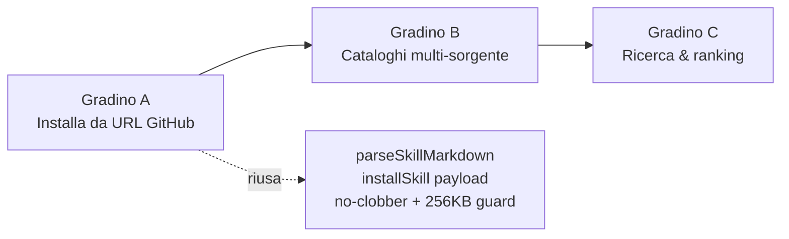

# Skills: Vaizer, copie nel catalogo, o discovery?

Ricerca su come funzionano oggi le skill "Vaizer" in Nekko Agent e su quale sia la
strada migliore per dare all'utente molte più skill senza riempire il catalogo di
copie. Nessuna modifica di comportamento: questo documento è solo analisi + proposta.

Branch di lavoro: `nekko/eager-violet-badger` (partito da `origin/main` @ `538eeb14`).

---

## 1. Cosa significa "Vaizer" nel codice oggi

**Vaizer non è una categoria di skill: è una *sorgente* di marketplace.** Il tipo è
esplicito in `packages/shared/src/skills-market.ts`:

```ts
export type SkillSource = 'nekkolabs' | 'community' | 'vaizer';
```

Le skill "considerate come Vaizer" sono quindi quelle con `source: 'vaizer'`, cioè
quelle che arrivano dal catalogo pubblico di [nekko-labs/vaizer](https://github.com/nekko-labs/vaizer)
(sfogliabile su [vaizer.app/skills](https://vaizer.app/skills)).

### Pipeline, file per file

| Pezzo | File | Cosa fa |
|---|---|---|
| Tipi + snapshot offline | `packages/shared/src/vaizer.ts` | `VaizerCatalog` / `VaizerCatalogSkill` / `VaizerTier`, `VAIZER_SNAPSHOT` bundled, `vaizerCategory()` (categoria libera → una delle 4 categorie app), `splitSkillMd()`, `vaizerToMarketSkill()` (id namespaces `vaizer-<slug>`) |
| Fetch host-side | `packages/host/src/vaizer.ts` | `getVaizerCatalog(refresh?)`: **zero rete** se non `refresh` → cache `vaizer.json`, altrimenti snapshot bundled. `getVaizerSkillMd(slug)`: SKILL.md verbatim al momento dell'install, con fallback al layout pre-2026-08-28 |
| Canali IPC | `packages/shared/src/ipc.ts` | `vaizer:catalog`, `vaizer:skillMd`, evento `skillsCatalogUpdated` |
| UI | `apps/desktop/src/renderer/views/SkillsView.tsx` | shelf **Vaizer** nel Marketplace: chip trust (🟣 official / 🟢 community), indicatore `live`/`cached`/`offline snapshot`, **↻ Refresh**, **Browse ↗** → vaizer.app/skills |
| CLI | `apps/cli/src/skills.ts` | `nekko-agent skills install <slug>` risolve slug → payload (stesso flusso della shelf) |
| Update periodico | `packages/host/src/update-checks.ts` | toggle `skillsCatalog` in Settings → Updates: refresh del catalogo ogni 6 h, ri-emette `skillsUpdated` |
| Install vero | `packages/host/src/skills.ts` | `installSkill(skillId, target, payload?)`: `nekko-agent` = solo record; `claude`/`codex` = scrive `<dir>/<name>/SKILL.md`, mai sovrascrivere una cartella non creata da noi |

### Stato reale del catalogo (verificato ora)

Il catalogo live `catalog.json` di nekko-labs/vaizer contiene **4 skill**, tutte
`tier: nekko-official`, **0 community**: `domain-finder`, `resume-checker`,
`codereview-spec`, `nyaa`. Lo snapshot bundled in `shared/vaizer.ts` è allineato
(sync dichiarata 2026-10-09, `nekko-labs/vaizer@4fd8d88`) e riporta le stesse 4.

Vaizer.app pubblica anche una sezione **"Recommended from Anthropic"** (Impeccable,
Skill Creator, MCP Builder, PDF Tools) che è **solo link**: non sono nel `catalog.json`
e Nekko Agent non le installa. E soprattutto la pagina dice:

> Paste any public GitHub URL to break down a skill that isn't listed.

Cioè l'UX di *discovery by URL* esiste già nel prodotto fratello, ma **non** in
Nekko Agent.

### Vincoli già scritti nel repo

Da `SPEC.md` (riga "Skills marketplace") e da `TASKS.md` T80/T112:

- Il testo di ogni entry del catalogo bundled **è scritto da Nekko Labs** e firmato
  Nekko Labs; la skill originale è citata solo come riferimento (`basedOn`, "based on"),
  **senza copiarne il testo**.
- Le document skill di Anthropic (pdf/docx/xlsx) sono proprietarie: **mai scaricate,
  mai bundlate**, solo linkate.
- Il catalogo bundled è un **snapshot offline-first**, curato a mano, con stelle
  GitHub congelate (`stars`, snapshot 2026-10-09, non live).

---

## 2. La domanda: "copiare molte skill" vs "cercarle"

### Opzione A — copiare molte skill nel catalogo bundled

Cosa costerebbe davvero:

1. **Viola la policy attuale** del repo (testo scritto da noi, niente copie).
   "Copiare" in blocco richiederebbe prima una revisione esplicita di quella regola e
   una verifica licenza per licenza (molte skill community sono MIT, le Anthropic no).
2. **Ogni skill = riga hardcoded** in `POPULAR_SKILLS` + riga di snapshot da
   mantenere. A decine diventa un fardello di manutenzione, e il problema si ripete a
   ogni release.
3. **Non risolve la discovery**: l'utente continua a vedere solo quello che abbiamo
   scelto noi, e il catalogo resta indietro rispetto all'ecosistema.

Utile solo per una **curation corta e di qualità** (le 10-20 skill che vogliamo
recommendare come Nekko Labs), non come strategia di volume.

### Opzione B — discovery da GitHub / dai siti di skill ← **direzione consigliata**

Il formato è uno **standard aperto**, non un dettaglio nostro: `agentskills.io`
(spec, client showcase, guide). Una skill è una cartella con `SKILL.md`
(`name` + `description` in frontmatter) più `scripts/`, `references/`, `assets/` opzionali.
Nekko Agent **già** legge questo formato da `external-skills.ts`
(`.claude/skills`, `.codex/skills`, `.gemini/skills`, `.agents/skills`, scope user e project,
read-only, guard a 256 KB).

Verifiche fatte ora, senza token GitHub:

- `GET /search/repositories?q=topic:agent-skills` → **31.791 repo**, senza auth.
  Top: `anthropics/skills` (180k⭐), `addyosmani/agent-skills` (106k⭐), `obra/superpowers`.
- `GET /search/code?q=filename:SKILL.md` → **401 Requires authentication**. La code
  search **non è utilizzabile anonima**: è il limite reale della discovery "search-first".
- Fetch raw di un `SKILL.md` noto → funziona (è già quello che fa `getVaizerSkillMd`).

Quindi: **elencare e installare è economico, cercare per contenuto no** (serve un token).

### Opzione C — marketplace di marketplace (cataloghi multi-sorgente)

Oggi il repo del catalogo è **hardcoded** (`VAIZER_REPO`, `VAIZER_CATALOG_URL`): non
esiste alcun setting per cataloghi custom (verificato: nessun `catalogUrl` /
`marketplaceUrl` nel codice). Il formato `catalog.json` è già generico e validato
(`validSkill()`), quindi aprirlo a N sorgenti è piccolo.

---

## 3. Proposta: tre gradini, in ordine di costo/beneficio



### Gradino A — "Installa da URL" (il più piccolo, sblocca tutto il resto)

Un campo nel Marketplace: incolli l'URL di una repo o di una cartella di skill.
L'host risolve il `SKILL.md` raw (già sa farlo), lo valida con `parseSkillMarkdown`
già esistente, mostra **preview** (nome, descrizione, corpo, provenienza, tier
`community`/unknown con la caution note che già c'è) e installa con lo **stesso**
`installSkill(skillId, target, payload)` usato per Vaizer.

Da fare: normalizzare URL GitHub → raw (gestire `tree/<branch>/<path>`, default branch,
`SKILL.md` dentro sottocartelle), riusare la guard 256 KB e il regex sul nome,
id deterministico non collidevole (es. `url-<host>-<owner>-<repo>-<slug>`), record con
`sourceUrl` per l'update. Nessuna UI nuova oltre al campo e alla card di preview.

Perché per primo: **nessun backend nuovo, nessuna decisione di licenza, nessuna policy
da riscrivere** — l'utente installa dalla fonte originale, e l'attribuzione resta sua.

### Gradino B — cataloghi multi-sorgente

`settings.skillCatalogs: Array<{ repo, catalogPath?, label? }>`, default `[nekko-labs/vaizer]`.
Ogni sorgente diventa una shelf (o una shelf "Other catalogs" con filtro), con la stessa
semantica offline-first: cache per sorgente, refresh esplicito, fallback snapshot solo
per Vaizer (che è l'unica che bundliamo). `update-checks.ts` gira sulle sorgenti attive.

Attenzione: `skillsSig` in `update-checks.ts` è oggi una firma unica → va resa per-sorgente,
altrimenti un catalogo nuovo fa scattare l'evento a vuoto.

### Gradino C — ricerca vera

Due modalità complementari:

- **Repo note + listing** (funziona anonimo): una lista curata di repo "che pubblicano
  skill" (Vaizer, `anthropics/skills`, `obra/superpowers`, `addyosmani/agent-skills`, …)
  esplorata con `git/trees` o `contents` API per trovare `SKILL.md`; ranking con le stelle
  del repo (il campo `stars` esiste già, va reso "aggiorato quando fai refresh").
- **Code search** (serve token): query `filename:SKILL.md path:skills <termine>`.
  Decisione aperta: token GitHub dell'utente opzionale (Settings → Connectors), oppure
  niente ricerca full-text e ci si ferma al listing curato.

Il gradino C vale solo dopo A e B: senza un flusso di install da URL, i risultati della
ricerca non hanno dove atterrare.

---

## 4. Rischi e decisioni da prendere

- **Fiducia.** Una skill installata gira con i tuoi permessi. La caution note "community:
  audit before use" esiste già per Vaizer: va mostrata anche per install da URL, e la
  preview del corpo del `SKILL.md` è il minimo sindacale prima dell'install.
- **Collisioni di nome.** Le skill built-in e marketplace hanno i nomi riservati e vincono;
  una skill importata da URL deve rispettare la stessa regola (già implementata per le
  skill esterne in `external-skills.ts`).
- **Niente clobber.** `installSkill` non sovrascrive cartelle non create da noi: deve
  valere anche per gli install da URL.
- **Skill con file extra.** Un `SKILL.md` che invoca `scripts/` propri oggi non funziona:
  i tool restano confinati alla workspace della chat (limite già documentato in SPEC per
  le skill importate). Se apriamo alla discovery, questo limite diventa più visibile.
- **Policy del repo.** Il gradino A **non** tocca la regola "testo scritto da Nekko Labs":
  l'install da URL scrive il `SKILL.md` verbatim **dalla fonte**, non nel nostro catalogo.
  Se invece volessimo bundlare copie in `POPULAR_SKILLS`, quella regola va cambiata
  esplicitamente in SPEC + licenza per licenza: è una decisione tua, non tecnica.
- **Licenze.** Vaizer dichiara MIT per le sue skill. Un catalogo di terze parti richiede
  almeno di mostrare la licenza dichiarata (il campo `license` esiste già in
  `VaizerCatalogSkill`, oggi non mostrato in UI).

---

## 5. Fonti

- Repo Nekko Agent: `SPEC.md` (Skills marketplace / Vaizer skills hub / Imported Agent Skills),
  `TASKS.md` T77, T80, T85, T112, T177, e il capitolo skill selection.
- Codice: `packages/shared/src/{vaizer,skills-market,skills,skill-markdown}.ts`,
  `packages/host/src/{vaizer,skills,external-skills,update-checks,dispatch,host}.ts`,
  `apps/desktop/src/renderer/views/SkillsView.tsx`, `apps/cli/src/skills.ts`.
- [nekko-labs/vaizer `catalog.json`](https://raw.githubusercontent.com/nekko-labs/vaizer/main/catalog.json) — fetch del 2026-10-14: 4 skill, 0 community.
- [vaizer.app/skills](https://vaizer.app/skills) — "paste any public GitHub URL", sezione curated link-only.
- [agentskills.io](https://agentskills.io/) — specifica del formato, guida per client implementors.
- GitHub API senza token: repo search `topic:agent-skills` = 31.791 risultati; code search = `401 Requires authentication`.

## 6. Prossimi step concreti

1. Decidere il perimetro: solo gradino A, o A+B?
2. Se A: `packages/host/src/skill-import.ts` con `resolveSkillSource(url)` (URL → raw
   `SKILL.md` candidate list) + test; canale IPC `skill:importPreview` / riuso `skill:install`
   con payload; campo + card di preview in `SkillsView.tsx`.
3. Aggiornare `SPEC.md` (nuova voce "Install from URL", `[implemented; unverified]` finché
   non c'è evidence visiva) e una voce T in `TASKS.md`.
4. Se B: setting `skillCatalogs`, cache per-sorgente, `skillsSig` per-sorgente.
5. Gradino C solo con una decisione su token GitHub vs listing curato.
