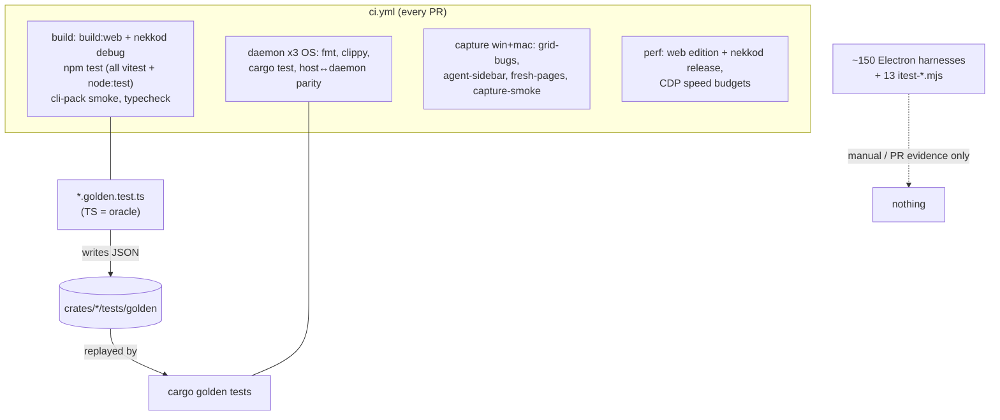
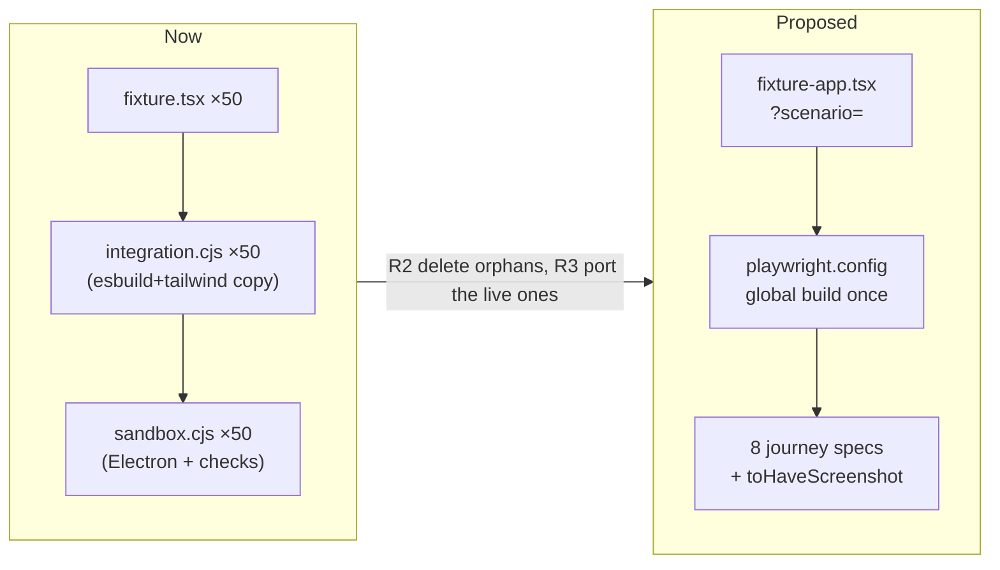

# Test suite audit, 2026-10-17

Scope: every test layer in `nekko-labs/nekko-agent` at `73028f66` (main). Read-only analysis. No tests or CI were changed.

## 1. Current architecture

| Layer | Runner | Where | Size | Runs in CI? |
|---|---|---|---|---|
| Root script unit tests | `node --test` | `scripts/*.test.mjs` (10 listed in root `npm test`) | 14 files, ~40 cases | yes (`build`) |
| TS unit/component | Vitest (no config files except mobile; package defaults) | `packages/{shared,core,host}`, `apps/{desktop,cli,cloud,relay,local-web-ui,api,mobile}` | ~470 files, ~3,600 tests | yes (`build`; api/mobile in their own workflows) |
| **Golden parity oracles** (TS→Rust) | Vitest writes JSON, `cargo test` replays it | 47 `*.golden.test.ts` → `crates/*/tests/golden/*.json` | 47 TS + ~30 Rust files | yes (both) |
| Rust unit + crate integration | `cargo test --workspace` | 53 `crates/*/tests/*.rs` + inline | ~300 tests | yes, 3 OS (`daemon`) |
| Real-binary daemon tests | cargo, spawns `nekkod` | `crates/nekkod/tests/daemon.rs` (5,283 lines, 68 tests) | 1 file | yes, 3 OS |
| Host↔daemon parity | Vitest against built `nekkod` | 4 host files (`session-clear.*`, `session-log-callback`) | 4 files | yes, 3 OS |
| **Electron hidden-window harnesses** | plain `node` + Electron | `apps/desktop/scripts/*-{fixture,sandbox,integration}` + `scripts/*-evidence*` | ~160 entrypoints, ~4k lines | **9 wired**, 87 run by nothing |
| Live itests (loopback models, relay, MCP) | plain `node` | `scripts/itest-*.mjs` (13) | 13 files | **none** in CI |
| Capture smoke | node + Electron | `capture-smoke.mjs` | 1 | yes (`capture`, win/mac) |
| Speed contract | CDP + headless Chromium vs web edition + nekkod | `scripts/perf/` | budgets gate | yes (`perf`) |
| Native mobile | Gradle / `swift test` / vitest | `apps/android`, `apps/ios`, `apps/mobile` | own workflows | yes |

### Local timing (Windows, warm builds)

| Workspace | Wall | Pass | Fail |
|---|---:|---:|---:|
| packages/host | 20.6 s | 953 | 3 |
| packages/core | 8.8 s | 503 | 0 |
| apps/desktop | 7.5 s | 1,355 | 3 |
| apps/cli | 4.8 s | 118 | 0 |
| apps/nekko-agent-api/cloud / local-web-ui / shared / relay | 2-3 s each | 681 | 0 |
| **Total vitest** | **~53 s sequential** | 4,151* | 6 |

\*Includes 358 duplicate runs (see F1). Summed per-file time is 157 s; the 47 golden files take 48 s of it (31%).

The six local failures look environment-related (they're not the cause of red CI), but each needs a decision:
- `session-clear.daemon.test.ts` fails with `ENOENT` when `target/debug/nekkod.exe` isn't built (CI builds it first).
- `bundleExternals.test.ts` (×3) can't find the package `electron-vite` when run from a plain `npx vitest` in desktop.
- `chat-worktrees.test.ts` timed out (5 s) on Windows git.
- `download.test.ts` hit `ENOTEMPTY` on cleanup, a Windows file-lock race.

## 2. Findings

**F1. Compiled `dist/` tests run twice (easy win).** `packages/shared` and `apps/cli` have no vitest config, so Vitest also collects `dist/**/*.test.js`. That's 34 files and 358 tests running a second time: shared runs 299 → 598, cli runs 59 → 118. Any stale `dist/` can also give false failures or passes.

**F2. About 55% of the Electron harnesses never run.** 87 of 160 harness entrypoints aren't invoked by any npm script or workflow. Most are one-off PR-evidence scripts like `wall-polish3/4-sandbox`, `*-evidence.cjs` and `model-chip-sandbox.cjs` (4 lines). Only one was touched in the last month. They still decay silently, and `check-sandbox-syntax` only parses them.

**F3. The harnesses are copy-paste triads.** Each feature has a `-fixture.tsx`, a `-sandbox.cjs` and an `-integration.cjs`. The same esbuild + Tailwind/PostCSS + `git archive` "before" bootstrap is copied into about 60 files (63 esbuild builders, 57 PostCSS copies, 69 `NEKKO_TEST_REVISION` copies). The same goes for the hidden-window, network-block, `check()` and `capture()` helpers. There's no shared library.

**F4. 38 tests assert on source text instead of behaviour.** Examples are `cleanStart.test.ts`, `agentLogs.test.ts` and `AgentPanelHeader.test.ts`, which run `readFileSync('ChatPane.tsx')` and then `toContain("surface !== 'composer' && !cleanStart && (\n <ChatHeader")`. These break on any reformat or refactor and don't prove the UI behaves. `ChatPane.tsx` alone is pinned by at least 6 files.

**F5. Golden parity is the backbone, and it's expensive.** The 47 TS oracles are 31% of vitest time. The slowest are `workflows.golden` (15 s), `agent-tools.golden` (14.5 s), `server.golden` (5 s) and `library.golden` (3.6 s). They're single giant `it()` blocks (1-2 cases, 300-650 lines), so a failure shows up as one huge JSON diff. Each one checks a port that is *already* checked from the Rust side. Per TASKS.md they stay until the TS engine is removed (step 2 of the strangler).

**F6. The slow non-golden files spawn real processes.** `chat-worktrees` (18 s, real git with about 30 commits), `hooks.test` (10.6 s; a 1 s hook timeout plus `node -e` spawns), `engine/server.test` (10.7 s), `workflows.test` (8 s) and `core/loop-retry` (6.5 s, real backoff delays).

**F7. Some test files overlap.** These pairs share a base name: `commandWall.test.ts` + `CommandWall.test.tsx` (32 + 32 cases), `monitorOrder` + `MonitorOrder`, and `QuestionCard.test.ts` + `QuestionCard.test.tsx`. Some of them are logic tests next to component tests, which is legitimate, but at least `QuestionCard` should be one file.

**F8. `daemon.rs` is a 5,283-line monolith** with 68 real-binary tests and 27 `sleep(` calls. It was the source of the #705 flakes. Every test spawns its own daemon.

**F9. The CI matrix rebuilds the same things.** `build`, `perf`, `daemon` (×3) and `capture` (×2) each run `npm ci` and build TS. `perf` builds nekkod in release while `build` builds it in debug. There's no shared build artifact.

**F10. The 13 `itest-*.mjs` loopback end-to-end scripts never run in CI.** Examples are `itest-turn-variants` (12 checks), `itest-relay-daemon` and `itest-messaging-daemon`. They're the closest thing the repo has to real end-to-end tests, and they're only run by hand.

## 3. Recommendations (prioritized)

| # | Change | Effort | Payoff |
|---|---|---|---|
| R1 | Add `vitest.config.ts` with `exclude: ['dist/**', 'node_modules/**']` to `packages/shared` and `apps/cli`, or one root `vitest.workspace` (see R7) | 10 min | −358 duplicate tests and no stale-dist false results |
| R2 | **Delete or archive the orphaned harnesses.** Keep the 9 wired ones plus any that guard a live regression. Move one-off PR evidence scripts to `scripts/evidence/archive/` or delete them, since git history keeps them | 1-2 h | about −90 files and −3k lines |
| R3 | **Consolidate the Electron harnesses into one Playwright-Electron end-to-end suite** (details below) | 2-3 days | −60 copies of bootstrap code; real end-to-end coverage that runs in CI |
| R4 | Rewrite the 38 source-text tests as rendered-component assertions (Testing Library), or fold them into the R3 end-to-end flows. Delete those that only pin formatting | 1 day | fewer brittle failures on refactor |
| R5 | Speed up the slow units: fake timers in `loop-retry`/`hooks` (inject `retryBaseDelayMs`/a timeout clock), one shared git fixture repo per file in `chat-worktrees` (`beforeAll` + `git worktree` reset) with a raised per-test timeout on Windows | 0.5 day | host about 20 s → about 10 s |
| R6 | Golden oracles: split each giant `it()` into per-scenario `it.each` so failures point at one case. Long term, **retire each TS golden when its TS implementation is deleted**, freezing the JSON as a Rust-only fixture | ongoing | clearer failures; −48 s once TS is gone |
| R7 | One root `vitest.workspace.ts` (projects = each package) run as `vitest run` in a single process, instead of 8 sequential `npm run test -w` | 0.5 day | one Vite startup, parallel across packages; probably about 53 s → 25 s |
| R8 | CI: build TS + nekkod once in a `prepare` job and upload `dist/` plus the binary as artifacts for `build`/`perf`/`capture` | 0.5 day | −3 to 4 redundant builds per PR |
| R9 | Split `daemon.rs` by domain (`turns.rs`, `engine.rs`, `remote.rs`, ...) with a shared `tests/common/mod.rs`. Replace `sleep` with event waits (as #705 started) | 1 day | fewer flakes, parallel test binaries |
| R10 | Promote 3-4 `itest-*.mjs` scripts (turn-variants, relay-daemon, messaging-daemon, mcp-http) into a nightly or `main`-only CI job | 0.5 day | real loopback end-to-end coverage that's actually exercised |
| R11 | Merge `QuestionCard.test.ts` into `.tsx`. Check `commandWall` vs `CommandWall` for overlapping cases | 30 min | small cleanup |

### R3 in detail: a consolidated end-to-end suite

Today each triad builds its own fixture bundle, starts its own Electron with hand-written `executeJavaScript` checks, and writes screenshots. The proposal replaces that with **one Playwright `_electron` project** that runs over:

1. **One shared fixture host.** A single `e2e/fixture-app.tsx` that mounts any view via `?scenario=chat-finder` with a synthetic `window.nekko` proxy. The proxy pattern repeats in every fixture today.
2. **One build step.** esbuild + Tailwind, built once per run and cached. The `NEKKO_TEST_REVISION=main` before/after mode becomes a fixture option (`--base main`) instead of 60 copies.
3. **Journeys instead of features.** Group the about 50 feature checks into about 8 user journeys, each a spec file with `test.step`s:

| Journey spec | Absorbs |
|---|---|
| `wall.e2e.ts` | wall-controls, wall-polish 1-4, wall-composer-size, wall-empty, grid-bugs, panel-grips, panel-metrics, pane-motion, focus-transitions, spooky-dock-drag, group-drag |
| `sidebar-and-finder.e2e.ts` | agent-sidebar, chat-finder, chat-search, chat-switch, chat-id-label, repo-actions, folders-modes |
| `composer.e2e.ts` | composer-editing, composer-activity, composer/composer-media evidence, plus-menu, picker-tools, shortcut |
| `transcript.e2e.ts` | live-reply, transcript-scroll, completion-interruption, ask-transcript, image-artifacts, artifact-cards, logs-bubble, done-row |
| `plan-and-mode.e2e.ts` | plan-rail, chat-plan-layout, change-plan, mode-panel, work-modes, decisions-tab, tasks-focus |
| `pages.e2e.ts` | fresh-pages, provider-layout, connectors-layout, downloads-panel, engine-repair, skills-library, budget-pricing, account-email |
| `agents-and-prs.e2e.ts` | subagent(+component), agent-window-controls/defaults, pr-divider, pr-stacks, pr-deck-titlebar, command-center, watch-rows, board-rail |
| `native.e2e.ts` (win/mac) | capture-smoke, native-channels, notification-*, tray-*, monitors |

4. **Screenshots become `toHaveScreenshot`** with stored baselines per OS and theme, which replaces the manual contact sheets. PR evidence is the HTML report artifact.
5. **CI:** the `capture` job runs `playwright test --project=electron`, sharded by journey across the win/mac matrix.

Expected result: about 150 harness files (about 4k lines) shrink to about 8 specs plus 1 fixture host plus 1 config (likely under 1.5k lines). All of it runs in CI instead of 9.

### Suggested target pyramid

| Level | Keep | Goal |
|---|---|---|
| Unit (vitest, cargo) | about 3.3k unique tests | fast, no process spawns except tagged files |
| Contract (golden TS↔Rust) | 47, shrinking as TS is retired | per-scenario `it.each` |
| Integration (real nekkod) | `daemon.rs` split, host↔daemon parity | event-driven, no sleeps |
| E2E UI (Playwright-Electron) | 8 journeys | every PR, win+mac |
| E2E system (itest loopback) | 4 promoted | nightly / main |
| Perf | unchanged | every PR |

## 4. Suggested order

1. R1 + R11 (minutes): an immediate drop in duplicate runs.
2. R2: delete orphans, with an explicit keep list.
3. R5 + R7: local and CI speed.
4. R3 + R4 together: the end-to-end consolidation. Port the wired harnesses first, then live regressions.
5. R8, R9, R10: CI structure.
6. R6: ongoing with the Rust strangler.

## Method / caveats

- Counts come from `git ls-files` plus regexes. Case counts are approximate (`it(`/`test(`/`#[test]`).
- "Orphan" means the file isn't named in any `package.json` script or workflow, and isn't only launched by another harness. Some may still be run by hand during feature work. Review the keep list before deleting.
- Timing is one local Windows run with warm builds. CI on Linux will differ.
- Cargo tests and the Electron harnesses were not run or timed.
