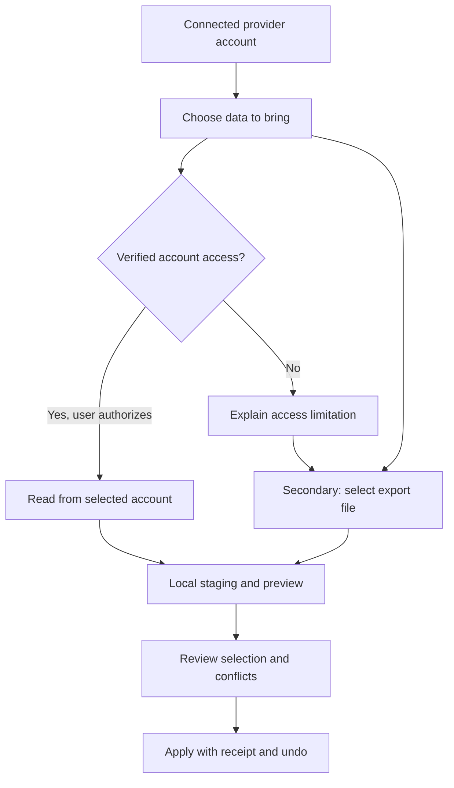

# Import provider history and personalization

**Status: planned; no import UI, adapter, or apply path implemented by this specification.** Tracked in [#2259](https://github.com/nekko-labs/nekko-agent/issues/2259). [Decision 0069](../../docs/decisions/0069-prefer-account-connected-provider-imports.md) records the account-first ordering. [Capability research](../../reports/provider-data-import-capabilities.md) distinguishes documented routes from unverified access.

## Intent

People adding Claude, ChatGPT, Grok, or another provider should be able to bring their past prompts and conversations, compatible settings, saved memory, and profile into Nekko Agent. Connecting a model should not mean starting their personal context over.

**Account-connected import is the primary experience. Importing an export file is the secondary option, not a replacement for the account-connected requirement.** Start with those three providers, with an extensible adapter model for others. A provider is also an account; work and personal accounts remain separate, even when their email addresses match. See [accounts and switching](accounts-and-switching.md).

This is a user-initiated migration, not continuous synchronization or permission to modify the source account. Import does not change subscription billing, model access, tool permissions, or provider credentials.

## Planned journey

1. After adding a provider, offer **Bring your history and preferences**; **Not now** leaves the connection usable. The same action remains available on existing provider accounts in Settings. No retrieval starts just because the person connects a model.
2. Start with the selected connected account. Identify its provider, account, and workspace; explain which data categories the current integration can read. If additional authorization is supported, ask for the narrow read scopes only when the person starts the import.
3. Present **Import from account** as the primary method when a verified adapter is available. If unavailable, show a specific reason and the secondary **Import an export file** option. Do not offer a dead sign-in loop, infer access from an API key, or describe opening an export-settings page as direct import.
4. Fetch or parse into local staging, then show category counts and a preview. Distinguish **Available**, **Empty**, **Not included**, **Needs authorization**, **Unsupported**, and **Failed**. A partial response is not a successful complete import.
5. Let the person choose conversations and each personalization category. Show conflicts against their existing Nekko profile. Keep existing values by default; replacing a value is an explicit action. Missing fields never erase values.
6. Apply only the reviewed selection. Show a receipt with imported, skipped, duplicate, unsupported, and failed counts, plus the origin account and an undo action. Cancel before apply leaves active chats, memory, and settings untouched.

## What each category means

| Source category | Proposed Nekko destination | Review and preservation rules |
| --- | --- | --- |
| Past prompts and conversations | Searchable imported chat history | Preserve source IDs, roles, timestamps, titles, and available branch structure; do not convert old prompts into new requests. Continue in a new Nekko chat only after a deliberate action. |
| Saved prompts and custom instructions | Proposed reusable prompts or profile instructions | Separate reusable prompts from historical user messages. Never activate instructions from the transcript merely because they resemble preferences. |
| Saved memory | Proposed memory entries | Explicitly saved source memories are distinct from model-inferred summaries. Review/edit before activation; show source and scope. No automatic model call to extract or infer memories. |
| Profile | Proposed personal profile fields | Distinguish identity claims (name/email/picture) from personalization (occupation, interests, preferred response style). Identity-only access is not complete profile migration. |
| Compatible settings | Allowlisted preference changes with a before/after diff | Transfer only settings with a deliberate semantic mapping. Explain unmapped settings. Do not import credentials, billing, approvals, YOLO, tool grants, executable hooks, or source-account privacy controls as Nekko permissions. |
| Attachments, projects, and unavailable categories | Coverage report and source references | Do not invent missing files or promise complete attachment migration. No automatic external downloads from archive URLs. Preserve safe references where supported and explicitly report omissions. |

## Capability contract

An adapter reports capabilities **per provider, account/workspace, authorization method, and data category**, with a reason and source/version. It must distinguish a documented export route, an implemented parser, and a verified live account adapter. None implies the others.

- Model inference access is not permission to read consumer chat history.
- OpenID Connect `profile` means identity claims, not saved personalization or memory.
- A Console/API workspace or managed-agent session is not the person's consumer ChatGPT, Claude.ai, or Grok history.
- OAuth account bindings use stable provider identity/workspace identifiers, not email alone. If an export cannot establish its origin, ask the person to label it and mark the association user-asserted rather than verified.
- Existing authentication stays unchanged. In particular, the [Claude policy](../product/claude-policy.md) is not bypassed: no reading Claude Code credentials, borrowed OAuth client, or consumer-session token replay.
- Unknown providers/categories fail closed with an explanation, not a generic successful import.

### Current evidence, not implemented capabilities

| Provider | Account-connected findings | Export-file findings |
| --- | --- | --- |
| ChatGPT | Current Nekko scopes and official sign-in docs establish identity/inference, not a consumer history/settings/memory read contract. A supported direct adapter remains blocked on that contract and authorization. | Official ZIP export contains chat history and other account data. Category-specific settings/memory coverage and current schema need fixtures; managed workspace availability differs. |
| Claude | Existing subscription access is through unmodified Claude Code; no Claude.ai data access is established. API managed-agent memory/user-profile endpoints must not be mistaken for consumer memories. | Official export explicitly includes chats, projects, memory, and account data, but excludes original uploaded files. Compatible settings/profile fields still need schema verification. |
| Grok | No documented consumer-history/settings/memory read adapter established in the reviewed sources. An API key is not assumed to grant access to the consumer account. | Official consumer FAQ documents data download in Settings/Data Controls. Payload coverage/schema need verification. Grok on X and standalone Grok must not be conflated. |

These findings are a bounded documentation review, not a claim that future or partner integrations are impossible. Recheck official contracts before implementing a provider. Never claim that all four requested categories are available because one is.

## Local-first and safety requirements

- Retrieval is read-only and explicitly initiated. Importing a local file is local processing by default, with no model inference, analytics payloads, new cloud upload, or source-account write. Disclose destination storage and existing sync policy before apply; import itself never enables sync or sends content to a model.
- Use the OS file picker and bounded streaming/archive parsing: cap compressed and expanded sizes, entry count, nesting and text lengths. Reject traversal, absolute paths, symlinks and unsupported/encrypted archive entries. Do not execute scripts, HTML, attachments, macros, tools, or instructions from an export.
- Keep credentials out of staging records, reports, logs, screenshots, and fixtures. A fixture must be sanitized and licensed for tests; do not commit a real account export.
- Imported chats remain untrusted history. Source system/developer messages are historical records, not Nekko system/developer instructions. Rendering must not load remote resources or run active content.
- Consent to retrieve is separate from consent to activate memory, custom instructions, and settings. Review applies only the selected fields and selected account scope.
- Use durable provenance (provider, stable origin account/workspace when available, external IDs, source format, import batch, timestamps) and deterministic deduplication. Importing the same data twice creates no duplicate chats or memories; edits are reviewed rather than silently overwriting prior imports.
- Cancellation, revoked authorization, network failures, and app restart must leave no invisible partial activation. Apply is transactional or has a durable recovery journal. Temporary data is cleaned up on cancel/expiry; retention must be visible.
- Undo removes only unchanged records created by the batch and restores overwritten values only if they have not subsequently changed. Later edits or chat continuations require a conflict review, never destructive rollback. Removing a provider does not silently delete imported history.

## Implementation sequence and gates

1. **Account-access validation:** obtain provider-supported read endpoints/scopes, account binding, pagination, rate limits, data coverage, and authorization for a dedicated test account. Identity claims alone do not satisfy history/memory import. Where no route exists, record the exact unsupported categories and the vendor access needed; do not scrape credentials or invent private endpoints.
2. **Export contract validation (independent fallback):** obtain current sanitized bundles or authoritative schemas for each provider, with empty/branched chats, memories, profile/settings and missing-file cases. Record the provenance and schema versions before claiming compatibility. The export route being documented is not a parser test.
3. **Local import pipeline:** bounded staging and normalized records shared by account and file adapters, per-account deduplication, conflict previews, explicit apply, receipts and undo. Review any persistent schema/public protocol change before committing that interface.
4. **UI and adapters:** account-first entry points in provider onboarding and Settings; secondary export picker; category-specific capability and failure states. Desktop and Local Web UI first integration surfaces; iOS and Android parity work remains planned together, not implicitly shipped.
5. **Verification:** focused parser/store/payload tests, then isolated account and UI tests with sanitized data and inspected matching evidence. Real provider sign-in requires a test account and separate permission; do not use a person's live account as a fixture.

## Acceptance checks (all implementation checks pending)

- Account-connected is the first method offered where verified; export files remain available independently, including for a person without a currently connected model account.
- A signed-in inference-only provider cannot silently invoke undocumented history endpoints or claim memory/profile access.
- Account A and account B with the same email stay distinct; authorization revocation, workspace changes and wrong-account exports cannot mix data.
- Selective imports preserve messages/roles/times/branches without executing historical requests. Unsupported records and unavailable attachments are counted and reported.
- No active memory, profile instruction, setting, sync or permission change occurs before review and apply.
- Duplicate import, retry after interruption, cancel, malformed archives, oversized decompression, HTML/script payloads and poisoned historical instructions have deterministic, tested results.
- Existing values survive missing data and conflicts; undo respects later edits.
- Test exports and captured evidence contain synthetic/sanitized information only. Account-connected retrieval is not marked verified on the strength of a mocked payload.
- Keyboard navigation, progress, failure recovery, narrow layouts and matching before/after screenshots are checked in an isolated profile when the UI exists.

## Unfinished work / release blockers

The feature is **not implemented**. Direct import needs a supported consumer-data read contract and authorized test access; export compatibility needs verified representative fixtures. Adapters, local staging/apply/undo, UI, tests, live retrieval, and visual evidence remain open in #2259. This document is a planning checkpoint, not a release claim, and does not close that issue.
