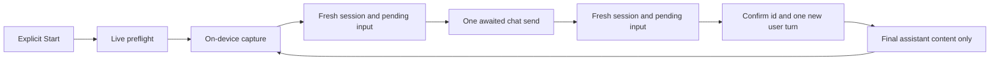

# Android hands-free voice (#2110)

Status: **native UI and controller integration implemented; SDK-free checks passed; native build/audio/visual verification outstanding.** Rust/TypeScript host authorization remains parent-owned. This shared-worktree change does not commit, open a PR, change branches, or replace the parallel image implementation.

## User-visible implementation

Requires Settings → Dictation enabled. New voice modes use installed **on-device** Android speech recognition (Android 12/API 31+), not a network-recognizer fallback, and installed offline-capable Android TTS. The existing dictation setting and language are read live. Existing phone/computer-engine dictation remains in the composer’s `+` menu; voice conversation and command capture use the on-device adapter, independently of that legacy engine choice.

- Text-chat composer `+` → **Voice conversation** opens a native dialog. Opening is not recording. Start explicitly opts into capture → send → completed reply → local speech → capture again. Stop/Close ends voice, not the agent task already submitted. The conversation dialog never routes utterances through the command parser.
- The actual message box offers **Hold to talk**, including an accessibility click action to start/finish a held utterance, and **Listen for “Nekko” commands** for explicitly started continuous command/dictation capture. There is a separate discard/Stop control and a normal Finish control; Stop never sends a trailing utterance.
- Hold uses the existing permission/start/release/minimum-duration rules (400 ms after recognizer-ready), not time from pointer-down. Release before recognizer startup, a short hold, cancellation, disabled controls and leaving discard the capture. Endpointed held speech is not executed until release.
- Command/dictation state is the **real composer**, including text, armed skills/saved prompts, photos and busy state. Successful send uses compare-and-set clearing, preserving edits typed while the reply was pending. Rejected/ambiguous sends retain the draft for inspection, not automatic replay.
- Existing command grammar/segmentation/confirmation rules remain in `VoiceRunner`, `VoiceCommands` and `VoiceSegmenter`. Send, archive/complete, switching/new chat, go-ahead/question answering, PR selection and merge are wired to actual chat/repository/navigation operations. No tool approval is automatically granted. Ambiguous chats/PRs/ship paths use the existing explicit choice/confirmation UI.
- Ordinary archive and question-answer callbacks retain their existing host classification. PR merge uses the existing `GitRequest.prAction` and signed `ComputersRepository.callChange` path, including explicit StepUpSheet when required; it never calls an unsigned Git fallback. Host refusals are not bypassed. The question call ID and open/non-draft PR URL are revalidated before their callbacks.
- Navigation callbacks are installed in both single-screen and folding-pane routes. Speech following a navigation command is parked as a draft, never sent to the destination. Existing destination drafts are merged, not overwritten.
- An Android manifest TTS service visibility query is added beside the existing recognition-service query. No foreground microphone service, background listening or audio-file persistence is added.

## Submission and fresh reply correlation

`ChatController.send()` intentionally returns before its turn completes and may use an offline/retrying outbox. **Voice does not call it.** `sendVoice()` owns one awaited, bounded `chat:send` request with a fresh `clientMessageId`.



Preflight refuses unloaded/saved/image chats, disconnected/unauthorized targets, local or host running work, host queues, phone outbox entries, pending questions/approvals, photos, armed prompts/skills and busy composer state. Conversation additionally requires an empty box. Session identity, pending-input shape and authorization are checked again around the fresh reads and immediately before submission. Live photo state is checked independently of recomposition.

Completion is the **awaited request**, never a transient idle UI frame or an unrelated Done event. The fresh transcript must:

1. Belong to the original session, be idle and have no queued work.
2. Acknowledge the new request ID, absent from the baseline ID list.
3. Retain the baseline’s last message anchor (or have started empty).
4. Contain exactly one new user message after that anchor, matching the submitted words, with no skill/photo ambiguity, old IDs or competing prompt/reply preceding it.
5. Contain a new, uninterrupted final assistant message with nonblank content and no outstanding tool calls. Reasoning, tool-call progress and old assistant replies are not spoken. Markdown is flattened by the existing conversation core before TTS.

Error/question/approval events fail the voice wait even if another Done event arrives. Unknown/ambiguous/truncated results fail closed with a check-the-chat message. The session ID acknowledgement is session-level, not a protocol-level per-message parent pointer; this integration deliberately rejects competing/truncated transcripts rather than trying to reconstruct their causality.

No voice outbox entry, `chat:queue`, legacy unknown-key fallback, automatic resend, reconnect replay or key-missing retry is used. The explicit StepUpSheet confirmation is the sole proof-required resubmission, not an ambiguous-delivery retry. Cancellation stops the **local wait** without issuing `chat:abort`; submitted agent work can finish on the computer.

## Live authority and audio ownership

All modes, including legacy dictation in either folding pane, use one main-thread `VoiceAudioOwner` lease. A new owner immediately stops the old owner; stale releases cannot cancel the replacement. Conversation switches the lease’s stop callback to its own machine, so another pane/mode can cancel capture, waiting and TTS, not only the command recognizer.

Live checks read app lock/cover, lifecycle RESUMED, phone setting, original computer identity, original connection object, current chat availability/completion and audio lease. Per-run epochs prevent an old suspended callback from becoming authorized after unlock/reconnect/new Start. Collectors revoke on lock/cover, voice-off, computer/connection changes and local tool overlays; safety observers additionally revoke on pause/stop/destroy, screen-off, noisy/disconnected audio routes and audio-focus loss. Pane focus loss and composition disposal stop without auto-resume.

`ChangeCalls` now accepts an optional authorization closure and retry policy. Existing nonvoice callers keep their defaults. It checks coroutine cancellation and live authority **after proof signing/authentication and before every signed wire call**, including key registration. The repository additionally checks that the connection object is unchanged. Voice disables automatic key-missing recovery. A pause/cover during system authentication revokes voice; returning does not silently resume the mutation or capture.

Permission grants never automatically start recording: the owner explicitly starts/holds again. Android microphone availability/permission are also checked by the native adapter at capture time.

## Verification

### Executed on Windows, without Android SDK access

```powershell
powershell -NoProfile -ExecutionPolicy Bypass -File apps/android/scripts/voice-integration-check.ps1
```

Result: **134 JVM tests passed**. The script reuses the existing image-check dependency/compiler setup and compiles exact protocol/controller/repository/security/voice-core sources with cached JVM dependencies. Android-backed storage is reduced to its existing JVM portions in temporary files, as in the image suite. It does **not** compile Compose/native Android adapters or claim to test Android storage.

Coverage includes the existing voice command/runner/listening/conversation/hold/speech suites; new `VoiceTurnTest`, `VoiceChatControllerTest`, and `VoiceChangeCallsTest`; and shared image controller/repository/protocol, typed chat, outbox and ChangeCalls regressions. New cases cover repeated prompt text versus stale replies, awaiting the actual request, interruption/empty reasoning-only results, queues and draft preflight, no retry/outbox/abort, cancellation, authority loss during proof, connection replacement during proof, and cross-pane lease replacement/stale release.

### Native fixture added, not executed here

`apps/android/app/src/androidTest/java/com/nekko/android/VoiceIntegrationEvidenceTest.kt` renders the actual ChatScreen/composer using synthetic, memory-only repository data, no live relay and no microphone activation. It exercises the `+` entry, Ready sheet, retained typed draft, lock dismissal and voice-off removal. Optional `nekkoVoiceEvidence=true` captures real native-window PNGs under the test app’s external-files `evidence/` directory, tagged with `nekkoDevice`. This is a **new surface with no before voice dialog**. No screenshots were captured or inspected in this session.

Example for an authorized isolated Android environment (not run here):

```powershell
./gradlew.bat :app:connectedDebugAndroidTest `
  -Pandroid.testInstrumentationRunnerArguments.class=com.nekko.android.VoiceIntegrationEvidenceTest `
  -Pandroid.testInstrumentationRunnerArguments.nekkoVoiceEvidence=true `
  -Pandroid.testInstrumentationRunnerArguments.nekkoDevice=phone
```

## Unfinished work / verification limitations

- **Native compilation and instrumentation are unverified.** No Android SDK, emulator, adb or user-owned app was accessed/launched in this session. Run a full Android build and the fixture on an authorized isolated device/CI environment. The SDK-free compiler checks are not a substitute for Compose/API compilation.
- **Native visual and interaction evidence is missing.** Capture and inspect the actual composer and Ready/Listening/Waiting/Speaking/Stopped/error/confirmation surfaces. For changed existing composer layout, capture a matching base screenshot; the voice dialog itself is new. Record video for hold/release and lifecycle timing. The fixture only covers Ready/no-audio behavior, not speech correctness.
- **Real audio and host end-to-end behavior are unverified.** Exercise on-device recognizer availability/language, permission denial/grant/revocation, offline-only TTS/voices, phone-call/audio focus, headset disconnect, lock/cover, navigation and disconnect/reconnect during capture/wait/speech/proof. A sent prompt may still finish remotely after Stop. Verify parent-owned host authorization and Change/StepUp enforcement with the real host; no Rust/TS changes are included here.
- **Foldable native matrix remains unrun:** folded/cover-screen single pane; unfolded side-by-side panes competing for audio; tabletop/book posture; fold/unfold and rotation while capturing/waiting/speaking. The JVM lease test proves ownership semantics only, not native posture/lifecycle behavior. Prospective named hardware is capability-based, not assumed hardware specifications.
- New voice resource strings currently use default English fallbacks. Existing command grammar remains English/addressed “Nekko”; selecting an STT language does not translate the command grammar or core error/confirmation copy.
- Archive completion uses the existing completion bar; completion can dispose/revoke the originating voice controls before their success toast. Device verification should check the resulting Completed state rather than depend on that toast.
