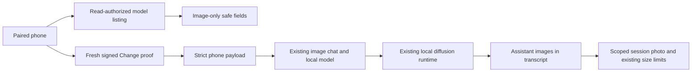

# Image chats (#2162)

**Implemented:** shared TypeScript and Rust phone policy, generated policy golden, host capability/preflight, and transcript-scoped generated-photo retrieval. **Photo edits from phones** (optional `images` and `size` in the same signed request, and the daemon's refusal of photos to a model that cannot edit them) follow decision 0069 (proposed, #2222); the gates and daemon side are implemented, the iOS and Android Edit UI is not yet. This document describes the approved host/security boundary, not the state of the parallel native UI work. No app edits, model installation/removal authority, arbitrary file/image reads, cloud uploads, or new proof format are part of this change.

## Authority and discovery

- `app:info.capabilities.imageGeneration` is `true`: this host supports image-generation chats. It is **not** a ready/healthy/installed assertion. A usable local model, compatible diffusion runtime and any required companions must already be available. An empty installation still advertises support.
- `engine:models` is **Read** class, with exactly zero arguments. Read-off refuses it before dispatch. Only eligible local library rows with `modality: "image"` and GGUF format are returned. Existing GGUF library rows omit `format`; these are normalized to `"gguf"`. MLX, chat, vision, embedding, audio, malformed and absolute/path-valued model IDs are excluded. This is not a provider/cloud model listing.
- The entire phone model result is projected to `{id, name, kind, format, state}`. `kind` is `"image"`, `format` is `"gguf"`, and `state` is `"loaded"`, `"error"` or `"available"`, derived from host load facts. `available` means discovered, **not** validated or ready. Path-like display names fall back to the library ID. IDs are bounded relative library keys, never absolute paths, traversal segments, drive paths or URLs. No file/path, folder, repository, preset, hardware, raw error/log or companion-path fields leave through this listing.
- `chat:generateImage` is **Change with an existing signed Change v1 proof**, not an unsigned agent-class action. Change-off, unknown/revoked device, missing key/proof, foreign/tampered/stale/replayed proof refuse the call. The proof binds the device, channel and exact request, including chat, prompt, selected model, dimensions, CFG and seed, and any photos to edit and edit size: changing, adding or dropping a photo or the size fails the proof. Existing replay/activity machinery is reused; no proof format, protocol version or bypass is added. As with other existing Change calls, Read-off alone does not grant or revoke Change authority.
- `session:setOptions` keeps its existing class/mode-raise proof rules. Its existing allowlist includes `chatType` and `imageParams`; `chatType` must be one of the existing chat types, and image parameters now receive the validation below. No arbitrary option or nested image/runtime keys are permitted. Saving options alone cannot generate an image.
- Model install, remove, download, raw engine generation, `image:fetch`, raw file reads and uploads remain outside this approval. Existing unrelated phone capabilities are unchanged.



## Exact phone generation payload

Exactly one request argument, with these top-level keys: `sessionId`, `prompt` and `params` always, and `images` and `size` when the request edits photos (decision 0069, proposed in #2222). Any other key is refused.

```json
{
  "sessionId": "s_image_chat",
  "prompt": "A calico cat",
  "params": {
    "modelId": "image/acme_sd/tiny-sd",
    "width": 1024,
    "height": 1024,
    "steps": 28,
    "cfgScale": 4,
    "seed": -1
  }
}
```

An edit adds the photos and the size to make the result at (the photo's shape at about the chat's pixel count; it is used for this turn only, the chat's saved size is unchanged):

```json
{
  "sessionId": "s_image_chat",
  "prompt": "Make the cat wear a hat",
  "params": { "modelId": "image/acme/flux2-klein", "width": 1024, "height": 1024, "steps": 4, "cfgScale": 1, "seed": -1 },
  "images": ["data:image/jpeg;base64,/9j/4AAQ..."],
  "size": { "width": 832, "height": 1216 }
}
```

All six parameter fields are required for generation; saved `imageParams` patches may be partial, but each supplied field is validated and unknown fields are refused. The selected `modelId` must be explicit; the host never selects a fallback model from a name or provider. The existing chat must have `chatType: "image"`, and its selected request model must currently exist as an eligible local image library row. These checks precede turn/transcript/model-selection writes. Existing sandbox refusal and cancellation stay in place.

| Field | Phone constraint |
|---|---|
| `sessionId` | 1–128 ASCII letters, digits, `_` or `-`; existing image session required by host |
| `prompt` | Nonblank after ECMAScript trimming; at most 8,000 UTF-16 code units |
| `modelId` | Nonempty relative library ID, at most 512 UTF-16 code units; no surrounding whitespace, control/DEL, `:`, backslash, leading slash/dash, empty or dot/traversal segments |
| `width`, `height` | Integers 256–2048, multiples of 64 |
| `steps` | Integer 1–100 |
| `cfgScale` | **Integer** 0–30; phone default **4** |
| `seed` | Integer -1–2,147,483,647; -1 requests a fresh seed |
| `images` | Optional. Array of 1–4 strings, each `data:image/png;base64,`, `data:image/jpeg;base64,` or `data:image/webp;base64,` (lowercase prefix) followed by nonempty standard base64 (`A–Z a–z 0–9 + /`, at most two trailing `=`, no whitespace). Together at most 6,291,456 characters (6 MiB) so the call fits one sealed relay frame; phones scale photos to 1536 px on the long side first |
| `size` | Optional, and only with `images`. Exactly `{ "width", "height" }`, each an integer 256–2048 and a multiple of 64 |

Booleans, strings, nulls, fractions, nonfinite numbers, missing generation fields, extra arguments, provider IDs, photos as paths, `file:` or web URLs, SVG, GIF or other non-raster types, an empty or over-long photo list, a `size` with other keys or without photos, output paths, arbitrary presets/runtime options and companion overrides are refused. Only `modelId`, `width`, `height`, `steps`, `cfgScale`, `seed` are image parameter keys. No silently rounded CFG and no unsigned fallback.

**Trusted local API compatibility:** the host also validates the exact shape, full parameter set, bounds, session type and selected model. Its authenticated local desktop API retains the existing bounded **fractional CFG** behavior (for example 4.5); this is not a phone permission. The Rust phone gate always applies the strict integer validator before dispatch. Saved fractional desktop CFG values remain readable but cannot be submitted or patched from a phone until the user selects a whole-number CFG. They are not migrated/rounded by this change. The shared desktop default is deliberately untouched. The host applies the same photo and size rules (types, base64, 1–4 photos, size bounds, size only with photos) but not the phone's 6 MiB total, which exists only for the relay frame: the desktop may send four 1536 px PNGs.

**Photos only to a model that can use them:** whichever client sent the request, the daemon refuses photos when the selected model's known companion set does not list `edit` or `video` (a video model animates the first photo). The prompt and photos stay in the transcript, the chat gets "The image could not be generated: This model can't change photos. Choose a model that edits photos, or send the prompt without a photo." as its reply, an `error` event is sent, and nothing is generated. A model with no known set counts as unable to edit, as on the desktop.

## Generated attachments and photos

Inspection of `nekko-turn/src/variants.rs::image_reply` and session persistence confirms the stored attachment shape is:

```json
{
  "id": "msg_example",
  "role": "assistant",
  "content": "",
  "images": ["data:image/png;base64,..."],
  "generated": {"modelId": "image/acme_sd/tiny-sd", "seed": 42, "ms": 1234}
}
```

Dimensions/steps/CFG are also copied into `generated` when supplied. There is no generated `attachments[].path` structure to resolve. User photos and assistant-generated photos use the same `images` array.

`session:photo [sessionId, messageId, index]` uses only the requested stored chat/message/image index, with role `user` or `assistant`. It returns inline PNG/JPEG/GIF/WebP base64 data URLs, never tool-result images, filesystem paths, URLs, SVG, attachment objects, or attached file paths. A missing chat/message/index returns null. It performs **no image/file fetching or path resolution**. The phone route retains the existing `phone_thumbs::full_photo` decoder, 4 MiB original-return cap, and 2048-pixel fallback resize; thumbnail/transcript limits remain unchanged. Invalid raster encodings return null through that existing phone decoder. The trusted raw host photo endpoint only checks the inline raster prefix; byte decoding/phone output limits are applied by the phone gate.

## Verification

Focused Windows verification in the shared `voice-image-readiness` worktree:

- All shared phone tests: **114 passed across 16 files**, with `UPDATE_GOLDEN` unset on the final verification run; shared-package TypeScript typecheck passed.
- `phone-access.json` was regenerated through `phone-access.golden.test.ts`, not edited manually. `phone-access-image.golden.test.ts` records requests, saved parameter patches and safe model projections in `crates/nekko-remote/tests/golden/phone-image.json`; Rust consumes the same decisions, including UTF-16/ECMAScript trim cases.
- Focused Rust phone run: **129 passed** (108 unit tests and 21 integration tests). Host image-filter run: **4 passed**; app-info-filter run: **2 passed**. The final additional proof-denial assertions were rerun successfully after the full focused run.
- Rust phone checks cover signed success, exact payload tampering, missing/foreign/stale/replayed proofs, unknown/revoked device, missing key, Read/Change switches, canonical-payload refusal of fractional CFG, payload/redaction parity, forbidden channel authority, scoped photo lookup and invalid raster decoding.
- Real daemon API tests use separate temporary data directories: capability without readiness, malformed/extra/cloud/path payloads and bounds, absent model/nonimage session, no transcript mutation or running turn on preflight failure, and assistant/user photo access versus cross-chat/index/tool/path/URL/SVG/object refusal.
- Existing fake-diffusion-runtime end-to-end test covers generation, persisted assistant attachment retrieval through `session:photo`, stage events, abort/cancellation and invalid-prompt rejection. It retains CFG 4.5 to check trusted local desktop compatibility; the signed phone test uses CFG 4.

Reproduction (Cargo may require its explicit `C:\Users\phili\.cargo\bin\cargo.exe` path in this environment):

```powershell
npx vitest run --config packages/shared/vitest.config.ts packages/shared/src/phone-
npm run typecheck -w @nekko-agent/shared
cargo test -p nekko-remote phone --locked
cargo test -p nekkod --test daemon image --locked
cargo test -p nekkod app_info --locked
```

## Remaining limitations / unverified work

- No native Android/iOS UI, device, folded/unfolded/posture layout, desktop-window, live relay or real GPU/model/runtime inference was exercised for this backend-only slice. Native app changes and evidence belong to the parallel app owners. The fake runtime proves request/turn behavior, not image quality or hardware readiness.
- Capability/discovery does not prove sufficient memory, valid weights, working runtime, available companions or successful load. Existing local runtime errors remain authoritative. This change does not download/install models or companions to make a listed model ready.
- Only local GGUF diffusion rows are eligible. MLX image models and cloud generation/upload are unsupported here. No negative prompt, arbitrary preset/companion options, file-backed images, remote image URLs or SVG retrieval were added. Photo edits take inline raster data URLs only.
- The iOS and Android Edit button and photo attachment in Photo chats are not built yet; decision 0069 is still proposed (#2222) and needs Philip's acceptance as owner of this boundary.
- Existing Change v1 cannot sign fractional numbers. Phone clients must use integer CFG (default 4) and require explicit user correction of existing fractional settings. A future fractional proof format would require a separate approved protocol change.
- A proof replay is blocked, but distinct newly signed requests are not content-deduplicated by this endpoint. No image-specific client request ID, automatic resend, offline outbox, or ambiguous-delivery recovery was added.
- This work follows the existing paired-device access model, not new per-session ACLs. It does not add broader secret/transcript redaction or change existing permitted artifact/file capabilities.
- Full workspace/platform suites were not run. No commits, PRs, branch changes or app edits are made by this slice; pre-existing and parallel shared-worktree edits are preserved.
